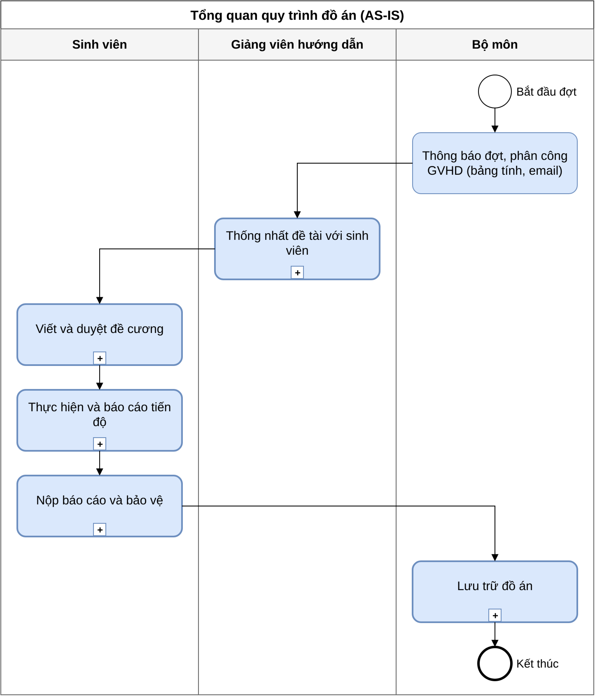
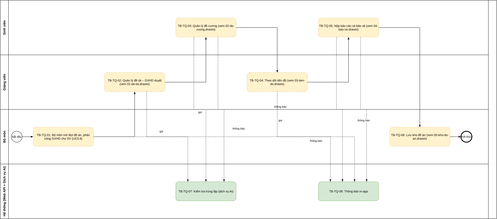
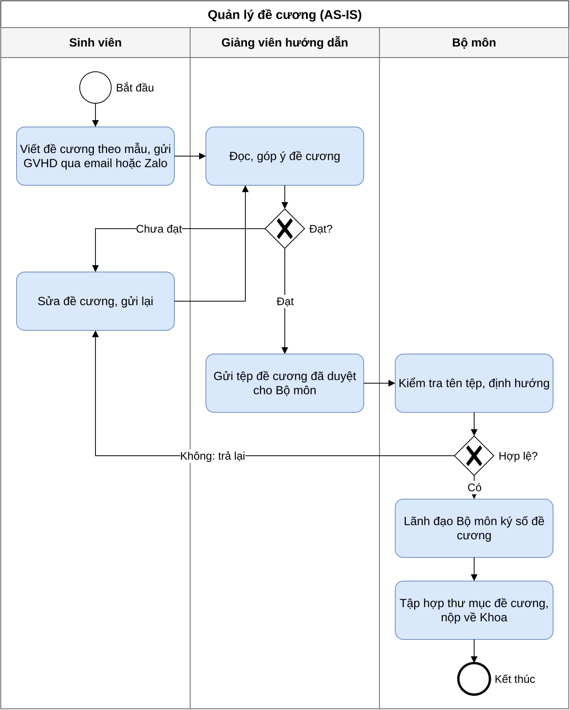
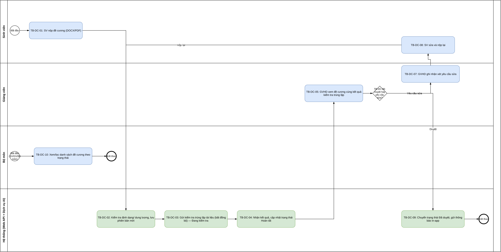
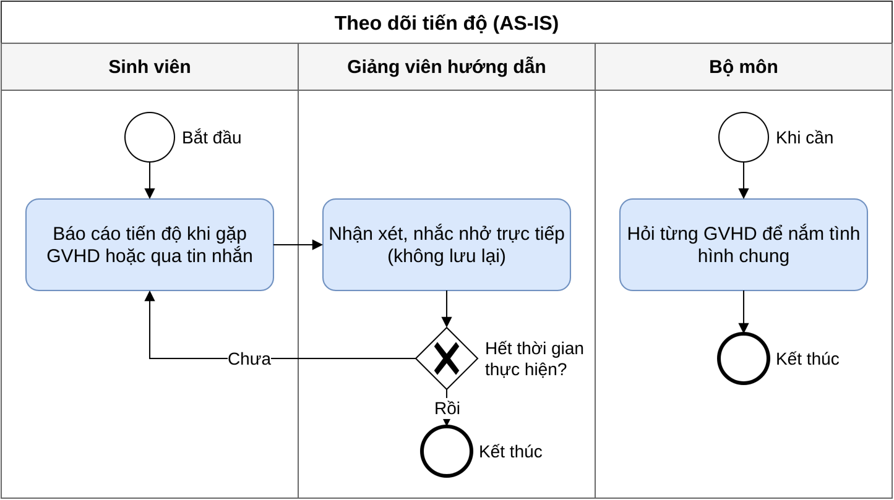
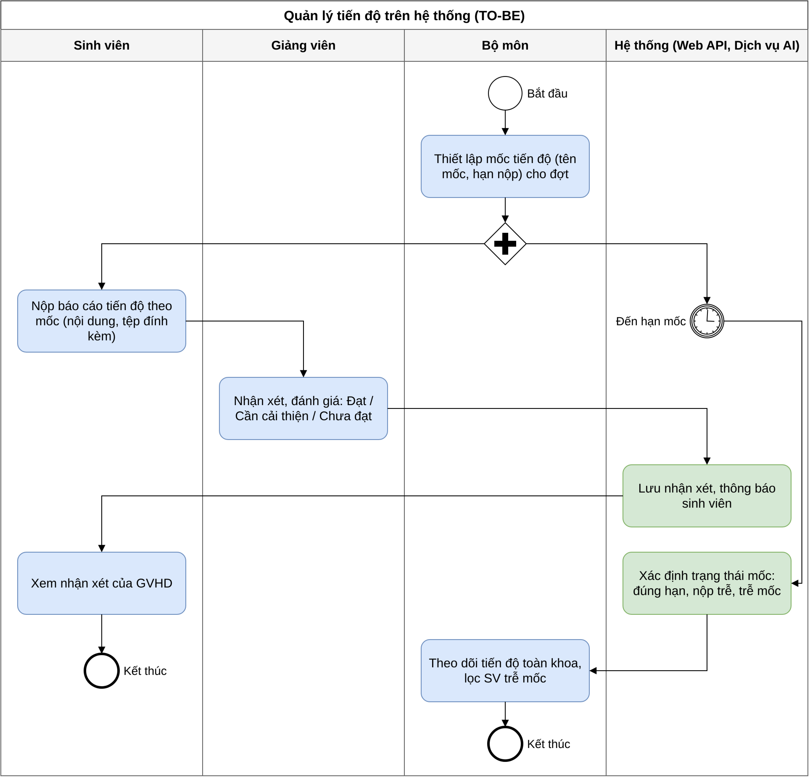
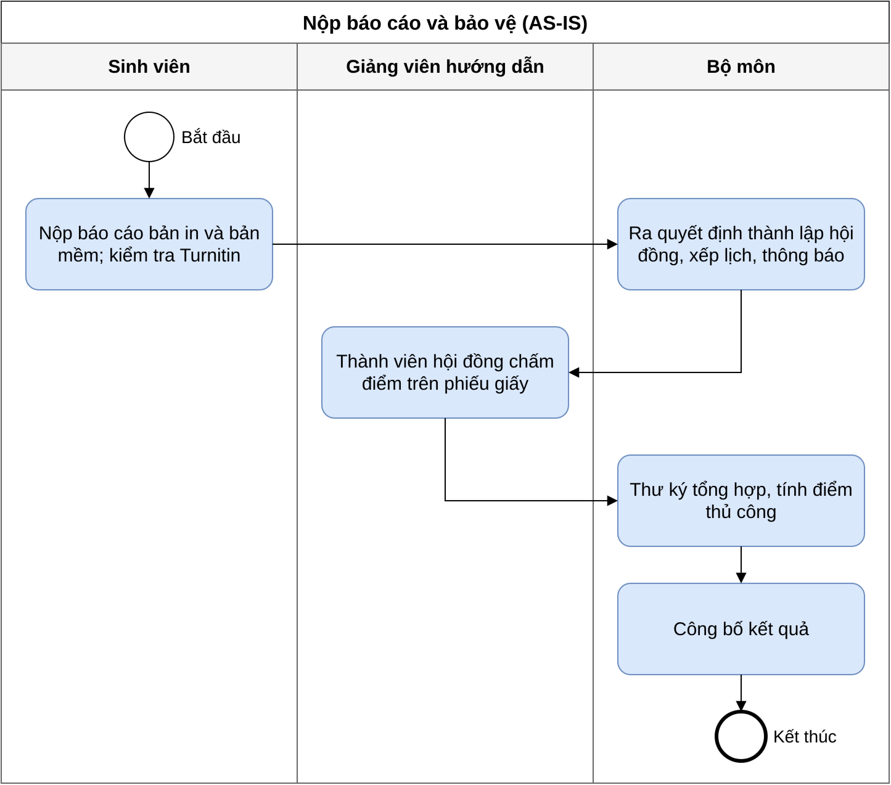
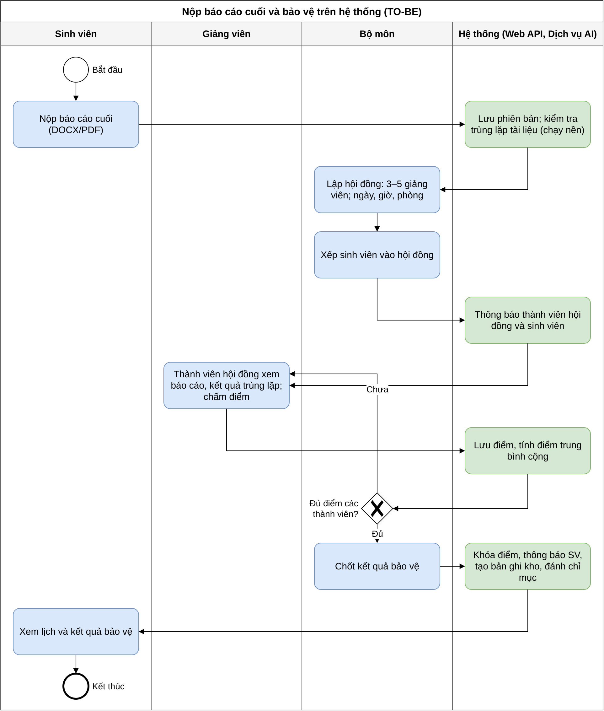
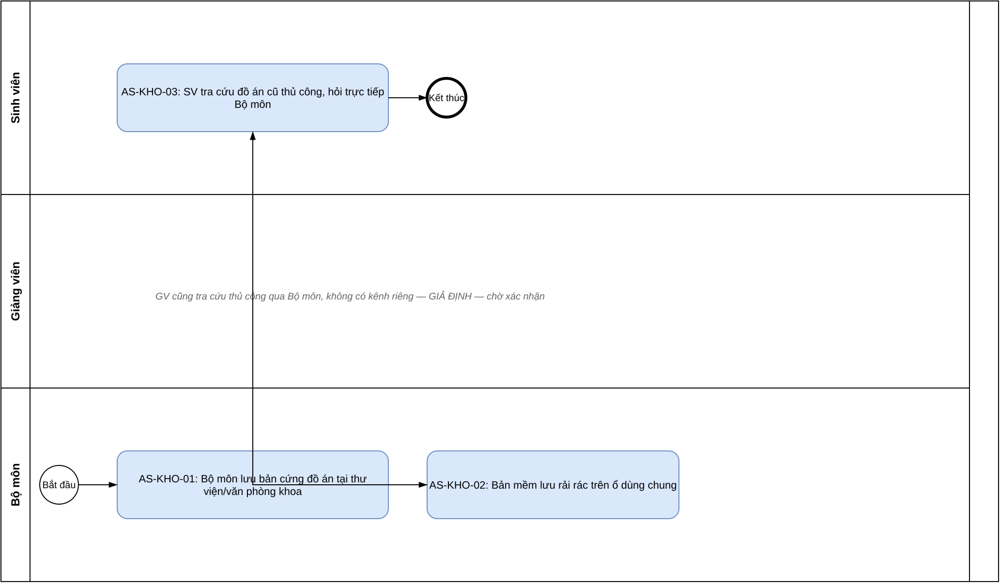
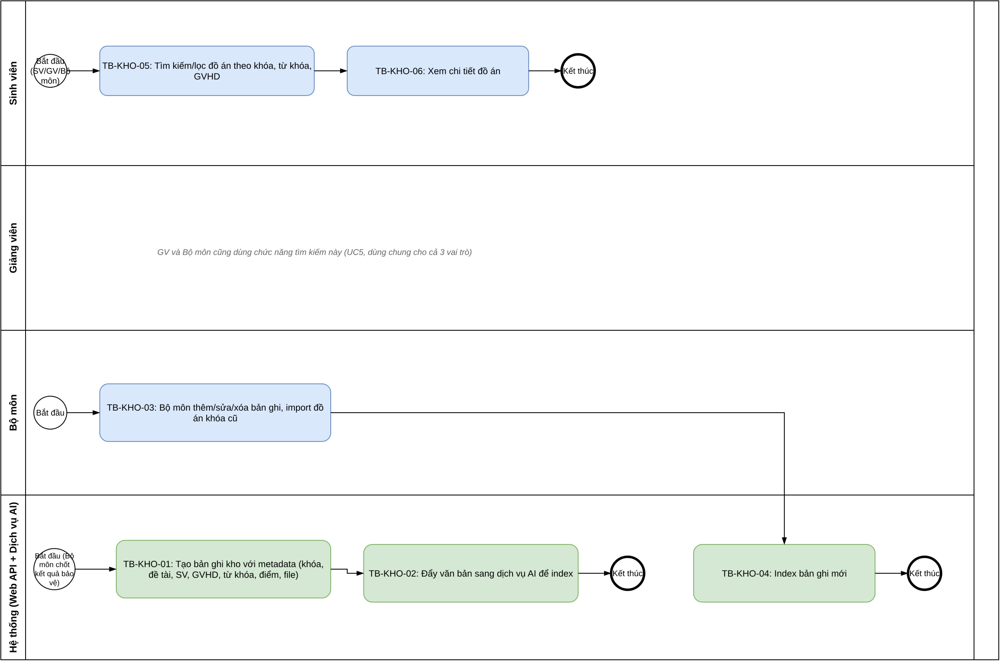

# Chương 2. Khảo sát & phân tích

## 2.2. Mô hình hóa quy trình nghiệp vụ

> **Mã PI:** 1.1 — **Yêu cầu:** ANLS-02

Mỗi quy trình nghiệp vụ của hệ thống được mô hình hóa dưới dạng hai sơ đồ BPMN: **AS-IS** (quy trình thủ công hiện tại, làm cơ sở khảo sát) và **TO-BE** (quy trình vận hành trên hệ thống, có bước kiểm tra trùng lặp bằng AI). Cả hai đều dùng chung 3 làn (swimlane) **Sinh viên / Giảng viên / Bộ môn**; riêng TO-BE có thêm làn **Hệ thống** thể hiện các bước tự động (Web API và Dịch vụ AI). Theo D-03, bộ sơ đồ gồm 1 sơ đồ tổng quan và 5 quy trình con, khớp 5 UC chính: Quản lý đề tài, Quản lý đề cương, Theo dõi tiến độ, Nộp báo cáo và bảo vệ, Quản lý kho dữ liệu đồ án.

### 2.2.1. Quy trình tổng quan

> GIẢ ĐỊNH — chờ xác nhận: chưa có phỏng vấn thật tại thời điểm viết (D-01, D-02). Phần AS-IS dưới đây là bản nháp; sẽ được đối chiếu sau khi có biên bản phỏng vấn (plan 01-07).

Sơ đồ tổng quan (`bpmn/00-tong-quan.drawio`) thể hiện toàn bộ chuỗi quy trình đồ án dưới dạng các sub-process đã thu gọn (collapsed), mỗi sub-process được mô tả chi tiết ở một sơ đồ riêng (§2.2.2–§2.2.6).

#### Quy trình AS-IS

| Mã bước | Lane | Công việc | Dữ liệu / biểu mẫu | Ghi chú |
|---------|------|-----------|---------------------|---------|
| AS-TQ-01 | Bộ môn | Bộ môn mở đợt đồ án tốt nghiệp | Thông báo mở đợt | GIẢ ĐỊNH — chờ xác nhận |
| AS-TQ-02 | Giảng viên | Quản lý đề tài (xem `bpmn/01-de-tai.drawio`) | — | GIẢ ĐỊNH — chờ xác nhận; chi tiết ở §2.2.2 |
| AS-TQ-03 | Sinh viên | Quản lý đề cương (xem `bpmn/02-de-cuong.drawio`) | — | GIẢ ĐỊNH — chờ xác nhận; chi tiết ở §2.2.3 |
| AS-TQ-04 | Giảng viên | Theo dõi tiến độ (xem `bpmn/03-tien-do.drawio`) | — | GIẢ ĐỊNH — chờ xác nhận; chi tiết ở §2.2.4 |
| AS-TQ-05 | Sinh viên | Nộp báo cáo và bảo vệ (xem `bpmn/04-bao-ve.drawio`) | — | GIẢ ĐỊNH — chờ xác nhận; chi tiết ở §2.2.5 |
| AS-TQ-06 | Bộ môn | Lưu kho đồ án (xem `bpmn/05-kho-do-an.drawio`) | — | GIẢ ĐỊNH — chờ xác nhận; chi tiết ở §2.2.6 |

**Điểm cải tiến của TO-BE so với AS-IS:**

- Toàn bộ chuỗi 5 quy trình con chạy trên một hệ thống thống nhất thay vì rời rạc qua email/Excel/giấy ở từng bước.
- Hai điểm tích hợp AI xuyên suốt (kiểm tra trùng lặp và thông báo in-app) được thể hiện tường minh trong làn Hệ thống, thay vì ẩn trong quy trình thủ công của từng bước.

#### Quy trình TO-BE

| Mã bước | Lane | Công việc | Dữ liệu / biểu mẫu | Ghi chú |
|---------|------|-----------|---------------------|---------|
| TB-TQ-01 | Bộ môn | Bộ môn mở đợt đồ án tốt nghiệp và phân công GVHD cho từng SV của đợt (UC0.8, chi tiết ở TB-DT-00a..TB-DT-00c) | Thông báo mở đợt; bảng phân công GVHD (nhập trên hệ thống hoặc import CSV) | Mỗi SV đúng một GVHD trong đợt |
| TB-TQ-02 | Giảng viên | Quản lý đề tài — SV đề xuất tới GVHD hoặc đăng ký đề tài GVHD mở cho lớp, GVHD duyệt (xem `bpmn/01-de-tai.drawio`) | — | Chi tiết ở §2.2.2 |
| TB-TQ-03 | Sinh viên | Quản lý đề cương (xem `bpmn/02-de-cuong.drawio`) | — | Chi tiết ở §2.2.3 |
| TB-TQ-04 | Giảng viên | Theo dõi tiến độ (xem `bpmn/03-tien-do.drawio`) | — | Chi tiết ở §2.2.4 |
| TB-TQ-05 | Sinh viên | Nộp báo cáo và bảo vệ (xem `bpmn/04-bao-ve.drawio`) | — | Chi tiết ở §2.2.5 |
| TB-TQ-06 | Bộ môn | Lưu kho đồ án (xem `bpmn/05-kho-do-an.drawio`) | — | Chi tiết ở §2.2.6 |
| TB-TQ-07 | Hệ thống | Kiểm tra trùng lặp (dịch vụ AI) — được gọi từ Quản lý đề tài, Quản lý đề cương và Nộp báo cáo/bảo vệ | Tên đề tài hoặc nội dung tài liệu | AISV-01..07 |
| TB-TQ-08 | Hệ thống | Thông báo in-app — được gọi từ Quản lý đề tài, Quản lý đề cương, Theo dõi tiến độ và Nộp báo cáo/bảo vệ | Sự kiện duyệt/từ chối/nhận xét/lịch bảo vệ | NOTF-01 |

### 2.2.2. Quy trình quản lý đề tài

> GIẢ ĐỊNH — chờ xác nhận: chưa có phỏng vấn thật tại thời điểm viết (D-01, D-02). Phần AS-IS dưới đây là bản nháp dựa trên suy luận thực tế phổ biến ở các khoa CNTT có quy trình tương tự; sẽ được đối chiếu và cập nhật (hoặc gỡ bỏ nhãn giả định) sau khi có biên bản phỏng vấn Bộ môn/GV/SV (plan 01-07).

#### Quy trình AS-IS

| Mã bước | Lane | Công việc | Dữ liệu / biểu mẫu | Ghi chú |
|---------|------|-----------|---------------------|---------|
| AS-DT-01 | Giảng viên | GV gửi danh sách đề tài đề xuất cho Bộ môn qua email/Excel | File Excel/email tự do | GIẢ ĐỊNH — chờ xác nhận |
| AS-DT-02 | Sinh viên | SV đăng ký đề tài qua phiếu giấy hoặc biểu mẫu trực tuyến rời rạc | Phiếu đăng ký giấy hoặc Google Form | GIẢ ĐỊNH — chờ xác nhận |
| AS-DT-03 | Bộ môn | Bộ môn tổng hợp danh sách đề tài và đăng ký thủ công vào Excel | Bảng tổng hợp Excel | GIẢ ĐỊNH — chờ xác nhận |
| AS-DT-04 | Bộ môn | Bộ môn họp xét duyệt đề tài | Biên bản họp | GIẢ ĐỊNH — chờ xác nhận |
| AS-DT-05 | Bộ môn | Bộ môn phân công GVHD thủ công | Bảng phân công | GIẢ ĐỊNH — chờ xác nhận; không kiểm tra tải GV tự động |
| AS-DT-06 | Bộ môn | Bộ môn công bố danh sách đề tài đã duyệt qua email/bảng tin | Thông báo email/bảng tin khoa | GIẢ ĐỊNH — chờ xác nhận; không có thông báo tức thời |

**Điểm cải tiến của TO-BE so với AS-IS:**

- Bộ môn phân công GVHD cho toàn bộ sinh viên ngay đầu đợt (UC0.8: gán từng dòng, hàng loạt hoặc import CSV, thấy ngay số SV mỗi GV đang hướng dẫn), thay vì phân công rải rác sau từng lần họp xét duyệt và không theo dõi được tải giảng viên (KS-DT-04).
- Đề tài chỉ đi một vòng: SV gửi thẳng tới GVHD của mình và GVHD duyệt/từ chối (UC1.3); đề tài GV giao cho SV hoặc SV đăng ký đề tài GVHD mở cho lớp được phân công ngay — bỏ hai lượt qua Bộ môn (duyệt, rồi xác nhận đăng ký và chọn GVHD) của AS-IS, đồng thời gắn trách nhiệm chất lượng đề tài cho GVHD (KS-DT-05).
- Kiểm tra trùng tên đề tài tự động bằng AI ngay khi đề xuất, thay vì người duyệt tự phát hiện trùng lặp thủ công khi họp xét duyệt (hoặc không phát hiện được).
- Chặn tự động một SV có nhiều đề tài đang hoạt động hoặc hai SV cùng đăng ký một đề tài, kể cả khi đăng ký cùng lúc (FR-DT-06), thay vì đối chiếu thủ công trên Excel.
- Trạng thái đề tài minh bạch theo thời gian thực (Nháp → Chờ duyệt → Mở cho lớp đăng ký/Từ chối → Đã phân công), mọi vai trò tự tra cứu được trong phạm vi của mình (UC1.4) thay vì chờ email công bố; Bộ môn theo dõi toàn bộ ở chế độ chỉ đọc.
- Thông báo in-app tức thời khi được phân công GVHD, khi có đề tài chờ duyệt, khi đề tài được duyệt/từ chối/giao/đăng ký, thay vì chờ email hoặc bảng tin.

#### Quy trình TO-BE

| Mã bước | Lane | Công việc | Dữ liệu / biểu mẫu | Ghi chú |
|---------|------|-----------|---------------------|---------|
| TB-DT-00a | Bộ môn | Đầu đợt, phân công GVHD cho từng SV của đợt — gán từng dòng, gán hàng loạt hoặc import CSV | Danh sách SV/GV; tệp CSV `ma_so_sinh_vien,ma_giang_vien` | UC0.8; mỗi SV đúng một GVHD trong đợt |
| TB-DT-00b | Hệ thống | Kiểm tra ràng buộc phân công (không đổi/gỡ GVHD khi SV đã có đề tài Đã phân công, không gỡ khi đang Chờ duyệt), lưu các dòng hợp lệ, báo lại dòng lỗi | Bảng phân công hướng dẫn | FR-DT-05, FR-DT-08, FR-DT-09 |
| TB-DT-00c | Hệ thống | Gửi thông báo in-app cho SV (GVHD của mình) và GV (số SV được phân công thêm) | Thông báo in-app (NOTF-01) | Kết thúc UC0.8; GV xem lớp tại "Sinh viên của tôi" |
| TB-DT-01a | Giảng viên | GV tạo đề tài (tên, mô tả, lĩnh vực); chọn một SV trong lớp hướng dẫn của mình hoặc để trống | Biểu mẫu đề xuất đề tài (điện tử) | Chỉ gửi được khi đợt đồ án đang mở (FR-DT-10) |
| TB-DT-01b | Sinh viên | SV đề xuất đề tài (tên, mô tả, lĩnh vực) gửi tới GVHD của mình | Biểu mẫu đề xuất đề tài (điện tử) | Chỉ gửi được khi đợt đang mở và SV đã có GVHD trong đợt |
| TB-DT-02 | Hệ thống | Kiểm tra trùng lặp tên đề tài theo ngữ nghĩa (gọi Dịch vụ AI) | Tên đề tài vừa nhập, kho đề tài đã có | So sánh ngữ nghĩa, không phải so khớp chuỗi ký tự |
| TB-DT-03 | Hệ thống | Gateway: có đề tài tương tự vượt ngưỡng cấu hình? | Ngưỡng do Bộ môn cấu hình (FR-DT-02) | Ngưỡng đặt trong yêu cầu phi chức năng (ANLS-04) |
| TB-DT-04 | Hệ thống | Hiển thị danh sách đề tài tương tự kèm tỷ lệ % | Top N đề tài tương tự | Chỉ cảnh báo, không chặn gửi |
| TB-DT-05 | Giảng viên | Người đề xuất (SV hoặc GV) sửa tên đề tài hoặc vẫn gửi | — | Quyết định thuộc về người đề xuất |
| TB-DT-06 | Hệ thống | Gateway: ai gửi, đã chọn SV hay chưa? | Bản ghi đề tài | Rẽ ba nhánh TB-DT-06a/06b/06c |
| TB-DT-06a | Hệ thống | SV gửi: chuyển "Chờ duyệt", gắn GVHD của SV, gửi thông báo in-app cho GVHD | Thông báo in-app (NOTF-01) | Kết thúc UC1.1, chuyển sang UC1.3 |
| TB-DT-06b | Hệ thống | GV giao cho SV trong lớp: chuyển "Đã phân công", gửi thông báo in-app cho SV | Thông báo in-app (NOTF-01) | UC1.1 – A3 |
| TB-DT-06c | Hệ thống | GV chưa chọn SV: chuyển "Mở cho lớp đăng ký" (chỉ SV cùng lớp hướng dẫn thấy) | Bản ghi đề tài | UC1.1 – A4, chuyển sang UC1.2 |
| TB-DT-07 | Sinh viên | SV chọn đăng ký một đề tài do GVHD của mình mở cho lớp | Danh sách đề tài "Mở cho lớp đăng ký" của GVHD, chưa có SV | UC1.2 |
| TB-DT-08 | Hệ thống | Kiểm tra đề tài do GVHD của SV mở trong đợt, còn trống, và SV chưa có đề tài đang hoạt động | Ràng buộc 1 SV – 1 đề tài (FR-DT-06) | Phải xử lý đúng khi 2 SV đăng ký cùng lúc |
| TB-DT-09 | Hệ thống | Gateway: đăng ký có hợp lệ? | — | — |
| TB-DT-10 | Hệ thống | Ghi nhận đăng ký, chuyển đề tài sang "Đã phân công" ngay, gửi thông báo in-app cho GVHD | Bản ghi đề tài, thông báo in-app | Nhánh hợp lệ của UC1.2, không có bước duyệt |
| TB-DT-11 | Hệ thống | Từ chối đăng ký, thông báo lý do | Thông báo lỗi | Nhánh không hợp lệ của UC1.2 |
| TB-DT-12 | Giảng viên | GVHD xem đề tài "Chờ duyệt" do SV trong lớp hướng dẫn đề xuất, kèm kết quả kiểm tra tên | Danh sách đề tài chờ duyệt của lớp | UC1.3 |
| TB-DT-13 | Giảng viên | Gateway: GVHD có duyệt đề tài? | — | — |
| TB-DT-14 | Giảng viên | GVHD duyệt đề tài (không chọn lại GVHD — đã được Bộ môn phân công ở TB-DT-00a) | — | Nhánh duyệt của UC1.3 |
| TB-DT-15 | Hệ thống | Chuyển trạng thái "Đã phân công", gửi thông báo in-app cho SV | Thông báo in-app (NOTF-01) | Kết thúc UC1.3 nhánh duyệt |
| TB-DT-16 | Giảng viên | GVHD từ chối kèm lý do (bắt buộc) | Ghi chú lý do từ chối | Nhánh từ chối của UC1.3 |
| TB-DT-17 | Hệ thống | Chuyển trạng thái "Từ chối", gửi thông báo in-app kèm lý do cho SV; SV được đề xuất lại (quay về TB-DT-01b, vẫn tới GVHD đó) | Thông báo in-app (NOTF-01) | Kết thúc UC1.3 nhánh từ chối |
| TB-DT-18 | Hệ thống | SV/GV/Bộ môn xem và lọc danh sách đề tài theo trạng thái, đợt, GV — phạm vi theo vai trò | Bộ lọc danh sách đề tài | UC1.4; Bộ môn chỉ xem |

### 2.2.3. Quy trình quản lý đề cương

> GIẢ ĐỊNH — chờ xác nhận: chưa có phỏng vấn thật tại thời điểm viết (D-01, D-02). Phần AS-IS dưới đây là bản nháp dựa trên suy luận thực tế phổ biến; sẽ được đối chiếu và cập nhật sau khi có biên bản phỏng vấn Bộ môn/GV/SV (plan 01-07).

#### Quy trình AS-IS

| Mã bước | Lane | Công việc | Dữ liệu / biểu mẫu | Ghi chú |
|---------|------|-----------|---------------------|---------|
| AS-DC-01 | Sinh viên | SV gửi file đề cương qua email/Zalo cho GVHD | File DOCX/PDF tự do (MAU-03) | GIẢ ĐỊNH — chờ xác nhận |
| AS-DC-02 | Giảng viên | GVHD đọc và góp ý thủ công (viết tay/email) | Bản in có bút phê hoặc email góp ý | GIẢ ĐỊNH — chờ xác nhận |
| AS-DC-03 | Sinh viên | SV chỉnh sửa và gửi lại (lặp cho đến khi đạt) | File DOCX/PDF chỉnh sửa | GIẢ ĐỊNH — chờ xác nhận; không quản lý phiên bản tập trung |
| AS-DC-04 | Giảng viên | GVHD xác nhận đạt, thông báo miệng/email cho SV | — | GIẢ ĐỊNH — chờ xác nhận; không có bước kiểm tra trùng lặp |

**Điểm cải tiến của TO-BE so với AS-IS:**

- Kiểm tra trùng lặp nội dung đề cương tự động trong phạm vi khoa (AISV-04), thay vì chỉ dựa vào trí nhớ/đọc thủ công của GVHD.
- Quản lý phiên bản tập trung mỗi lần SV nộp lại (OUTL-01), thay vì gửi file rời rạc qua email/Zalo không lưu vết.
- GVHD xem kết quả kiểm tra trùng lặp ngay trên màn hình duyệt (OUTL-02), thay vì chỉ đọc nội dung đơn thuần.
- Trạng thái đề cương minh bạch theo thời gian thực (Đang kiểm tra → Hoàn tất → Đã duyệt/Yêu cầu sửa), Bộ môn tự tra cứu được, thay vì chờ thông báo miệng/email.

#### Quy trình TO-BE

| Mã bước | Lane | Công việc | Dữ liệu / biểu mẫu | Ghi chú |
|---------|------|-----------|---------------------|---------|
| TB-DC-01 | Sinh viên | SV nộp đề cương (DOCX/PDF) | MAU-03, mỗi lần nộp tạo phiên bản mới | OUTL-01 |
| TB-DC-02 | Hệ thống | Kiểm tra định dạng/dung lượng, lưu phiên bản mới | File đề cương | Pitfall 8: kiểm tra magic bytes, không chỉ đuôi file |
| TB-DC-03 | Hệ thống | Gửi kiểm tra trùng lặp tài liệu (bất đồng bộ) — trạng thái "Đang kiểm tra" | Nội dung đề cương đã trích xuất | AISV-04, AISV-06; loại bỏ phần mẫu chung trước khi so sánh (Pitfall 3) |
| TB-DC-04 | Hệ thống | Nhận kết quả, cập nhật trạng thái "Hoàn tất" | Tỷ lệ tương đồng, đoạn trùng, đồ án trùng | AISV-05 |
| TB-DC-05 | Giảng viên | GVHD xem đề cương cùng kết quả kiểm tra trùng lặp | Panel kết quả trùng lặp | OUTL-02 |
| TB-DC-06 | Giảng viên | Gateway: Duyệt hay yêu cầu sửa? | Nhận xét kèm theo | OUTL-03 |
| TB-DC-07 | Giảng viên | GVHD ghi nhận xét yêu cầu sửa | Nhận xét | Nhánh yêu cầu sửa |
| TB-DC-08 | Sinh viên | SV sửa và nộp lại | File đề cương chỉnh sửa | Lặp lại từ TB-DC-02 đến khi được duyệt (OUTL-03) |
| TB-DC-09 | Hệ thống | Chuyển trạng thái "Đã duyệt", gửi thông báo in-app | Thông báo in-app (NOTF-01) | Nhánh duyệt, kết thúc |
| TB-DC-10 | Bộ môn | Xem/lọc danh sách đề cương theo trạng thái | Bộ lọc danh sách đề cương | Chức năng dùng chung, tương tự UC1.4 |

### 2.2.4. Quy trình theo dõi tiến độ

> GIẢ ĐỊNH — chờ xác nhận: chưa có phỏng vấn thật tại thời điểm viết (D-01, D-02). Phần AS-IS dưới đây là bản nháp; sẽ được đối chiếu sau khi có biên bản phỏng vấn (plan 01-07).

#### Quy trình AS-IS

| Mã bước | Lane | Công việc | Dữ liệu / biểu mẫu | Ghi chú |
|---------|------|-----------|---------------------|---------|
| AS-TD-01 | Sinh viên | SV báo cáo tiến độ không định kỳ, gặp trực tiếp/nhắn tin | Không có biểu mẫu cố định | GIẢ ĐỊNH — chờ xác nhận |
| AS-TD-02 | Giảng viên | GVHD nhận xét trực tiếp, không lưu vết văn bản | — | GIẢ ĐỊNH — chờ xác nhận; Bộ môn không có số liệu tổng hợp (xem §2.1.3.3) |

**Điểm cải tiến của TO-BE so với AS-IS:**

- Mốc tiến độ chung cho cả đợt do Bộ môn thiết lập (PROG-01), thay vì mỗi GVHD tự quy định tần suất riêng.
- Báo cáo tiến độ có nội dung và (tùy chọn) file đính kèm được lưu tập trung, thay vì trao đổi miệng/nhắn tin không lưu vết.
- Hệ thống tự động đánh dấu SV trễ mốc bằng timer khi quá hạn (PROG-03), thay vì Bộ môn phải tự phát hiện.
- Bộ môn có dashboard tổng hợp tiến độ toàn khóa theo thời gian thực, thay vì không có số liệu tổng hợp.

#### Quy trình TO-BE

| Mã bước | Lane | Công việc | Dữ liệu / biểu mẫu | Ghi chú |
|---------|------|-----------|---------------------|---------|
| TB-TD-01 | Bộ môn | Bộ môn thiết lập các mốc tiến độ của đợt | Danh sách mốc (ngày, mô tả) | PROG-01 |
| TB-TD-02 | Sinh viên | SV nộp báo cáo tiến độ theo mốc (nội dung + file tùy chọn) | MAU-04 | PROG-01 |
| TB-TD-03 | Giảng viên | GVHD nhận xét và đánh giá báo cáo | MAU-04 (phần nhận xét) | PROG-02 |
| TB-TD-05 | Hệ thống | Timer "Quá hạn mốc" kích hoạt khi SV chưa nộp đúng hạn; hệ thống đánh dấu SV trễ mốc | Trạng thái báo cáo tiến độ | PROG-03 |
| TB-TD-06 | Bộ môn | Bộ môn theo dõi dashboard tiến độ toàn khóa | Tổng hợp trạng thái tất cả SV | PROG-03 |

### 2.2.5. Quy trình nộp báo cáo và tổ chức bảo vệ

> GIẢ ĐỊNH — chờ xác nhận: chưa có phỏng vấn thật tại thời điểm viết (D-01, D-02). Phần AS-IS dưới đây là bản nháp; sẽ được đối chiếu sau khi có biên bản phỏng vấn (plan 01-07).

#### Quy trình AS-IS

| Mã bước | Lane | Công việc | Dữ liệu / biểu mẫu | Ghi chú |
|---------|------|-----------|---------------------|---------|
| AS-BV-01 | Sinh viên | SV nộp báo cáo bản cứng và bản mềm | Bản in + file mềm định dạng chưa thống nhất | GIẢ ĐỊNH — chờ xác nhận |
| AS-BV-02 | Bộ môn | Khoa ra quyết định thành lập hội đồng và xếp lịch | MAU-06 | GIẢ ĐỊNH — chờ xác nhận |
| AS-BV-03 | Giảng viên | GV trong hội đồng chấm điểm bằng phiếu giấy | MAU-05 | GIẢ ĐỊNH — chờ xác nhận |
| AS-BV-04 | Bộ môn | Thư ký tổng hợp điểm thủ công | Bảng tổng hợp điểm | GIẢ ĐỊNH — chờ xác nhận |

**Điểm cải tiến của TO-BE so với AS-IS:**

- Kiểm tra trùng lặp nội dung báo cáo cuối tự động trong phạm vi khoa (AISV-04), bổ sung cho Turnitin theo quy định trường, thay vì chỉ có Turnitin.
- Bộ môn lập hội đồng và thông báo lịch qua hệ thống, GV/SV nhận thông báo in-app tức thời (NOTF-01), thay vì quyết định giấy và bảng tin.
- Hệ thống tự tính điểm trung bình cộng các thành viên hội đồng (DEFN-04), thay vì thư ký tổng hợp thủ công dễ sai sót.
- Sau khi chốt kết quả, đồ án được tự động đưa vào kho dữ liệu (liên kết trực tiếp sang §2.2.6), thay vì một quy trình lưu trữ tách rời không đồng bộ.

#### Quy trình TO-BE

| Mã bước | Lane | Công việc | Dữ liệu / biểu mẫu | Ghi chú |
|---------|------|-----------|---------------------|---------|
| TB-BV-01 | Sinh viên | SV nộp báo cáo cuối (DOCX/PDF) | DEFN-01 | Kích hoạt kiểm tra trùng lặp nội dung |
| TB-BV-02 | Hệ thống | Kiểm tra trùng lặp tài liệu (bất đồng bộ) | Nội dung báo cáo đã trích xuất | AISV-04..06, bổ sung cho Turnitin |
| TB-BV-03 | Bộ môn | Bộ môn lập hội đồng (chọn GV thành viên, xếp ngày/giờ/phòng, danh sách SV) | MAU-06 | DEFN-02 |
| TB-BV-04 | Hệ thống | Thông báo cho GV và SV | Thông báo in-app (NOTF-01) | — |
| TB-BV-05 | Giảng viên | GV trong hội đồng xem báo cáo của SV thuộc hội đồng mình, nhập điểm và nhận xét | MAU-05 | DEFN-03; chỉ GV trong hội đồng đó được chấm |
| TB-BV-06 | Hệ thống | Tính điểm trung bình cộng các thành viên | Điểm từng thành viên | DEFN-04 |
| TB-BV-07 | Bộ môn | Bộ môn chốt kết quả | Điểm bảo vệ cuối cùng | DEFN-04 |
| TB-BV-08 | Sinh viên | SV xem lịch và kết quả của mình | — | DEFN-04 |
| TB-BV-09 | Hệ thống | Kích hoạt tạo bản ghi kho (xem §2.2.6, `bpmn/05-kho-do-an.drawio`) | Metadata đồ án | REPO-01 |

### 2.2.6. Quy trình quản lý kho dữ liệu đồ án

> GIẢ ĐỊNH — chờ xác nhận: chưa có phỏng vấn thật tại thời điểm viết (D-01, D-02). Phần AS-IS dưới đây là bản nháp; sẽ được đối chiếu sau khi có biên bản phỏng vấn (plan 01-07).

#### Quy trình AS-IS

| Mã bước | Lane | Công việc | Dữ liệu / biểu mẫu | Ghi chú |
|---------|------|-----------|---------------------|---------|
| AS-KHO-01 | Bộ môn | Bộ môn lưu bản cứng đồ án tại thư viện/văn phòng khoa | Bản in đồ án | GIẢ ĐỊNH — chờ xác nhận |
| AS-KHO-02 | Bộ môn | Bản mềm lưu rải rác trên ổ dùng chung | File DOCX/PDF không chuẩn hóa | GIẢ ĐỊNH — chờ xác nhận |
| AS-KHO-03 | Sinh viên | SV tra cứu đồ án cũ thủ công, hỏi trực tiếp Bộ môn | — | GIẢ ĐỊNH — chờ xác nhận; xem thêm §2.1.3.5 |

**Điểm cải tiến của TO-BE so với AS-IS:**

- Kho dữ liệu tìm kiếm/lọc theo khóa, từ khóa, GVHD (REPO-02), thay vì tra cứu thủ công qua hỏi trực tiếp Bộ môn.
- Đồ án đã chốt kết quả được tự động đưa vào kho với đầy đủ metadata (REPO-01), thay vì lưu bản cứng/bản mềm rải rác không đồng bộ.
- Nội dung mới (kể cả đồ án khóa cũ import thủ công) được đẩy sang dịch vụ AI để index ngay (REPO-03), làm cơ sở cho kiểm tra trùng lặp của các khóa sau.

#### Quy trình TO-BE

| Mã bước | Lane | Công việc | Dữ liệu / biểu mẫu | Ghi chú |
|---------|------|-----------|---------------------|---------|
| TB-KHO-01 | Hệ thống | Tạo bản ghi kho với metadata (khóa, đề tài, SV, GVHD, từ khóa, điểm, file) | MAU-07 | REPO-01; kích hoạt bởi TB-BV-09 |
| TB-KHO-02 | Hệ thống | Đẩy văn bản sang dịch vụ AI để index | Nội dung đồ án | REPO-01, AISV-01/02 |
| TB-KHO-03 | Bộ môn | Bộ môn thêm/sửa/xóa bản ghi, import đồ án khóa cũ | MAU-07 | REPO-03 |
| TB-KHO-04 | Hệ thống | Index bản ghi mới | Nội dung bản ghi vừa thêm/sửa | REPO-03, AISV-01/02 |
| TB-KHO-05 | Sinh viên | Tìm kiếm/lọc đồ án theo khóa, từ khóa, GVHD | Bộ lọc kho | REPO-02, dùng chung cho SV/GV/Bộ môn |
| TB-KHO-06 | Sinh viên | Xem chi tiết đồ án | Bản ghi kho đầy đủ | REPO-02 |
