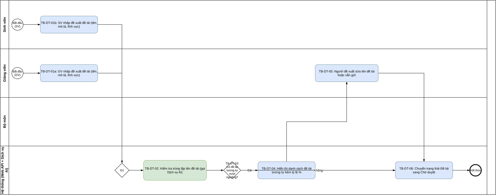

# Chương 2. Khảo sát & phân tích

## 2.2. Mô hình hóa quy trình nghiệp vụ

> **Mã PI:** 1.1 — **Yêu cầu:** ANLS-02

Mỗi quy trình nghiệp vụ của hệ thống được mô hình hóa dưới dạng hai sơ đồ BPMN: **AS-IS** (quy trình thủ công hiện tại, làm cơ sở khảo sát) và **TO-BE** (quy trình vận hành trên hệ thống, có bước kiểm tra trùng lặp bằng AI). Cả hai đều dùng chung 3 làn (swimlane) **Sinh viên / Giảng viên / Bộ môn**; riêng TO-BE có thêm làn **Hệ thống** thể hiện các bước tự động (Web API và Dịch vụ AI). Nguồn sơ đồ là file draw.io `bpmn/01-de-tai.drawio` (nhiều trang), xuất PNG bằng `tools/render-diagrams.sh`.

### 2.2.2. Quy trình quản lý đề tài

*(Phần AS-IS được bổ sung ở Kế hoạch 01-02 Task 2 — xem mục "Điểm cải tiến của TO-BE so với AS-IS" bên dưới trang này sau khi hoàn thiện.)*

#### Quy trình TO-BE

Luồng mô tả ở đây là lát cắt UC1.1 – Đề xuất đề tài (Giảng viên hoặc Sinh viên đề xuất; Bộ môn duyệt và phân công được mô tả trong UC1.3, bổ sung ở Task 2).

| Mã bước | Lane | Công việc | Dữ liệu / biểu mẫu | Ghi chú |
|---------|------|-----------|---------------------|---------|
| TB-DT-01a | Giảng viên | GV nhập đề xuất đề tài (tên, mô tả, lĩnh vực) | Biểu mẫu đề xuất đề tài (điện tử) | Chỉ thực hiện được khi đợt đồ án đang mở |
| TB-DT-01b | Sinh viên | SV tự đề xuất đề tài (tên, mô tả, lĩnh vực) | Biểu mẫu đề xuất đề tài (điện tử) | Chỉ thực hiện được khi đợt đồ án đang mở |
| TB-DT-02 | Hệ thống | Kiểm tra trùng lặp tên đề tài theo ngữ nghĩa (gọi Dịch vụ AI) | Tên đề tài vừa nhập, kho đề tài đã có | So sánh ngữ nghĩa, không phải so khớp chuỗi ký tự |
| TB-DT-03 | Hệ thống | Gateway: có đề tài tương tự vượt ngưỡng cấu hình? | Ngưỡng do Bộ môn cấu hình (FR-DT-02) | Ngưỡng đặt trong yêu cầu phi chức năng (ANLS-04) |
| TB-DT-04 | Hệ thống | Hiển thị danh sách đề tài tương tự kèm tỷ lệ % | Top N đề tài tương tự | Chỉ cảnh báo, không chặn gửi |
| TB-DT-05 | Giảng viên | Người đề xuất sửa tên đề tài hoặc vẫn gửi | — | Quyết định thuộc về người đề xuất |
| TB-DT-06 | Hệ thống | Chuyển trạng thái đề tài sang "Chờ duyệt" | Bản ghi đề tài | Kết thúc lát cắt UC1.1; UC1.3 (Task 2) tiếp tục từ trạng thái này |
