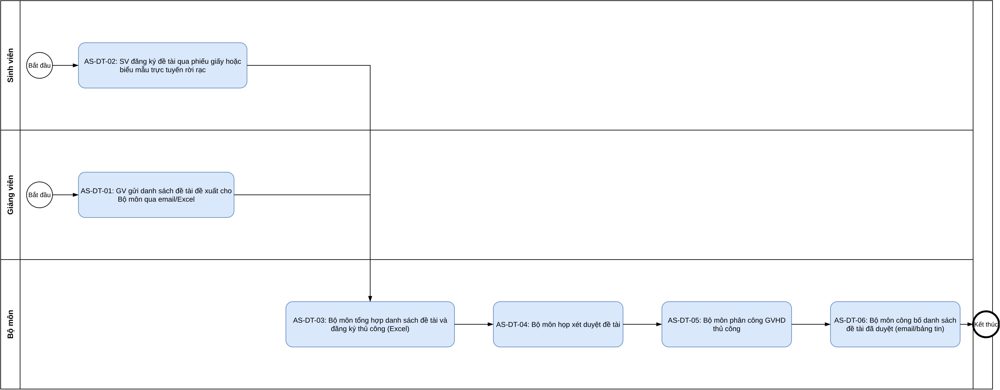

# Chương 2. Khảo sát & phân tích

## 2.2. Mô hình hóa quy trình nghiệp vụ

> **Mã PI:** 1.1 — **Yêu cầu:** ANLS-02

Mỗi quy trình nghiệp vụ của hệ thống được mô hình hóa dưới dạng hai sơ đồ BPMN: **AS-IS** (quy trình thủ công hiện tại, làm cơ sở khảo sát) và **TO-BE** (quy trình vận hành trên hệ thống, có bước kiểm tra trùng lặp bằng AI). Cả hai đều dùng chung 3 làn (swimlane) **Sinh viên / Giảng viên / Bộ môn**; riêng TO-BE có thêm làn **Hệ thống** thể hiện các bước tự động (Web API và Dịch vụ AI). Nguồn sơ đồ là file draw.io `bpmn/01-de-tai.drawio` (nhiều trang), xuất PNG bằng `tools/render-diagrams.sh`.

### 2.2.2. Quy trình quản lý đề tài

> GIẢ ĐỊNH — chờ xác nhận: chưa có phỏng vấn thật tại thời điểm viết (D-01, D-02). Phần AS-IS dưới đây là bản nháp dựa trên suy luận thực tế phổ biến ở các khoa CNTT có quy trình tương tự; sẽ được đối chiếu và cập nhật (hoặc gỡ bỏ nhãn giả định) sau khi có biên bản phỏng vấn Bộ môn/GV/SV (plan 01-07).

#### Quy trình AS-IS

| Mã bước | Lane | Công việc | Dữ liệu / biểu mẫu | Ghi chú |
|---------|------|-----------|---------------------|---------|
| AS-DT-01 | Giảng viên | GV gửi danh sách đề tài đề xuất cho Bộ môn qua email/Excel | File Excel/email tự do | GIẢ ĐỊNH — chờ xác nhận |
| AS-DT-02 | Sinh viên | SV đăng ký đề tài qua phiếu giấy hoặc biểu mẫu trực tuyến rời rạc | Phiếu đăng ký giấy hoặc Google Form | GIẢ ĐỊNH — chờ xác nhận |
| AS-DT-03 | Bộ môn | Bộ môn tổng hợp danh sách đề tài và đăng ký thủ công vào Excel | Bảng tổng hợp Excel | GIẢ ĐỊNH — chờ xác nhận |
| AS-DT-04 | Bộ môn | Bộ môn họp xét duyệt đề tài | Biên bản họp | GIẢ ĐỊNH — chờ xác nhận |
| AS-DT-05 | Bộ môn | Bộ môn phân công GVHD thủ công | Bảng phân công | GIẢ ĐỊNH — chờ xác nhận; không kiểm tra tải GV tự động |
| AS-DT-06 | Bộ môn | Bộ môn công bố danh sách đề tài đã duyệt qua email/bảng tin | Thông báo email/bảng tin khoa | GIẢ ĐỊNH — chờ xác nhận; không có thông báo tức thời |

**Điểm cải tiến của TO-BE so với AS-IS:**

- Kiểm tra trùng tên đề tài tự động bằng AI ngay khi đề xuất, thay vì Bộ môn tự phát hiện trùng lặp thủ công khi họp xét duyệt (hoặc không phát hiện được).
- Chặn tự động một SV đăng ký nhiều đề tài hoặc hai SV cùng đăng ký một đề tài, kể cả khi đăng ký cùng lúc (FR-DT-06, Task 2), thay vì đối chiếu thủ công trên Excel.
- Trạng thái đề tài minh bạch theo thời gian thực (Nháp → Chờ duyệt → Đã duyệt/Từ chối → Đã phân công), mọi vai trò tự tra cứu được (UC1.4) thay vì chờ email công bố.
- Thông báo in-app tức thời cho SV và GV khi có quyết định duyệt/từ chối/phân công, thay vì chờ email hoặc bảng tin.

#### Quy trình TO-BE

| Mã bước | Lane | Công việc | Dữ liệu / biểu mẫu | Ghi chú |
|---------|------|-----------|---------------------|---------|
| TB-DT-01a | Giảng viên | GV nhập đề xuất đề tài (tên, mô tả, lĩnh vực) | Biểu mẫu đề xuất đề tài (điện tử) | Chỉ thực hiện được khi đợt đồ án đang mở |
| TB-DT-01b | Sinh viên | SV tự đề xuất đề tài (tên, mô tả, lĩnh vực) | Biểu mẫu đề xuất đề tài (điện tử) | Chỉ thực hiện được khi đợt đồ án đang mở |
| TB-DT-02 | Hệ thống | Kiểm tra trùng lặp tên đề tài theo ngữ nghĩa (gọi Dịch vụ AI) | Tên đề tài vừa nhập, kho đề tài đã có | So sánh ngữ nghĩa, không phải so khớp chuỗi ký tự |
| TB-DT-03 | Hệ thống | Gateway: có đề tài tương tự vượt ngưỡng cấu hình? | Ngưỡng do Bộ môn cấu hình (FR-DT-02) | Ngưỡng đặt trong yêu cầu phi chức năng (ANLS-04) |
| TB-DT-04 | Hệ thống | Hiển thị danh sách đề tài tương tự kèm tỷ lệ % | Top N đề tài tương tự | Chỉ cảnh báo, không chặn gửi |
| TB-DT-05 | Giảng viên | Người đề xuất sửa tên đề tài hoặc vẫn gửi | — | Quyết định thuộc về người đề xuất |
| TB-DT-06 | Hệ thống | Chuyển trạng thái đề tài sang "Chờ duyệt" | Bản ghi đề tài | Kết thúc UC1.1 |
| TB-DT-07 | Sinh viên | SV chọn đăng ký một đề tài do GV đề xuất và còn trống | Danh sách đề tài trạng thái "Đã duyệt", chưa có SV | UC1.2 |
| TB-DT-08 | Hệ thống | Kiểm tra SV chưa có đề tài đang hoạt động và đề tài chưa có SV khác đăng ký | Ràng buộc 1 SV – 1 đề tài (FR-DT-06) | Phải xử lý đúng khi 2 SV đăng ký cùng lúc |
| TB-DT-09 | Hệ thống | Gateway: đăng ký có hợp lệ? | — | — |
| TB-DT-10 | Hệ thống | Ghi nhận đăng ký, chuyển đề tài sang "Chờ duyệt" | Bản ghi đề tài | Nhánh hợp lệ của UC1.2 |
| TB-DT-11 | Hệ thống | Từ chối đăng ký, thông báo lý do | Thông báo in-app | Nhánh không hợp lệ của UC1.2 |
| TB-DT-12 | Bộ môn | Bộ môn xem đề tài ở trạng thái "Chờ duyệt" | Danh sách đề tài chờ duyệt | UC1.3 |
| TB-DT-13 | Bộ môn | Gateway: Bộ môn có duyệt đề tài? | — | — |
| TB-DT-14 | Bộ môn | Phân công GVHD | Danh sách GV khả dụng | Nhánh duyệt của UC1.3 |
| TB-DT-15 | Hệ thống | Chuyển trạng thái "Đã phân công", gửi thông báo in-app cho SV và GV | Thông báo in-app (NOTF-01) | Kết thúc UC1.3 nhánh duyệt |
| TB-DT-16 | Bộ môn | Từ chối kèm lý do | Ghi chú lý do từ chối | Nhánh từ chối của UC1.3 |
| TB-DT-17 | Hệ thống | Chuyển trạng thái "Từ chối", gửi thông báo in-app cho SV và GV | Thông báo in-app (NOTF-01) | Kết thúc UC1.3 nhánh từ chối |
| TB-DT-18 | Hệ thống | SV/GV/Bộ môn xem và lọc danh sách đề tài theo trạng thái, đợt, GV | Bộ lọc danh sách đề tài | UC1.4, dùng chung cho cả 3 vai trò |
