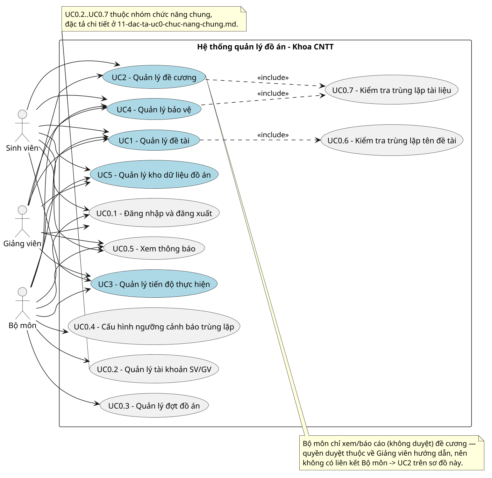

## 2.5. Sơ đồ use case tổng quát

> **Mã PI:** 1.3 — **Yêu cầu:** ANLS-05

Hệ thống có 3 tác nhân (Sinh viên, Giảng viên, Bộ môn — hội đồng bảo vệ dùng tài khoản Giảng viên được phân công, không phải một tác nhân riêng) và 5 use case chính, mỗi use case chính được tách thành các use case con (D-06) đặc tả riêng ở §2.6.1–§2.6.5. Nhóm UC0 – Chức năng chung (§2.6.6) gồm các chức năng dùng lại từ nhiều use case chính, trong đó UC0.6 và UC0.7 là hai điểm tích hợp với dịch vụ AI, được `<<include>>` từ UC1 và từ UC2/UC4.

### Bảng tác nhân

| Tác nhân | Mô tả | Use case chính |
|---|---|---|
| Sinh viên | Người dùng đề xuất/đăng ký đề tài, nộp đề cương/báo cáo tiến độ/báo cáo cuối, xem lịch và kết quả bảo vệ, tra cứu kho đồ án | UC1, UC2, UC3, UC4, UC5 |
| Giảng viên | Đề xuất đề tài, duyệt đề cương, nhận xét tiến độ, làm thành viên hội đồng chấm điểm bảo vệ, tra cứu kho đồ án | UC1, UC2, UC3, UC4, UC5 |
| Bộ môn | Duyệt đề tài và phân công GVHD, thiết lập mốc và theo dõi tiến độ toàn khoa, lập hội đồng và chốt kết quả bảo vệ, quản lý kho dữ liệu đồ án, quản lý tài khoản/đợt đồ án/ngưỡng trùng lặp | UC1, UC3, UC4, UC5, UC0.1–UC0.5 |

### Bảng danh mục use case

| Mã | Tên use case | Tác nhân | Use case con | Tệp đặc tả |
|---|---|---|---|---|
| UC1 | Quản lý đề tài | Sinh viên, Giảng viên, Bộ môn | UC1.1 Đề xuất đề tài; UC1.2 Đăng ký đề tài có sẵn; UC1.3 Duyệt đề tài và phân công GVHD; UC1.4 Xem và lọc danh sách đề tài | [06-dac-ta-uc1-quan-ly-de-tai.md](06-dac-ta-uc1-quan-ly-de-tai.md) |
| UC2 | Quản lý đề cương | Sinh viên, Giảng viên | UC2.1 Nộp đề cương; UC2.2 Duyệt hoặc yêu cầu sửa đề cương; UC2.3 Xem lịch sử phiên bản và nhận xét | [07-dac-ta-uc2-quan-ly-de-cuong.md](07-dac-ta-uc2-quan-ly-de-cuong.md) |
| UC3 | Quản lý tiến độ thực hiện | Sinh viên, Giảng viên, Bộ môn | UC3.1 Thiết lập mốc tiến độ; UC3.2 Nộp báo cáo tiến độ; UC3.3 Nhận xét và đánh giá báo cáo tiến độ; UC3.4 Theo dõi tiến độ toàn khoa | [08-dac-ta-uc3-quan-ly-tien-do.md](08-dac-ta-uc3-quan-ly-tien-do.md) |
| UC4 | Quản lý bảo vệ | Sinh viên, Giảng viên, Bộ môn | UC4.1 Nộp báo cáo cuối; UC4.2 Lập hội đồng và xếp lịch; UC4.3 Chấm điểm và nhận xét; UC4.4 Chốt kết quả bảo vệ; UC4.5 Xem lịch và kết quả bảo vệ | [09-dac-ta-uc4-quan-ly-bao-ve.md](09-dac-ta-uc4-quan-ly-bao-ve.md) |
| UC5 | Quản lý kho dữ liệu đồ án | Sinh viên, Giảng viên, Bộ môn | UC5.1 Tra cứu và xem chi tiết đồ án; UC5.2 Lưu đồ án vào kho; UC5.3 Quản lý bản ghi kho; UC5.4 Import đồ án các khóa cũ | [10-dac-ta-uc5-quan-ly-kho-do-an.md](10-dac-ta-uc5-quan-ly-kho-do-an.md) |
| UC0 | Chức năng chung | Sinh viên, Giảng viên, Bộ môn, Hệ thống | UC0.1 Đăng nhập/đăng xuất; UC0.2 Quản lý tài khoản SV/GV; UC0.3 Quản lý đợt đồ án; UC0.4 Cấu hình ngưỡng cảnh báo trùng lặp; UC0.5 Xem thông báo; UC0.6 Kiểm tra trùng lặp tên đề tài (included by UC1); UC0.7 Kiểm tra trùng lặp tài liệu (included by UC2, UC4) | [11-dac-ta-uc0-chuc-nang-chung.md](11-dac-ta-uc0-chuc-nang-chung.md) |
