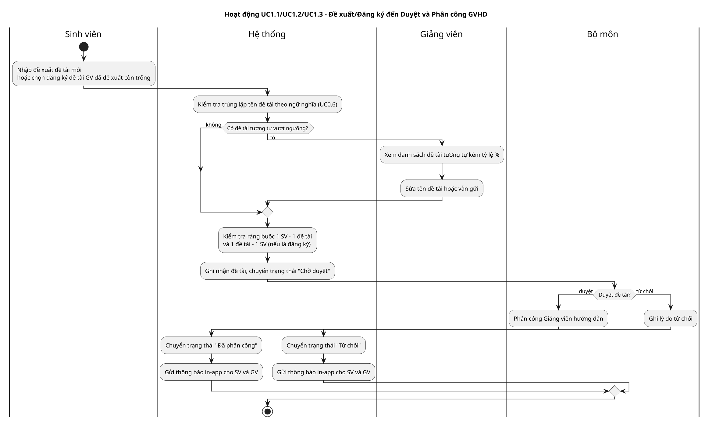

### 2.6.1. Đặc tả UC1 – Quản lý đề tài

> **Mã PI:** 1.3 — **Yêu cầu:** ANLS-05

UC1 – Quản lý đề tài được tách thành 4 UC con để mỗi UC có một luồng nghiệp vụ độc lập, dễ đặc tả và dễ lập trình theo lát cắt: UC1.1 Đề xuất đề tài, UC1.2 Đăng ký đề tài có sẵn, UC1.3 Duyệt đề tài và phân công GVHD, UC1.4 Xem và lọc danh sách đề tài.

#### UC1.1 – Đề xuất đề tài

| Thuộc tính | Nội dung |
|---|---|
| Mã UC | UC1.1 |
| Tên UC | Đề xuất đề tài |
| Tác nhân | Giảng viên, Sinh viên |
| Mô tả | Giảng viên hoặc Sinh viên nhập một đề tài mới (tên, mô tả, lĩnh vực) vào đợt đồ án đang mở. Hệ thống kiểm tra trùng lặp tên đề tài theo ngữ nghĩa (bao gồm UC0.6) trước khi ghi nhận. |
| Tiền điều kiện | Người dùng đã đăng nhập với vai trò Giảng viên hoặc Sinh viên; có ít nhất một đợt đồ án đang ở trạng thái "đang mở" |
| Hậu điều kiện | Đề tài mới được tạo với trạng thái "Chờ duyệt"; nếu có đề tài tương tự vượt ngưỡng, danh sách tương tự đã được hiển thị cho người đề xuất trước khi gửi |
| Yêu cầu liên quan | FR-DT-01, FR-DT-02 |
| Màn hình | MH-06 |

**Luồng sự kiện chính**

1. Người dùng (GV hoặc SV) chọn "Đề xuất đề tài" trên màn hình MH-06.
2. Người dùng nhập tên đề tài, mô tả, lĩnh vực và chọn đợt đồ án đang mở.
3. Hệ thống gọi UC0.6 (Kiểm tra trùng lặp tên đề tài) để so sánh ngữ nghĩa tên đề tài vừa nhập với kho đề tài đã có.
4. Nếu không có đề tài nào vượt ngưỡng tương đồng: hệ thống chuyển sang bước 6.
5. Nếu có đề tài tương tự vượt ngưỡng: hệ thống hiển thị danh sách tối đa N đề tài tương tự kèm tỷ lệ % tương đồng (MH-06).
6. Hệ thống ghi nhận đề tài mới với trạng thái "Chờ duyệt" và thông báo thành công cho người dùng.

**Luồng thay thế**

- **A1** (rẽ nhánh từ bước 5): Người đề xuất xem danh sách đề tài tương tự, chỉnh sửa lại tên đề tài, hệ thống quay lại bước 3 để kiểm tra lại.
- **A2** (rẽ nhánh từ bước 5): Người đề xuất xác nhận vẫn muốn gửi dù có cảnh báo trùng lặp; hệ thống tiếp tục bước 6 và ghi chú lại rằng đề tài đã được gửi kèm cảnh báo.

**Ngoại lệ**

- **E1**: Đợt đồ án đã đóng tại thời điểm gửi → hệ thống từ chối và thông báo lý do, không tạo đề tài.
- **E2**: Dịch vụ AI (UC0.6) không phản hồi trong thời gian quy định (NFR ANLS-04) → hệ thống vẫn cho phép gửi đề tài, ghi nhận trạng thái kiểm tra là "chưa kiểm tra" để Bộ môn biết khi duyệt (UC1.3).

#### UC1.2 – Đăng ký đề tài có sẵn

| Thuộc tính | Nội dung |
|---|---|
| Mã UC | UC1.2 |
| Tên UC | Đăng ký đề tài có sẵn |
| Tác nhân | Sinh viên |
| Mô tả | Sinh viên chọn một đề tài do Giảng viên đề xuất, đang ở trạng thái đã duyệt và còn trống, để đăng ký làm đề tài của mình. |
| Tiền điều kiện | Sinh viên đã đăng nhập; tồn tại ít nhất một đề tài do GV đề xuất, còn trống (chưa có SV đăng ký); Sinh viên hiện chưa có đề tài nào đang hoạt động |
| Hậu điều kiện | Đề tài được gắn với Sinh viên và chuyển trạng thái "Chờ duyệt"; hoặc đăng ký bị từ chối nếu vi phạm ràng buộc |
| Yêu cầu liên quan | FR-DT-03, FR-DT-06 |
| Màn hình | MH-05, MH-06 |

**Luồng sự kiện chính**

1. Sinh viên mở danh sách đề tài (MH-05), lọc theo đợt đồ án đang mở và trạng thái "Đã duyệt, còn trống".
2. Sinh viên chọn một đề tài và xác nhận đăng ký (MH-06).
3. Hệ thống kiểm tra Sinh viên chưa có đề tài nào đang hoạt động, và đề tài chưa có Sinh viên khác đăng ký (FR-DT-06).
4. Hệ thống ghi nhận đăng ký, gắn Sinh viên vào đề tài, chuyển trạng thái đề tài sang "Chờ duyệt".

**Luồng thay thế**

- **A1** (rẽ nhánh từ bước 3): Nếu Sinh viên đã có đề tài đang hoạt động, hệ thống từ chối đăng ký và thông báo lý do; Sinh viên phải hủy hoặc chờ xử lý đề tài cũ trước.

**Ngoại lệ**

- **E1**: Hai Sinh viên cùng đăng ký một đề tài gần như đồng thời → hệ thống dùng ràng buộc duy nhất ở tầng CSDL (không chỉ kiểm tra ở tầng ứng dụng) để đảm bảo chỉ một đăng ký thành công; đăng ký còn lại nhận thông báo "đề tài vừa được người khác đăng ký".

#### UC1.3 – Duyệt đề tài và phân công GVHD

| Thuộc tính | Nội dung |
|---|---|
| Mã UC | UC1.3 |
| Tên UC | Duyệt đề tài và phân công GVHD |
| Tác nhân | Bộ môn |
| Mô tả | Bộ môn xem các đề tài ở trạng thái "Chờ duyệt", quyết định duyệt (kèm phân công Giảng viên hướng dẫn) hoặc từ chối (kèm lý do). |
| Tiền điều kiện | Bộ môn đã đăng nhập; tồn tại ít nhất một đề tài ở trạng thái "Chờ duyệt" |
| Hậu điều kiện | Đề tài chuyển "Đã phân công" (kèm GVHD) hoặc "Từ chối" (kèm lý do); SV và GV liên quan nhận thông báo in-app |
| Yêu cầu liên quan | FR-DT-04, FR-DT-05 |
| Màn hình | MH-07 |

**Luồng sự kiện chính**

1. Bộ môn mở danh sách đề tài "Chờ duyệt" (MH-07).
2. Bộ môn xem chi tiết đề tài, bao gồm kết quả kiểm tra trùng lặp tên (nếu có).
3. Bộ môn quyết định duyệt: chọn Giảng viên hướng dẫn từ danh sách GV khả dụng.
4. Hệ thống chuyển trạng thái đề tài sang "Đã phân công" và gửi thông báo in-app cho Sinh viên và Giảng viên được phân công.

**Luồng thay thế**

- **A1** (rẽ nhánh từ bước 3): Bộ môn từ chối đề tài, nhập lý do từ chối; hệ thống chuyển trạng thái sang "Từ chối" và gửi thông báo in-app cho người đề xuất/đăng ký.

**Ngoại lệ**

- **E1**: Đề tài được đề xuất bởi Giảng viên và Giảng viên đó cũng là người duy nhất phù hợp làm GVHD → Bộ môn vẫn phải xác nhận phân công thủ công (hệ thống không tự gán).

#### UC1.4 – Xem và lọc danh sách đề tài

| Thuộc tính | Nội dung |
|---|---|
| Mã UC | UC1.4 |
| Tên UC | Xem và lọc danh sách đề tài |
| Tác nhân | Sinh viên, Giảng viên, Bộ môn |
| Mô tả | Cả 3 vai trò xem danh sách đề tài, lọc theo trạng thái, đợt đồ án và Giảng viên hướng dẫn. |
| Tiền điều kiện | Người dùng đã đăng nhập |
| Hậu điều kiện | Danh sách đề tài thỏa điều kiện lọc được hiển thị |
| Yêu cầu liên quan | FR-DT-07 |
| Màn hình | MH-05 |

**Luồng sự kiện chính**

1. Người dùng mở màn hình danh sách đề tài (MH-05).
2. Người dùng chọn bộ lọc: trạng thái (Nháp/Chờ duyệt/Đã duyệt/Từ chối/Đã phân công), đợt đồ án, Giảng viên hướng dẫn.
3. Hệ thống trả về danh sách đề tài thỏa điều kiện, phân trang.

**Luồng thay thế**

- **A1**: Sinh viên chỉ thấy đề tài của chính mình và các đề tài còn trống (không thấy đề tài đã gắn SV khác); Giảng viên thấy đề tài mình đề xuất/hướng dẫn và các đề tài còn trống; Bộ môn thấy toàn bộ.

**Ngoại lệ**

- Không có ngoại lệ đáng kể (UC chỉ đọc dữ liệu).

