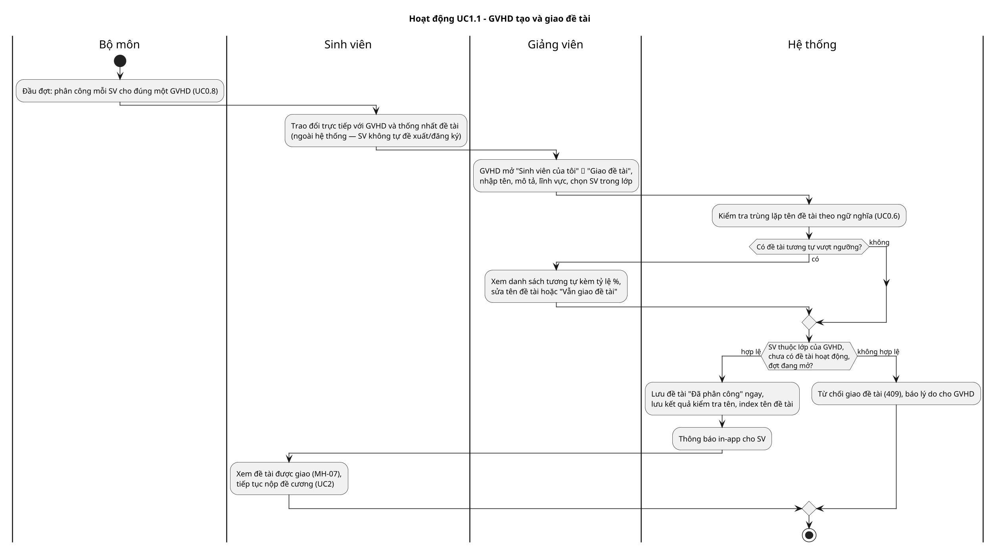

### 2.6.1. Đặc tả UC1 – Quản lý đề tài

> **Mã PI:** 1.3 — **Yêu cầu:** ANLS-05

UC1 – Quản lý đề tài được tách thành 2 UC con để mỗi UC có một luồng nghiệp vụ độc lập, dễ đặc tả và dễ lập trình theo lát cắt: UC1.1 Tạo và giao đề tài (do GVHD thực hiện) và UC1.2 Xem và lọc danh sách đề tài.

Theo góp ý của giảng viên hướng dẫn (góp ý GVHD mục 1), **sinh viên không tự đề xuất đề tài và không đăng ký đề tài trên hệ thống**. Sinh viên trao đổi trực tiếp với giảng viên (ngoài hệ thống); khi hai bên đã thống nhất thì đề tài được coi là *đề tài do giảng viên giao*. Trên hệ thống, chỉ giảng viên hướng dẫn (GVHD) mới tạo đề tài và giao thẳng cho sinh viên trong lớp hướng dẫn của mình; đề tài ở trạng thái "Đã phân công" ngay, không còn bước duyệt. Sinh viên chỉ xem đề tài được giao rồi tiếp tục các UC sau (UC2–UC5).

Toàn bộ UC1 dựa trên kết quả của **UC0.8 – Phân công GVHD** (§2.6.6): đầu mỗi đợt đồ án, Bộ môn phân công mỗi sinh viên cho đúng một giảng viên hướng dẫn (gọi là "lớp hướng dẫn" của giảng viên đó trong đợt). Chỉ GVHD được Bộ môn phân công cho sinh viên trong đợt mới tạo và giao được đề tài cho sinh viên đó. Cách tổ chức này khớp với thực tế vận hành của Khoa (Bộ môn chia sinh viên về các giảng viên ngay khi mở đợt; sinh viên và giảng viên thỏa thuận đề tài trực tiếp), loại bỏ việc một đề tài phải đi nhiều vòng trên hệ thống, đồng thời gắn trách nhiệm về chất lượng đề tài cho chính GVHD. Vai trò của Bộ môn trong UC1 là phân bổ khối lượng hướng dẫn (UC0.8) và theo dõi toàn bộ đề tài ở chế độ chỉ đọc (UC1.2); các quy trình từ đề cương (UC2) trở đi không thay đổi.

**Quy tắc nghiệp vụ chung của UC1**

| Mã | Quy tắc |
|---|---|
| BR-DT-01 | Chỉ GVHD được Bộ môn phân công cho sinh viên trong đợt (UC0.8) mới tạo, sửa, gửi đề tài và kiểm tra trùng tên đề tài cho sinh viên đó; sinh viên và Bộ môn gọi các chức năng này nhận lỗi 403. Đề tài luôn gắn với một sinh viên trong lớp hướng dẫn của GVHD (bắt buộc chọn sinh viên); không có đề tài "mở cho lớp". |
| BR-DT-02 | Giảng viên không phải GVHD của sinh viên, hoặc sinh viên không thuộc lớp hướng dẫn của giảng viên trong đợt, bị từ chối với thông báo "Sinh viên không thuộc lớp hướng dẫn của bạn trong đợt này" (lỗi 409). |
| BR-DT-03 | Giảng viên giao đề tài (gửi) thì đề tài chuyển "Đã phân công" ngay, kết quả kiểm tra trùng tên (UC0.6) được lưu cùng lúc và sinh viên nhận thông báo in-app; lưu nháp thì đề tài ở trạng thái "Nháp", sinh viên chưa nhìn thấy. |
| BR-DT-04 | Sinh viên chỉ xem được đề tài được giao cho chính mình; không có chức năng sinh viên tự đề xuất, sửa, gửi hay đăng ký đề tài. Không còn bước duyệt/từ chối đề tài. |
| BR-DT-05 | Mỗi sinh viên có tối đa một đề tài đang hoạt động (Đã phân công) và mỗi đề tài có đúng một sinh viên — bảo đảm ở tầng CSDL, kể cả khi hai yêu cầu giao đề tài cho cùng một sinh viên đến đồng thời (§3.2.5). |

#### UC1.1 – Tạo và giao đề tài

| Thuộc tính | Nội dung |
|---|---|
| Mã UC | UC1.1 |
| Tên UC | Tạo và giao đề tài |
| Tác nhân | Giảng viên (GVHD) |
| Mô tả | Sau khi đã trao đổi và thống nhất đề tài với sinh viên (ngoài hệ thống), GVHD tạo một đề tài mới (tên, mô tả, lĩnh vực) và giao thẳng cho sinh viên đó trong lớp hướng dẫn của mình. Hệ thống kiểm tra trùng lặp tên đề tài theo ngữ nghĩa (bao gồm UC0.6) trước khi ghi nhận, lưu kết quả kiểm tra và thông báo cho sinh viên. |
| Tiền điều kiện | Giảng viên đã đăng nhập; có ít nhất một đợt đồ án đang ở trạng thái "đang mở"; sinh viên được Bộ môn phân công cho giảng viên trong đợt đó (UC0.8, BR-DT-01) và chưa có đề tài đang hoạt động |
| Hậu điều kiện | Đề tài ở trạng thái "Đã phân công", gắn với sinh viên và GVHD; kết quả kiểm tra trùng tên đã được lưu; sinh viên nhận thông báo in-app. Nếu có đề tài tương tự vượt ngưỡng, danh sách tương tự đã được hiển thị cho GVHD trước khi giao |
| Yêu cầu liên quan | FR-DT-01, FR-DT-02, FR-DT-04, FR-DT-06, FR-DT-10 |
| Màn hình | MH-06, MH-16 |

**Luồng sự kiện chính**

1. GVHD mở "Sinh viên của tôi" (MH-16) và chọn "Giao đề tài" ở dòng của sinh viên chưa có đề tài; hệ thống mở form MH-06 điền sẵn đợt đồ án và sinh viên.
2. GVHD nhập tên đề tài, mô tả, lĩnh vực.
3. Hệ thống gọi UC0.6 (Kiểm tra trùng lặp tên đề tài) để so sánh ngữ nghĩa tên đề tài vừa nhập với kho đề tài đã có.
4. Nếu không có đề tài nào vượt ngưỡng tương đồng: hệ thống chuyển sang bước 6.
5. Nếu có đề tài tương tự vượt ngưỡng: hệ thống hiển thị danh sách tối đa N đề tài tương tự kèm tỷ lệ % tương đồng (MH-06).
6. GVHD chọn "Giao đề tài cho sinh viên"; hệ thống kiểm tra sinh viên thuộc lớp hướng dẫn của GVHD (BR-DT-02), sinh viên chưa có đề tài đang hoạt động (BR-DT-05), ghi nhận đề tài ở trạng thái "Đã phân công" (BR-DT-03), lưu kết quả kiểm tra trùng tên, gửi thông báo in-app cho sinh viên và đưa tên đề tài vào chỉ mục của dịch vụ AI.

**Luồng thay thế**

- **A1** (rẽ nhánh từ bước 5): GVHD xem danh sách đề tài tương tự, chỉnh sửa lại tên đề tài, hệ thống quay lại bước 3 để kiểm tra lại.
- **A2** (rẽ nhánh từ bước 5): GVHD xác nhận "Vẫn giao đề tài" dù có cảnh báo trùng lặp; hệ thống tiếp tục bước 6 và lưu kèm kết quả cảnh báo.
- **A3** (thay cho bước 1): GVHD mở menu "Giao đề tài" (MH-06), chọn đợt đồ án và chọn sinh viên trong lớp hướng dẫn (ô sinh viên bắt buộc); các bước tiếp theo như trên.
- **A4**: GVHD chọn "Lưu nháp" thay cho giao; hệ thống lưu đề tài ở trạng thái "Nháp", sinh viên chưa nhìn thấy và không nhận thông báo. GVHD sửa bản nháp (MH-06 chế độ sửa) hoặc gửi từ trang chi tiết (MH-07) — khi gửi hệ thống kiểm tra lại như bước 3–6; nếu Bộ môn đã đổi GVHD của sinh viên và bản nháp mất sinh viên được chọn thì hệ thống yêu cầu chọn lại sinh viên (lỗi 409).

**Ngoại lệ**

- **E1**: Đợt đồ án đã đóng tại thời điểm giao → hệ thống từ chối và thông báo lý do, không giao đề tài.
- **E2**: Dịch vụ AI (UC0.6) không phản hồi trong thời gian quy định (NFR ANLS-04) → hệ thống vẫn cho phép giao đề tài, ghi nhận kết quả kiểm tra là "chưa kiểm tra".
- **E3**: Sinh viên và Bộ môn gọi chức năng tạo, sửa, gửi hoặc kiểm tra tên đề tài (hoặc gửi yêu cầu trực tiếp tới API) → hệ thống trả 403 (BR-DT-01); các chức năng đăng ký đề tài và duyệt đề tài không còn tồn tại.
- **E4**: GVHD chọn sinh viên không thuộc lớp hướng dẫn của mình (hoặc giảng viên không phải GVHD của sinh viên), hoặc sinh viên đã có đề tài đang hoạt động (kể cả khi hai yêu cầu giao đến đồng thời) → hệ thống từ chối và thông báo lý do (BR-DT-02, BR-DT-05).

#### UC1.2 – Xem và lọc danh sách đề tài

| Thuộc tính | Nội dung |
|---|---|
| Mã UC | UC1.2 |
| Tên UC | Xem và lọc danh sách đề tài |
| Tác nhân | Sinh viên, Giảng viên, Bộ môn |
| Mô tả | Cả 3 vai trò xem danh sách đề tài trong phạm vi của mình, lọc theo trạng thái, đợt đồ án, Giảng viên hướng dẫn, lĩnh vực và từ khóa; sinh viên xem đề tài được giao cho mình (chi tiết đề tài được giao ở MH-07). |
| Tiền điều kiện | Người dùng đã đăng nhập |
| Hậu điều kiện | Danh sách đề tài thỏa điều kiện lọc được hiển thị |
| Yêu cầu liên quan | FR-DT-03, FR-DT-07 |
| Màn hình | MH-05, MH-07 |

**Luồng sự kiện chính**

1. Người dùng mở màn hình danh sách đề tài (MH-05); sinh viên còn có thể mở đề tài được giao từ trang tổng quan (MH-02).
2. Người dùng chọn bộ lọc: trạng thái (Nháp/Đã phân công), đợt đồ án, Giảng viên hướng dẫn, lĩnh vực, từ khóa.
3. Hệ thống trả về danh sách đề tài thỏa điều kiện trong phạm vi của vai trò, phân trang.
4. Người dùng mở một đề tài để xem chi tiết (MH-07): đợt, lĩnh vực, GVHD, sinh viên, mô tả và kết quả kiểm tra trùng tên đã lưu lúc giao (nếu có).

**Luồng thay thế**

- **A1**: Sinh viên chỉ thấy đề tài được giao cho chính mình (không thấy bản nháp GVHD đang soạn, không thấy đề tài của sinh viên khác); Giảng viên chỉ thấy đề tài mình hướng dẫn; Bộ môn thấy toàn bộ đề tài ở chế độ chỉ đọc.

**Ngoại lệ**

- **E1**: Người dùng mở chi tiết một đề tài ngoài phạm vi của mình (qua đường dẫn trực tiếp) → hệ thống trả 403.

