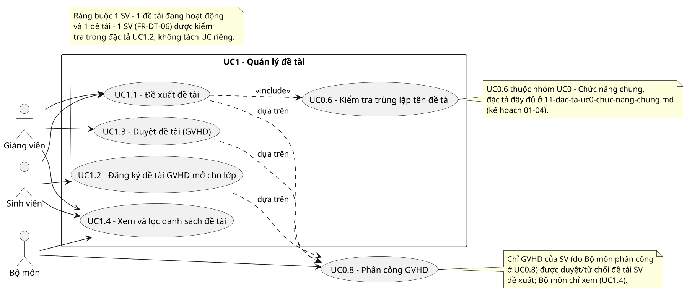

### 2.6.1. Đặc tả UC1 – Quản lý đề tài

> **Mã PI:** 1.3 — **Yêu cầu:** ANLS-05

UC1 – Quản lý đề tài được tách thành 4 UC con để mỗi UC có một luồng nghiệp vụ độc lập, dễ đặc tả và dễ lập trình theo lát cắt: UC1.1 Đề xuất đề tài, UC1.2 Đăng ký đề tài GVHD mở cho lớp, UC1.3 Duyệt đề tài, UC1.4 Xem và lọc danh sách đề tài.

Toàn bộ UC1 dựa trên kết quả của **UC0.8 – Phân công GVHD** (§2.6.6): đầu mỗi đợt đồ án, Bộ môn phân công mỗi sinh viên cho đúng một giảng viên hướng dẫn (gọi là "lớp hướng dẫn" của giảng viên đó trong đợt). Từ đó sinh viên chỉ làm việc trực tiếp với GVHD của mình: đề tài sinh viên đề xuất được gửi tới GVHD duyệt, đề tài giảng viên mở thì chỉ sinh viên trong lớp của giảng viên đó đăng ký được. Cách tổ chức này khớp với thực tế vận hành của Khoa (Bộ môn chia sinh viên về các giảng viên ngay khi mở đợt), loại bỏ việc một đề tài phải đi hai vòng qua Bộ môn (duyệt, rồi xác nhận đăng ký và chọn GVHD), đồng thời gắn trách nhiệm về chất lượng đề tài cho chính GVHD. Vai trò của Bộ môn trong UC1 chuyển sang phân bổ khối lượng hướng dẫn (UC0.8) và theo dõi toàn bộ đề tài ở chế độ chỉ đọc (UC1.4); các quy trình từ đề cương (UC2) trở đi không thay đổi.

**Quy tắc nghiệp vụ chung của UC1**

| Mã | Quy tắc |
|---|---|
| BR-DT-01 | Sinh viên chỉ gửi được đề xuất đề tài trong đợt mà mình đã được Bộ môn phân công GVHD (UC0.8); đề tài sinh viên gửi được gắn ngay với GVHD đó và ở trạng thái "Chờ duyệt". Lưu nháp không cần điều kiện này. |
| BR-DT-02 | Chỉ GVHD của sinh viên (trong đợt chứa đề tài) được duyệt hoặc từ chối đề tài sinh viên đó đề xuất; Bộ môn, sinh viên và giảng viên khác nhận lỗi 403. Từ chối bắt buộc có lý do. |
| BR-DT-03 | Giảng viên chỉ giao đề tài cho sinh viên trong lớp hướng dẫn của mình ở đợt đó; đề tài giảng viên gửi mà chưa chọn sinh viên ở trạng thái "Mở cho lớp đăng ký" (mã `DA_DUYET`) và chỉ sinh viên cùng lớp hướng dẫn trong đợt đó nhìn thấy, đăng ký được. |
| BR-DT-04 | Đăng ký thành công một đề tài "Mở cho lớp đăng ký" chuyển đề tài sang "Đã phân công" ngay, không có bước duyệt. |
| BR-DT-05 | Mỗi sinh viên có tối đa một đề tài đang hoạt động (Chờ duyệt, Mở cho lớp đăng ký hoặc Đã phân công) và mỗi đề tài có tối đa một sinh viên — bảo đảm ở tầng CSDL, kể cả khi hai yêu cầu đến đồng thời (§3.2.5). |

#### UC1.1 – Đề xuất đề tài

| Thuộc tính | Nội dung |
|---|---|
| Mã UC | UC1.1 |
| Tên UC | Đề xuất đề tài |
| Tác nhân | Giảng viên, Sinh viên |
| Mô tả | Sinh viên đề xuất một đề tài mới (tên, mô tả, lĩnh vực) gửi tới GVHD của mình; Giảng viên tạo một đề tài mới và giao thẳng cho một sinh viên trong lớp hướng dẫn hoặc mở cho cả lớp đăng ký. Hệ thống kiểm tra trùng lặp tên đề tài theo ngữ nghĩa (bao gồm UC0.6) trước khi ghi nhận. |
| Tiền điều kiện | Người dùng đã đăng nhập với vai trò Giảng viên hoặc Sinh viên; có ít nhất một đợt đồ án đang ở trạng thái "đang mở"; với Sinh viên: đã được Bộ môn phân công GVHD trong đợt đó (UC0.8, BR-DT-01) |
| Hậu điều kiện | Đề tài SV đề xuất ở trạng thái "Chờ duyệt", gắn với GVHD của SV, GVHD nhận thông báo in-app; đề tài GV giao cho SV ở trạng thái "Đã phân công", SV nhận thông báo; đề tài GV chưa chọn SV ở trạng thái "Mở cho lớp đăng ký". Nếu có đề tài tương tự vượt ngưỡng, danh sách tương tự đã được hiển thị cho người đề xuất trước khi gửi |
| Yêu cầu liên quan | FR-DT-01, FR-DT-02, FR-DT-10 |
| Màn hình | MH-06 |

**Luồng sự kiện chính** (Sinh viên đề xuất)

1. Sinh viên chọn "Đề xuất đề tài" trên màn hình MH-06; hệ thống hiển thị GVHD của sinh viên trong đợt đang chọn (chỉ đọc).
2. Sinh viên nhập tên đề tài, mô tả, lĩnh vực và chọn đợt đồ án đang mở.
3. Hệ thống gọi UC0.6 (Kiểm tra trùng lặp tên đề tài) để so sánh ngữ nghĩa tên đề tài vừa nhập với kho đề tài đã có.
4. Nếu không có đề tài nào vượt ngưỡng tương đồng: hệ thống chuyển sang bước 6.
5. Nếu có đề tài tương tự vượt ngưỡng: hệ thống hiển thị danh sách tối đa N đề tài tương tự kèm tỷ lệ % tương đồng (MH-06).
6. Sinh viên gửi đề xuất; hệ thống kiểm tra sinh viên đã có GVHD trong đợt (BR-DT-01), ghi nhận đề tài với trạng thái "Chờ duyệt", gắn GVHD của sinh viên và gửi thông báo in-app "đề tài chờ duyệt" cho GVHD.

**Luồng thay thế**

- **A1** (rẽ nhánh từ bước 5): Người đề xuất xem danh sách đề tài tương tự, chỉnh sửa lại tên đề tài, hệ thống quay lại bước 3 để kiểm tra lại.
- **A2** (rẽ nhánh từ bước 5): Người đề xuất xác nhận vẫn muốn gửi dù có cảnh báo trùng lặp; hệ thống tiếp tục bước 6 và ghi chú lại rằng đề tài đã được gửi kèm cảnh báo.
- **A3** (Giảng viên giao đề tài, thay cho bước 1 và 6): Giảng viên tạo đề tài trên MH-06 và chọn một sinh viên trong lớp hướng dẫn của mình ở đợt đó (BR-DT-03); bước 2–5 như trên; khi gửi, hệ thống ghi nhận đề tài ở trạng thái "Đã phân công" với giảng viên là GVHD và gửi thông báo in-app cho sinh viên.
- **A4** (Giảng viên mở đề tài cho lớp, thay cho bước 1 và 6): Giảng viên tạo đề tài và để trống ô sinh viên; khi gửi, hệ thống ghi nhận đề tài ở trạng thái "Mở cho lớp đăng ký" — chỉ sinh viên trong lớp hướng dẫn của giảng viên ở đợt đó nhìn thấy và đăng ký được (UC1.2).
- **A5**: Người dùng chọn "Lưu nháp" thay cho "Gửi"; hệ thống lưu đề tài ở trạng thái "Nháp", không kiểm tra điều kiện GVHD, không gửi thông báo.

**Ngoại lệ**

- **E1**: Đợt đồ án đã đóng tại thời điểm gửi → hệ thống từ chối và thông báo lý do, không gửi đề tài.
- **E2**: Dịch vụ AI (UC0.6) không phản hồi trong thời gian quy định (NFR ANLS-04) → hệ thống vẫn cho phép gửi đề tài, ghi nhận trạng thái kiểm tra là "chưa kiểm tra" để GVHD biết khi duyệt (UC1.3).
- **E3**: Sinh viên chưa được Bộ môn phân công GVHD trong đợt → hệ thống từ chối gửi với thông báo "Bạn chưa được Bộ môn phân công giảng viên hướng dẫn trong đợt này" (bản nháp vẫn được giữ).
- **E4**: Giảng viên chọn một sinh viên không thuộc lớp hướng dẫn của mình, hoặc sinh viên đó đã có đề tài đang hoạt động → hệ thống từ chối gửi và thông báo lý do (BR-DT-03, BR-DT-05).

#### UC1.2 – Đăng ký đề tài GVHD mở cho lớp

| Thuộc tính | Nội dung |
|---|---|
| Mã UC | UC1.2 |
| Tên UC | Đăng ký đề tài GVHD mở cho lớp |
| Tác nhân | Sinh viên |
| Mô tả | Sinh viên chọn một đề tài ở trạng thái "Mở cho lớp đăng ký" do chính GVHD của mình mở trong đợt, để nhận làm đề tài của mình; đăng ký thành công là đề tài được phân công ngay. |
| Tiền điều kiện | Sinh viên đã đăng nhập và đã được phân công GVHD trong đợt đang mở (UC0.8); tồn tại ít nhất một đề tài GVHD đó mở cho lớp, còn trống (chưa có SV đăng ký); Sinh viên hiện chưa có đề tài nào đang hoạt động |
| Hậu điều kiện | Đề tài được gắn với Sinh viên và chuyển trạng thái "Đã phân công", GVHD nhận thông báo in-app; hoặc đăng ký bị từ chối nếu vi phạm ràng buộc |
| Yêu cầu liên quan | FR-DT-03, FR-DT-06 |
| Màn hình | MH-05, MH-06 |

**Luồng sự kiện chính**

1. Sinh viên mở danh sách đề tài (MH-05); hệ thống chỉ hiển thị đề tài của chính sinh viên và các đề tài GVHD của sinh viên mở cho lớp (BR-DT-03); sinh viên lọc theo đợt đồ án đang mở và trạng thái "Mở cho lớp đăng ký".
2. Sinh viên chọn một đề tài và xác nhận đăng ký (MH-06).
3. Hệ thống kiểm tra đề tài do GVHD của sinh viên mở trong đợt, Sinh viên chưa có đề tài nào đang hoạt động, và đề tài chưa có Sinh viên khác đăng ký (FR-DT-06).
4. Hệ thống ghi nhận đăng ký, gắn Sinh viên vào đề tài, chuyển trạng thái đề tài sang "Đã phân công" (BR-DT-04) và gửi thông báo in-app cho GVHD.

**Luồng thay thế**

- **A1** (rẽ nhánh từ bước 3): Nếu Sinh viên đã có đề tài đang hoạt động, hệ thống từ chối đăng ký và thông báo lý do; Sinh viên phải chờ xử lý đề tài cũ trước.

**Ngoại lệ**

- **E1**: Hai Sinh viên cùng đăng ký một đề tài gần như đồng thời → hệ thống dùng UPDATE có điều kiện và ràng buộc duy nhất ở tầng CSDL (không chỉ kiểm tra ở tầng ứng dụng) để đảm bảo chỉ một đăng ký thành công; đăng ký còn lại nhận thông báo "đề tài vừa được người khác đăng ký".
- **E2**: Đề tài không do GVHD của sinh viên mở (sinh viên khác lớp hướng dẫn, hoặc gửi yêu cầu trực tiếp tới API) → hệ thống từ chối đăng ký, không tiết lộ đề tài của lớp khác.

#### UC1.3 – Duyệt đề tài

| Thuộc tính | Nội dung |
|---|---|
| Mã UC | UC1.3 |
| Tên UC | Duyệt đề tài |
| Tác nhân | Giảng viên (GVHD của sinh viên) |
| Mô tả | GVHD xem các đề tài ở trạng thái "Chờ duyệt" do sinh viên trong lớp hướng dẫn của mình đề xuất, quyết định duyệt hoặc từ chối (kèm lý do). |
| Tiền điều kiện | Giảng viên đã đăng nhập; tồn tại ít nhất một đề tài "Chờ duyệt" do sinh viên mà giảng viên là GVHD (UC0.8) đề xuất |
| Hậu điều kiện | Đề tài chuyển "Đã phân công" hoặc "Từ chối" (kèm lý do); sinh viên nhận thông báo in-app |
| Yêu cầu liên quan | FR-DT-04 |
| Màn hình | MH-07, MH-16 |

**Luồng sự kiện chính**

1. GVHD mở màn hình "Duyệt đề tài" (MH-07) — trực tiếp, từ mục "Việc cần xử lý" trên trang tổng quan, từ thông báo, hoặc từ nút "Duyệt đề tài" ở danh sách "Sinh viên của tôi" (MH-16); hệ thống chỉ liệt kê đề tài "Chờ duyệt" của sinh viên trong lớp hướng dẫn của giảng viên.
2. GVHD xem chi tiết đề tài, bao gồm kết quả kiểm tra trùng lặp tên đã lưu lúc đề xuất (nếu có).
3. GVHD quyết định duyệt.
4. Hệ thống chuyển trạng thái đề tài sang "Đã phân công" (GVHD giữ nguyên là giảng viên đã được phân công) và gửi thông báo in-app cho sinh viên.

**Luồng thay thế**

- **A1** (rẽ nhánh từ bước 3): GVHD từ chối đề tài, nhập lý do từ chối (bắt buộc); hệ thống chuyển trạng thái sang "Từ chối" và gửi thông báo in-app kèm lý do cho sinh viên. Sinh viên được tự do đề xuất đề tài mới, vẫn gửi tới cùng GVHD.

**Ngoại lệ**

- **E1**: Người gọi không phải GVHD của sinh viên (Bộ môn, sinh viên, hoặc giảng viên khác) → hệ thống trả 403, không thay đổi đề tài (BR-DT-02).
- **E2**: Đề tài không còn ở trạng thái "Chờ duyệt" hoặc đã chuyển sang GVHD khác tại thời điểm quyết định (ví dụ Bộ môn vừa đổi GVHD của sinh viên, UC0.8) → hệ thống từ chối thao tác và yêu cầu tải lại danh sách.
- **E3**: Từ chối mà để trống lý do → hệ thống không cho xác nhận.

#### UC1.4 – Xem và lọc danh sách đề tài

| Thuộc tính | Nội dung |
|---|---|
| Mã UC | UC1.4 |
| Tên UC | Xem và lọc danh sách đề tài |
| Tác nhân | Sinh viên, Giảng viên, Bộ môn |
| Mô tả | Cả 3 vai trò xem danh sách đề tài trong phạm vi của mình, lọc theo trạng thái, đợt đồ án và Giảng viên hướng dẫn. |
| Tiền điều kiện | Người dùng đã đăng nhập |
| Hậu điều kiện | Danh sách đề tài thỏa điều kiện lọc được hiển thị |
| Yêu cầu liên quan | FR-DT-07 |
| Màn hình | MH-05 |

**Luồng sự kiện chính**

1. Người dùng mở màn hình danh sách đề tài (MH-05).
2. Người dùng chọn bộ lọc: trạng thái (Nháp/Chờ duyệt/Mở cho lớp đăng ký/Từ chối/Đã phân công), đợt đồ án, Giảng viên hướng dẫn.
3. Hệ thống trả về danh sách đề tài thỏa điều kiện trong phạm vi của vai trò, phân trang.

**Luồng thay thế**

- **A1**: Sinh viên chỉ thấy đề tài của chính mình và các đề tài do GVHD của mình mở cho lớp; Giảng viên chỉ thấy đề tài mình hướng dẫn hoặc đề xuất (không thấy bản nháp sinh viên chưa gửi); Bộ môn thấy toàn bộ đề tài ở chế độ chỉ đọc (không duyệt).

**Ngoại lệ**

- **E1**: Người dùng mở chi tiết một đề tài ngoài phạm vi của mình (qua đường dẫn trực tiếp) → hệ thống trả 403.

