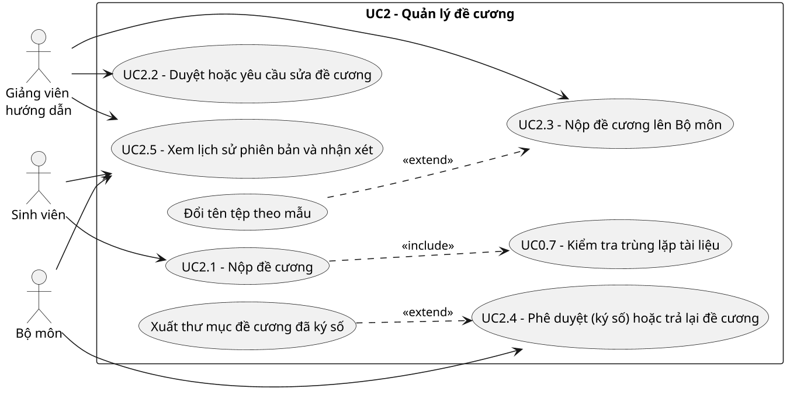
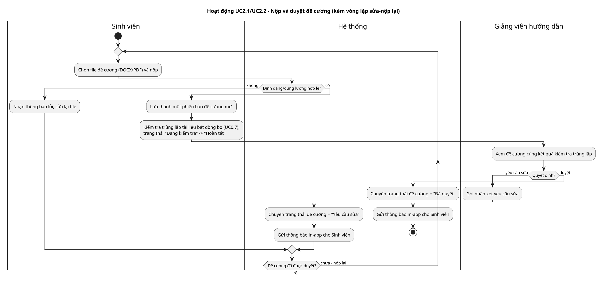

### 2.6.2. Đặc tả UC2 – Quản lý đề cương

> **Mã PI:** 1.3 — **Yêu cầu:** ANLS-05

UC2 – Quản lý đề cương được tách thành 3 UC con: UC2.1 Nộp đề cương, UC2.2 Duyệt hoặc yêu cầu sửa đề cương, UC2.3 Xem lịch sử phiên bản và nhận xét.

#### UC2.1 – Nộp đề cương

| Thuộc tính | Nội dung |
|---|---|
| Mã UC | UC2.1 |
| Tên UC | Nộp đề cương |
| Tác nhân | Sinh viên |
| Mô tả | Sinh viên nộp đề cương dạng DOCX hoặc PDF cho đề tài của mình; mỗi lần nộp tạo một phiên bản mới, kích hoạt kiểm tra trùng lặp tài liệu (UC0.7). |
| Tiền điều kiện | Sinh viên đã đăng nhập; đề tài của Sinh viên ở trạng thái "Đã phân công" |
| Hậu điều kiện | Một phiên bản đề cương mới được lưu, gắn với đề tài; kết quả kiểm tra trùng lặp đang ở trạng thái "Đang kiểm tra" hoặc đã "Hoàn tất" |
| Yêu cầu liên quan | FR-DC-01, FR-DC-02 |
| Màn hình | MH-08 |

**Luồng sự kiện chính**

1. Sinh viên mở màn hình nộp đề cương (MH-08).
2. Sinh viên chọn file đề cương (DOCX hoặc PDF) và xác nhận nộp.
3. Hệ thống kiểm tra định dạng và dung lượng file.
4. Hệ thống lưu file thành một phiên bản đề cương mới (số phiên bản tăng dần).
5. Hệ thống gọi UC0.7 (Kiểm tra trùng lặp tài liệu) chạy bất đồng bộ, đánh dấu trạng thái kiểm tra là "Đang kiểm tra".
6. Hệ thống thông báo nộp thành công cho Sinh viên; khi UC0.7 hoàn tất, trạng thái kiểm tra chuyển "Hoàn tất" và Giảng viên hướng dẫn nhận thông báo có đề cương mới cần duyệt.

**Luồng thay thế**

- **A1** (rẽ nhánh từ bước 4): Đây là lần nộp lại sau khi bị yêu cầu sửa (UC2.2); hệ thống vẫn tạo phiên bản mới, không ghi đè phiên bản cũ, và giữ liên kết tới nhận xét của lần duyệt trước.

**Ngoại lệ**

- **E1**: File sai định dạng (không phải DOCX/PDF) hoặc vượt quá dung lượng tối đa (NFR-06) → hệ thống từ chối lưu, thông báo lý do, không tạo phiên bản mới.
- **E2**: Dịch vụ AI (UC0.7) không phản hồi hoặc lỗi khi kiểm tra → hệ thống vẫn giữ phiên bản đề cương đã nộp, đánh dấu trạng thái kiểm tra là "Lỗi" (có thể kiểm tra lại), không chặn Giảng viên hướng dẫn duyệt đề cương.

#### UC2.2 – Duyệt hoặc yêu cầu sửa đề cương

| Thuộc tính | Nội dung |
|---|---|
| Mã UC | UC2.2 |
| Tên UC | Duyệt hoặc yêu cầu sửa đề cương |
| Tác nhân | Giảng viên hướng dẫn |
| Mô tả | Giảng viên hướng dẫn xem đề cương mới nhất cùng kết quả kiểm tra trùng lặp, quyết định duyệt hoặc yêu cầu Sinh viên sửa kèm nhận xét. |
| Tiền điều kiện | Giảng viên hướng dẫn đã đăng nhập; tồn tại một phiên bản đề cương của Sinh viên mình hướng dẫn đang chờ duyệt |
| Hậu điều kiện | Đề cương chuyển trạng thái "Đã duyệt" (kết thúc UC2), hoặc "Yêu cầu sửa" (Sinh viên phải nộp lại — quay lại UC2.1) |
| Yêu cầu liên quan | FR-DC-03, FR-DC-04 |
| Màn hình | MH-09, MH-14 |

**Luồng sự kiện chính**

1. Giảng viên hướng dẫn mở màn hình duyệt đề cương (MH-09), chọn một đề cương đang chờ duyệt.
2. Hệ thống hiển thị nội dung đề cương cùng panel kết quả kiểm tra trùng lặp (tỷ lệ tổng, đồ án trùng, đoạn trùng — chi tiết ở MH-14, xem UC0.7).
3. Giảng viên hướng dẫn xem xét nội dung và kết quả kiểm tra, quyết định duyệt.
4. Hệ thống chuyển trạng thái đề cương sang "Đã duyệt" và gửi thông báo in-app cho Sinh viên.

**Luồng thay thế**

- **A1** (rẽ nhánh từ bước 3): Giảng viên hướng dẫn yêu cầu sửa, nhập nhận xét cụ thể; hệ thống chuyển trạng thái sang "Yêu cầu sửa" và gửi thông báo in-app cho Sinh viên; Sinh viên thực hiện lại UC2.1 để nộp phiên bản mới, quy trình lặp lại từ bước 1 cho đến khi được duyệt.

**Ngoại lệ**

- **E1**: Kết quả kiểm tra trùng lặp vẫn ở trạng thái "Đang kiểm tra" khi Giảng viên hướng dẫn mở màn hình duyệt → hệ thống vẫn cho phép xem nội dung đề cương và duyệt/yêu cầu sửa, chỉ panel kết quả trùng lặp hiển thị "Đang kiểm tra, chưa có kết quả".

#### UC2.3 – Xem lịch sử phiên bản và nhận xét

| Thuộc tính | Nội dung |
|---|---|
| Mã UC | UC2.3 |
| Tên UC | Xem lịch sử phiên bản và nhận xét |
| Tác nhân | Sinh viên, Giảng viên hướng dẫn |
| Mô tả | Sinh viên và Giảng viên hướng dẫn xem lại toàn bộ các phiên bản đề cương đã nộp, cùng nhận xét gắn với từng lần duyệt. |
| Tiền điều kiện | Người dùng đã đăng nhập; đề tài đã có ít nhất một phiên bản đề cương |
| Hậu điều kiện | Danh sách phiên bản (kèm ngày nộp, trạng thái, nhận xét nếu có) được hiển thị |
| Yêu cầu liên quan | FR-DC-05 |
| Màn hình | MH-08 |

**Luồng sự kiện chính**

1. Người dùng mở tab "Lịch sử phiên bản" trên màn hình đề cương (MH-08).
2. Hệ thống liệt kê các phiên bản theo thứ tự thời gian, mỗi phiên bản kèm trạng thái (Đang kiểm tra/Đã duyệt/Yêu cầu sửa) và nhận xét của Giảng viên hướng dẫn (nếu đã duyệt/yêu cầu sửa phiên bản đó).
3. Người dùng chọn xem chi tiết một phiên bản (tải file hoặc xem nội dung đã trích xuất).

**Luồng thay thế**

- Không có luồng thay thế.

**Ngoại lệ**

- Không có ngoại lệ đáng kể (UC chỉ đọc dữ liệu).

