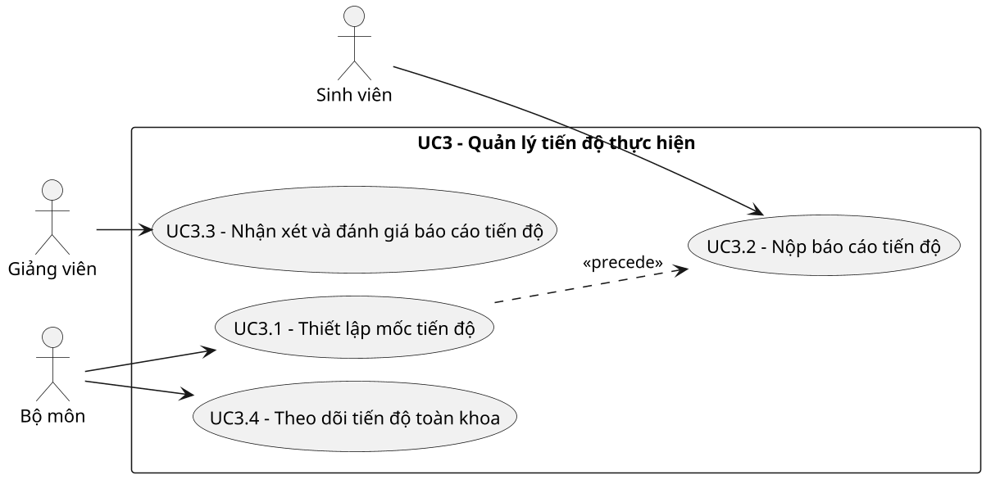

### 2.6.3. Đặc tả UC3 – Quản lý tiến độ thực hiện

> **Mã PI:** 1.3 — **Yêu cầu:** ANLS-05

UC3 – Quản lý tiến độ thực hiện được tách thành 4 UC con: UC3.1 Thiết lập mốc tiến độ, UC3.2 Nộp báo cáo tiến độ, UC3.3 Nhận xét và đánh giá báo cáo tiến độ, UC3.4 Theo dõi tiến độ toàn khoa.

#### UC3.1 – Thiết lập mốc tiến độ

| Thuộc tính | Nội dung |
|---|---|
| Mã UC | UC3.1 |
| Tên UC | Thiết lập mốc tiến độ |
| Tác nhân | Bộ môn |
| Mô tả | Bộ môn thiết lập các mốc tiến độ cố định (tên mốc, hạn nộp) áp dụng cho toàn bộ đợt đồ án đang mở. |
| Tiền điều kiện | Bộ môn đã đăng nhập; tồn tại một đợt đồ án đang mở |
| Hậu điều kiện | Danh sách mốc tiến độ của đợt được tạo hoặc cập nhật, áp dụng cho mọi Sinh viên thuộc đợt |
| Yêu cầu liên quan | FR-TD-01 |
| Màn hình | MH-04 |

**Luồng sự kiện chính**

1. Bộ môn mở màn hình quản lý tiến độ toàn khoa (MH-04), chọn đợt đồ án đang mở.
2. Bộ môn thêm mốc mới (tên mốc, hạn nộp) hoặc sửa hạn nộp của mốc đã có.
3. Hệ thống lưu danh sách mốc, áp dụng cho toàn bộ Sinh viên thuộc đợt.

**Luồng thay thế**

- **A1**: Bộ môn xóa một mốc chưa có Sinh viên nào nộp báo cáo; hệ thống cho phép xóa. Nếu mốc đã có báo cáo nộp, hệ thống từ chối xóa và gợi ý sửa hạn thay vì xóa.

**Ngoại lệ**

- **E1**: Hạn nộp của mốc mới nhập nằm ngoài khoảng thời gian đợt đồ án (trước ngày mở hoặc sau ngày đóng đợt) → hệ thống từ chối lưu và thông báo lý do.

#### UC3.2 – Nộp báo cáo tiến độ

| Thuộc tính | Nội dung |
|---|---|
| Mã UC | UC3.2 |
| Tên UC | Nộp báo cáo tiến độ |
| Tác nhân | Sinh viên |
| Mô tả | Sinh viên nộp báo cáo tiến độ theo từng mốc đã thiết lập, gồm nội dung mô tả công việc và file đính kèm tùy chọn. |
| Tiền điều kiện | Sinh viên đã đăng nhập; đề cương đã được duyệt (UC2.2); tồn tại ít nhất một mốc tiến độ chưa nộp báo cáo |
| Hậu điều kiện | Báo cáo tiến độ của mốc được ghi nhận, gắn với Sinh viên và mốc tương ứng |
| Yêu cầu liên quan | FR-TD-02 |
| Màn hình | MH-10 |

**Luồng sự kiện chính**

1. Sinh viên mở màn hình báo cáo tiến độ (MH-10), chọn mốc cần nộp.
2. Sinh viên nhập nội dung mô tả công việc đã thực hiện, đính kèm file (tùy chọn).
3. Hệ thống ghi nhận báo cáo, gắn với mốc và đánh dấu Sinh viên đã nộp đúng hạn (nếu nộp trước hạn mốc).

**Luồng thay thế**

- **A1**: Sinh viên nộp lại báo cáo cho cùng một mốc trước khi Giảng viên hướng dẫn nhận xét; hệ thống ghi đè nội dung báo cáo của mốc đó (không tạo phiên bản như đề cương, vì tiến độ không cần giữ lịch sử soạn thảo).

**Ngoại lệ**

- **E1**: Sinh viên nộp sau hạn của mốc → hệ thống vẫn nhận báo cáo nhưng đánh dấu "Nộp trễ", dữ liệu này được UC3.4 dùng để tính Sinh viên trễ mốc.

#### UC3.3 – Nhận xét và đánh giá báo cáo tiến độ

| Thuộc tính | Nội dung |
|---|---|
| Mã UC | UC3.3 |
| Tên UC | Nhận xét và đánh giá báo cáo tiến độ |
| Tác nhân | Giảng viên hướng dẫn |
| Mô tả | Giảng viên hướng dẫn xem báo cáo tiến độ của Sinh viên mình hướng dẫn theo từng mốc, ghi nhận xét và đánh giá. |
| Tiền điều kiện | Giảng viên hướng dẫn đã đăng nhập; Sinh viên mình hướng dẫn đã nộp báo cáo cho một mốc |
| Hậu điều kiện | Báo cáo tiến độ có nhận xét và đánh giá của Giảng viên hướng dẫn; Sinh viên nhận thông báo in-app |
| Yêu cầu liên quan | FR-TD-03 |
| Màn hình | MH-10 |

**Luồng sự kiện chính**

1. Giảng viên hướng dẫn mở màn hình báo cáo tiến độ (MH-10), chọn Sinh viên và mốc cần xem.
2. Giảng viên hướng dẫn đọc nội dung báo cáo (và file đính kèm nếu có).
3. Giảng viên hướng dẫn nhập nhận xét và đánh giá (ví dụ: Đạt/Cần cải thiện/Chưa đạt).
4. Hệ thống lưu nhận xét, gửi thông báo in-app cho Sinh viên.

**Luồng thay thế**

- Không có luồng thay thế.

**Ngoại lệ**

- **E1**: Sinh viên chưa nộp báo cáo cho mốc đã quá hạn → Giảng viên hướng dẫn vẫn có thể ghi nhận xét "Chưa nộp" để đồng bộ với dashboard toàn khoa (UC3.4).

#### UC3.4 – Theo dõi tiến độ toàn khoa

| Thuộc tính | Nội dung |
|---|---|
| Mã UC | UC3.4 |
| Tên UC | Theo dõi tiến độ toàn khoa |
| Tác nhân | Bộ môn |
| Mô tả | Bộ môn xem dashboard tổng hợp tiến độ của toàn bộ Sinh viên trong đợt đồ án; hệ thống tự động đánh dấu Sinh viên trễ mốc. |
| Tiền điều kiện | Bộ môn đã đăng nhập; đợt đồ án đã có ít nhất một mốc tiến độ |
| Hậu điều kiện | Dashboard hiển thị trạng thái tiến độ (đúng hạn/trễ hạn/chưa nộp) của mọi Sinh viên theo từng mốc |
| Yêu cầu liên quan | FR-TD-04 |
| Màn hình | MH-04 |

**Luồng sự kiện chính**

1. Bộ môn mở màn hình dashboard tiến độ toàn khoa (MH-04).
2. Hệ thống liệt kê mọi Sinh viên trong đợt, trạng thái nộp báo cáo theo từng mốc.
3. Đến hạn một mốc mà Sinh viên chưa nộp báo cáo, hệ thống tự động đánh dấu Sinh viên đó "Trễ mốc" trên dashboard, không cần Bộ môn thao tác thủ công.

**Luồng thay thế**

- **A1**: Bộ môn lọc danh sách theo trạng thái "Trễ mốc" để xử lý ưu tiên.

**Ngoại lệ**

- Không có ngoại lệ đáng kể (UC chỉ đọc dữ liệu và cảnh báo tự động theo thời gian).
