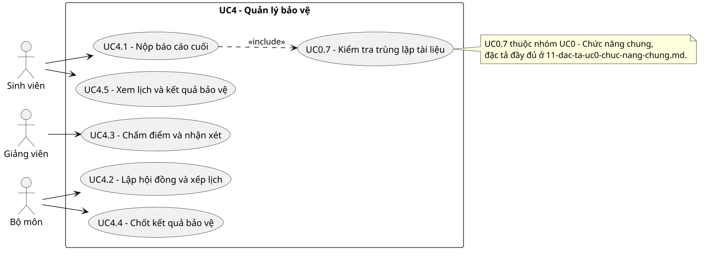
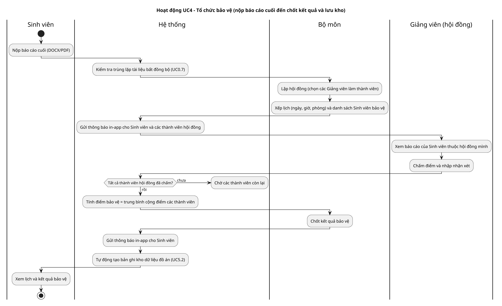

### 2.6.4. Đặc tả UC4 – Quản lý bảo vệ

> **Mã PI:** 1.3 — **Yêu cầu:** ANLS-05

UC4 – Quản lý bảo vệ được tách thành 5 UC con: UC4.1 Nộp báo cáo cuối, UC4.2 Lập hội đồng và xếp lịch, UC4.3 Chấm điểm và nhận xét, UC4.4 Chốt kết quả bảo vệ, UC4.5 Xem lịch và kết quả bảo vệ.

#### UC4.1 – Nộp báo cáo cuối

| Thuộc tính | Nội dung |
|---|---|
| Mã UC | UC4.1 |
| Tên UC | Nộp báo cáo cuối |
| Tác nhân | Sinh viên |
| Mô tả | Sinh viên nộp báo cáo cuối dạng DOCX hoặc PDF; lần nộp này kích hoạt kiểm tra trùng lặp nội dung (UC0.7) trước khi Bộ môn lập hội đồng. |
| Tiền điều kiện | Sinh viên đã đăng nhập; đề cương đã được duyệt; các mốc tiến độ đã hoàn thành |
| Hậu điều kiện | Báo cáo cuối được lưu, gắn với đề tài; kết quả kiểm tra trùng lặp đang "Đang kiểm tra" hoặc đã "Hoàn tất" |
| Yêu cầu liên quan | FR-BV-01 |
| Màn hình | MH-08 (tab Báo cáo cuối), MH-14 |

**Luồng sự kiện chính**

1. Sinh viên mở tab "Báo cáo cuối" trên màn hình đề cương (MH-08), chọn file DOCX/PDF và nộp.
2. Hệ thống kiểm tra định dạng và dung lượng file (như UC2.1).
3. Hệ thống lưu báo cáo cuối, gọi UC0.7 (Kiểm tra trùng lặp tài liệu) chạy bất đồng bộ.
4. Sinh viên nhận thông báo nộp thành công; kết quả kiểm tra trùng lặp hiển thị ở MH-14 khi hoàn tất.

**Luồng thay thế**

- Không có luồng thay thế (khác UC2.1, báo cáo cuối chỉ nộp một lần chính thức trước khi Bộ môn lập hội đồng; không có vòng lặp sửa-duyệt ở bước này).

**Ngoại lệ**

- **E1**: File sai định dạng hoặc quá dung lượng (NFR-06) → hệ thống từ chối lưu, thông báo lý do.
- **E2**: Dịch vụ AI không phản hồi khi kiểm tra → hệ thống đánh dấu trạng thái "Lỗi" (có thể kiểm tra lại), không chặn Bộ môn lập hội đồng ở UC4.2.

#### UC4.2 – Lập hội đồng và xếp lịch

| Thuộc tính | Nội dung |
|---|---|
| Mã UC | UC4.2 |
| Tên UC | Lập hội đồng và xếp lịch |
| Tác nhân | Bộ môn |
| Mô tả | Bộ môn chọn các Giảng viên làm thành viên hội đồng, xếp ngày/giờ/phòng bảo vệ và danh sách Sinh viên bảo vệ theo hội đồng đó. |
| Tiền điều kiện | Bộ môn đã đăng nhập; tồn tại Sinh viên đã nộp báo cáo cuối và chưa được xếp vào hội đồng nào |
| Hậu điều kiện | Một hội đồng được tạo với danh sách thành viên Giảng viên, lịch (ngày/giờ/phòng) và danh sách Sinh viên bảo vệ; các bên liên quan nhận thông báo in-app |
| Yêu cầu liên quan | FR-BV-02, FR-BV-03 |
| Màn hình | MH-11 |

**Luồng sự kiện chính**

1. Bộ môn mở màn hình lập hội đồng (MH-11).
2. Bộ môn chọn các Giảng viên làm thành viên hội đồng.
3. Bộ môn xếp ngày, giờ, phòng bảo vệ và chọn danh sách Sinh viên bảo vệ theo hội đồng.
4. Hệ thống lưu hội đồng và lịch, gửi thông báo in-app cho các Sinh viên và Giảng viên liên quan.

**Luồng thay thế**

- **A1**: Bộ môn sửa lịch hoặc thành viên của một hội đồng đã tạo trước khi buổi bảo vệ diễn ra; hệ thống cập nhật và gửi lại thông báo.

**Ngoại lệ**

- **E1**: Bộ môn chọn trùng ngày/giờ/phòng cho hai hội đồng khác nhau → hệ thống cảnh báo trùng lịch nhưng vẫn cho phép lưu (xử lý xung đột lịch tự động không thuộc phạm vi đồ án — xem "Out of Scope"), Bộ môn tự quyết định xử lý.

#### UC4.3 – Chấm điểm và nhận xét

| Thuộc tính | Nội dung |
|---|---|
| Mã UC | UC4.3 |
| Tên UC | Chấm điểm và nhận xét |
| Tác nhân | Giảng viên (thành viên hội đồng) |
| Mô tả | Giảng viên được phân vào hội đồng xem báo cáo của Sinh viên và nhập điểm kèm nhận xét. Một Giảng viên chỉ xem và chấm được Sinh viên thuộc hội đồng mà Giảng viên đó là thành viên — không xem được báo cáo của hội đồng khác. |
| Tiền điều kiện | Giảng viên đã đăng nhập và được phân vào ít nhất một hội đồng (UC4.2); hội đồng đã đến hoặc qua ngày bảo vệ |
| Hậu điều kiện | Điểm và nhận xét của Giảng viên đó cho Sinh viên được ghi nhận |
| Yêu cầu liên quan | FR-BV-04 |
| Màn hình | MH-12 |

**Luồng sự kiện chính**

1. Giảng viên mở màn hình chấm điểm (MH-12), hệ thống chỉ hiển thị các Sinh viên thuộc hội đồng mà Giảng viên này là thành viên.
2. Giảng viên xem báo cáo cuối và kết quả kiểm tra trùng lặp của Sinh viên.
3. Giảng viên nhập điểm và nhận xét cho Sinh viên đó.
4. Hệ thống lưu điểm và nhận xét của thành viên này.

**Luồng thay thế**

- Không có luồng thay thế.

**Ngoại lệ**

- **E1**: Giảng viên cố truy cập báo cáo của một Sinh viên thuộc hội đồng khác (ví dụ qua URL trực tiếp) → server từ chối với HTTP 403 (NFR-04), không chỉ ẩn trên giao diện.

#### UC4.4 – Chốt kết quả bảo vệ

| Thuộc tính | Nội dung |
|---|---|
| Mã UC | UC4.4 |
| Tên UC | Chốt kết quả bảo vệ |
| Tác nhân | Bộ môn |
| Mô tả | Bộ môn chốt kết quả bảo vệ của một Sinh viên sau khi toàn bộ thành viên hội đồng đã chấm điểm; hệ thống tính điểm cuối bằng trung bình cộng điểm các thành viên. |
| Tiền điều kiện | Bộ môn đã đăng nhập; mọi thành viên hội đồng của Sinh viên đó đã chấm điểm (UC4.3) |
| Hậu điều kiện | Kết quả bảo vệ của Sinh viên (điểm trung bình cộng) được chốt, không thể sửa điểm thành viên sau khi chốt; kích hoạt UC5.2 (Lưu đồ án vào kho) |
| Yêu cầu liên quan | FR-BV-05, FR-BV-06 |
| Màn hình | MH-11 |

**Luồng sự kiện chính**

1. Bộ môn mở màn hình lập hội đồng/kết quả (MH-11), chọn một Sinh viên đã có đủ điểm từ mọi thành viên hội đồng.
2. Hệ thống tính điểm bảo vệ = trung bình cộng điểm các thành viên đã chấm.
3. Bộ môn xác nhận chốt kết quả.
4. Hệ thống lưu kết quả cuối, gửi thông báo in-app cho Sinh viên, và tự động kích hoạt UC5.2 để đưa đồ án vào kho.

**Luồng thay thế**

- Không có luồng thay thế.

**Ngoại lệ**

- **E1**: Bộ môn cố chốt kết quả khi chưa đủ mọi thành viên hội đồng chấm điểm → hệ thống từ chối thao tác chốt, chỉ chốt được khi mọi thành viên đã chấm.

#### UC4.5 – Xem lịch và kết quả bảo vệ

| Thuộc tính | Nội dung |
|---|---|
| Mã UC | UC4.5 |
| Tên UC | Xem lịch và kết quả bảo vệ |
| Tác nhân | Sinh viên |
| Mô tả | Sinh viên xem lịch bảo vệ của mình (ngày, giờ, phòng, hội đồng) và kết quả bảo vệ sau khi đã được Bộ môn chốt. |
| Tiền điều kiện | Sinh viên đã đăng nhập; đã được xếp vào một hội đồng (UC4.2) |
| Hậu điều kiện | Thông tin lịch bảo vệ và (nếu đã chốt) kết quả bảo vệ được hiển thị |
| Yêu cầu liên quan | FR-BV-07 |
| Màn hình | MH-02 |

**Luồng sự kiện chính**

1. Sinh viên mở dashboard của mình (MH-02).
2. Hệ thống hiển thị lịch bảo vệ (ngày, giờ, phòng, danh sách hội đồng) nếu đã được xếp lịch.
3. Sau khi Bộ môn chốt kết quả, hệ thống hiển thị điểm bảo vệ trên cùng màn hình.

**Luồng thay thế**

- Không có luồng thay thế.

**Ngoại lệ**

- Không có ngoại lệ đáng kể (UC chỉ đọc dữ liệu).

