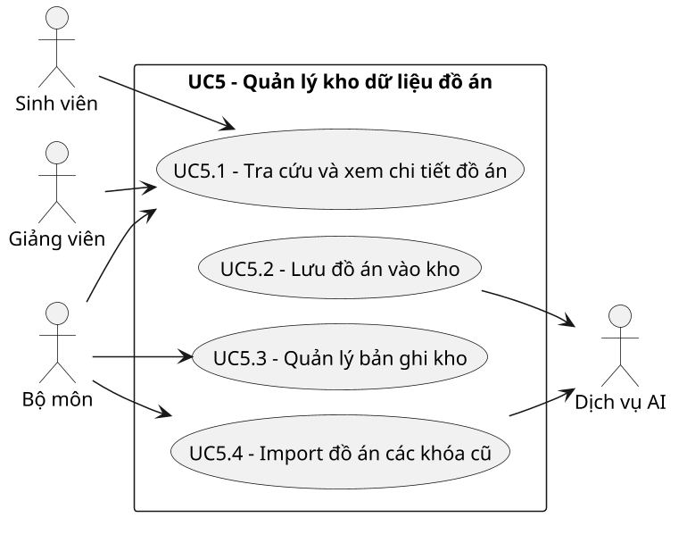

### 2.6.5. Đặc tả UC5 – Quản lý kho dữ liệu đồ án

> **Mã PI:** 1.3 — **Yêu cầu:** ANLS-05

UC5 – Quản lý kho dữ liệu đồ án được tách thành 4 UC con: UC5.1 Tra cứu và xem chi tiết đồ án, UC5.2 Lưu đồ án vào kho, UC5.3 Quản lý bản ghi kho, UC5.4 Import đồ án các khóa cũ.

#### UC5.1 – Tra cứu và xem chi tiết đồ án

| Thuộc tính | Nội dung |
|---|---|
| Mã UC | UC5.1 |
| Tên UC | Tra cứu và xem chi tiết đồ án |
| Tác nhân | Sinh viên, Giảng viên, Bộ môn |
| Mô tả | Mọi vai trò tìm kiếm/lọc đồ án trong kho theo khóa, từ khóa, Giảng viên hướng dẫn, và xem chi tiết một bản ghi (metadata, file báo cáo). |
| Tiền điều kiện | Người dùng đã đăng nhập; kho đã có ít nhất một bản ghi |
| Hậu điều kiện | Danh sách/kết quả tra cứu hoặc chi tiết một bản ghi kho được hiển thị |
| Yêu cầu liên quan | FR-KHO-02 |
| Màn hình | MH-13 |

**Luồng sự kiện chính**

1. Người dùng mở màn hình kho đồ án (MH-13).
2. Người dùng nhập bộ lọc: khóa, từ khóa, Giảng viên hướng dẫn.
3. Hệ thống trả về danh sách đồ án thỏa điều kiện, phân trang.
4. Người dùng chọn một bản ghi để xem chi tiết (metadata đầy đủ, tải file báo cáo).

**Luồng thay thế**

- Không có luồng thay thế.

**Ngoại lệ**

- Không có ngoại lệ đáng kể (UC chỉ đọc dữ liệu).

#### UC5.2 – Lưu đồ án vào kho

| Thuộc tính | Nội dung |
|---|---|
| Mã UC | UC5.2 |
| Tên UC | Lưu đồ án vào kho |
| Tác nhân | Hệ thống |
| Mô tả | Ngay sau khi Bộ môn chốt kết quả bảo vệ (UC4.4), hệ thống tự động tạo một bản ghi kho với metadata (khóa, đề tài, Sinh viên, GVHD, từ khóa, điểm, file báo cáo cuối) và đẩy văn bản báo cáo sang dịch vụ AI để tính embedding/index. |
| Tiền điều kiện | UC4.4 vừa hoàn tất (kết quả bảo vệ của Sinh viên đã được chốt) |
| Hậu điều kiện | Một bản ghi kho mới tồn tại, tra cứu được ở UC5.1; bản ghi đã được index trong dịch vụ AI để dùng làm nguồn so sánh trùng lặp cho các đồ án sau |
| Yêu cầu liên quan | FR-KHO-01, FR-KHO-05 |
| Màn hình | — (tự động, không có màn hình riêng) |

**Luồng sự kiện chính**

1. UC4.4 chốt kết quả bảo vệ của một Sinh viên.
2. Hệ thống tự động tạo bản ghi kho, điền metadata từ dữ liệu đề tài/đề cương/báo cáo/kết quả bảo vệ đã có.
3. Hệ thống gọi API `/ingest` của dịch vụ AI để tính embedding và đưa văn bản báo cáo vào chỉ mục so sánh trùng lặp.

**Luồng thay thế**

- Không có luồng thay thế (hoàn toàn tự động, không có tương tác người dùng).

**Ngoại lệ**

- **E1**: Dịch vụ AI không phản hồi khi ingest → bản ghi kho vẫn được tạo (không chặn việc lưu kho), đánh dấu trạng thái index là "Chưa index" để Bộ môn có thể yêu cầu index lại sau (qua UC5.3).

#### UC5.3 – Quản lý bản ghi kho

| Thuộc tính | Nội dung |
|---|---|
| Mã UC | UC5.3 |
| Tên UC | Quản lý bản ghi kho |
| Tác nhân | Bộ môn |
| Mô tả | Bộ môn thêm, sửa, xóa bản ghi kho dữ liệu đồ án (ví dụ: sửa metadata sai, xóa bản ghi trùng lặp do nhập nhầm). |
| Tiền điều kiện | Bộ môn đã đăng nhập |
| Hậu điều kiện | Bản ghi kho được thêm mới, cập nhật hoặc xóa |
| Yêu cầu liên quan | FR-KHO-03 |
| Màn hình | MH-13 |

**Luồng sự kiện chính**

1. Bộ môn mở màn hình kho đồ án (MH-13), chọn thao tác thêm/sửa/xóa trên một bản ghi.
2. Bộ môn nhập/sửa thông tin metadata (khóa, đề tài, Sinh viên, GVHD, từ khóa, điểm) hoặc xác nhận xóa.
3. Hệ thống lưu thay đổi.

**Luồng thay thế**

- **A1** (thêm mới thủ công): Bộ môn thêm một bản ghi kho không qua quy trình bảo vệ (ví dụ dữ liệu lịch sử thiếu); hệ thống vẫn đẩy sang dịch vụ AI để index như UC5.2 bước 3.

**Ngoại lệ**

- **E1**: Bộ môn xóa một bản ghi đã được dùng làm nguồn trong một kết quả kiểm tra trùng lặp trước đó → hệ thống vẫn cho xóa khỏi kho, nhưng lịch sử kết quả kiểm tra trùng lặp đã ghi nhận trước đó không bị xóa theo (giữ nguyên minh chứng lịch sử).

#### UC5.4 – Import đồ án các khóa cũ

| Thuộc tính | Nội dung |
|---|---|
| Mã UC | UC5.4 |
| Tên UC | Import đồ án các khóa cũ |
| Tác nhân | Bộ môn |
| Mô tả | Bộ môn import hàng loạt đồ án của các khóa trước (đã hoàn thành trước khi có hệ thống) vào kho, mỗi đồ án cũng được đẩy sang dịch vụ AI để index như UC5.2. |
| Tiền điều kiện | Bộ môn đã đăng nhập; có sẵn dữ liệu đồ án khóa cũ (file + metadata) để import |
| Hậu điều kiện | Các bản ghi kho mới được tạo hàng loạt, đã được index trong dịch vụ AI |
| Yêu cầu liên quan | FR-KHO-04, FR-KHO-05 |
| Màn hình | MH-13 |

**Luồng sự kiện chính**

1. Bộ môn mở màn hình kho đồ án (MH-13), chọn chức năng import.
2. Bộ môn tải lên danh sách đồ án khóa cũ (metadata + file báo cáo) theo mẫu quy định.
3. Hệ thống tạo bản ghi kho cho từng đồ án hợp lệ trong danh sách, đẩy văn bản sang dịch vụ AI để index.
4. Hệ thống báo cáo kết quả import (số bản ghi thành công, số bản ghi lỗi kèm lý do).

**Luồng thay thế**

- Không có luồng thay thế.

**Ngoại lệ**

- **E1**: Một số dòng trong danh sách import thiếu trường bắt buộc hoặc file không đúng định dạng → hệ thống bỏ qua các dòng lỗi, vẫn import thành công các dòng hợp lệ còn lại, và liệt kê rõ dòng nào bị bỏ qua kèm lý do.
