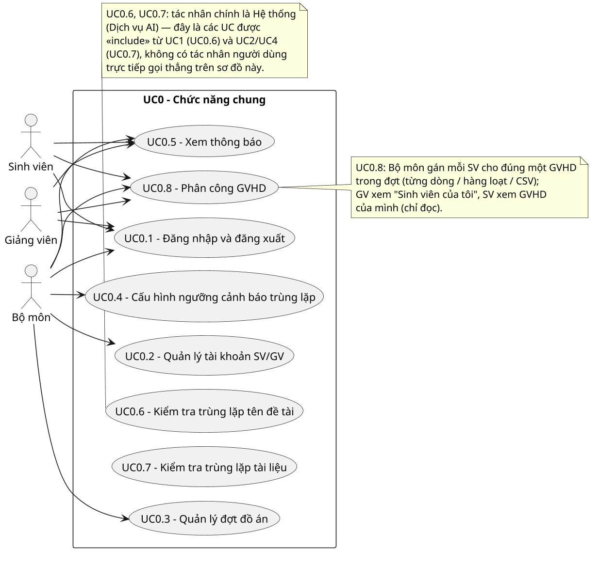

### 2.6.6. Đặc tả nhóm chức năng chung – UC0

> **Mã PI:** 1.3 — **Yêu cầu:** ANLS-05

UC0 – Chức năng chung gồm 8 UC con dùng chung bởi nhiều use case chính: UC0.1 Đăng nhập và đăng xuất, UC0.2 Quản lý tài khoản SV/GV, UC0.3 Quản lý đợt đồ án, UC0.4 Cấu hình ngưỡng cảnh báo trùng lặp, UC0.5 Xem thông báo, UC0.6 Kiểm tra trùng lặp tên đề tài, UC0.7 Kiểm tra trùng lặp tài liệu, UC0.8 Phân công GVHD. UC0.8 được thực hiện ngay sau khi mở đợt (UC0.3) và là điều kiện tiền đề của UC1 (sinh viên chỉ đề xuất/đăng ký đề tài với GVHD được phân công) cũng như của UC2–UC4 (GVHD duyệt đề cương, nhận xét tiến độ). UC0.6 và UC0.7 có tác nhân chính là **Hệ thống** (Dịch vụ AI) — chúng không được người dùng gọi trực tiếp mà được `<<include>>` từ UC1.1 (UC0.6) và từ UC2.1/UC4.1 (UC0.7).

#### UC0.1 – Đăng nhập và đăng xuất

| Thuộc tính | Nội dung |
|---|---|
| Mã UC | UC0.1 |
| Tên UC | Đăng nhập và đăng xuất |
| Tác nhân | Sinh viên, Giảng viên, Bộ môn |
| Mô tả | Người dùng đăng nhập bằng mã SV/GV hoặc email + mật khẩu, nhận JWT; phiên được giữ khi tải lại trang; đăng xuất được từ mọi trang. Server kiểm tra vai trò và quyền sở hữu dữ liệu trên mọi API khác. |
| Tiền điều kiện | Người dùng đã có tài khoản (do Bộ môn tạo, hoặc tài khoản seed) |
| Hậu điều kiện | Người dùng có JWT hợp lệ để gọi các API còn lại, hoặc phiên bị hủy sau khi đăng xuất |
| Yêu cầu liên quan | FR-TK-01, FR-TK-02, FR-TK-03 |
| Màn hình | MH-01 |

**Luồng sự kiện chính**

1. Người dùng mở màn hình đăng nhập (MH-01), nhập mã SV/GV hoặc email và mật khẩu.
2. Hệ thống xác thực mật khẩu (băm bcrypt, NFR-02), phát hành JWT chứa vai trò và thời hạn.
3. Người dùng dùng JWT cho các request tiếp theo; JWT được lưu phía client để giữ phiên khi tải lại trang.
4. Người dùng chọn đăng xuất từ menu trên bất kỳ trang nào; hệ thống xóa JWT phía client.

**Luồng thay thế**

- Không có luồng thay thế.

**Ngoại lệ**

- **E1**: Sai mã/email hoặc mật khẩu → hệ thống từ chối đăng nhập, không tiết lộ mật khẩu hay email nào tồn tại (thông báo chung "sai thông tin đăng nhập").
- **E2**: Tài khoản đang ở trạng thái khóa (UC0.2) → hệ thống từ chối đăng nhập dù đúng mật khẩu (NFR-05).
- **E3**: JWT hết hạn khi gọi API → hệ thống trả 401, client chuyển người dùng về màn hình đăng nhập (NFR-03).

#### UC0.2 – Quản lý tài khoản SV/GV

| Thuộc tính | Nội dung |
|---|---|
| Mã UC | UC0.2 |
| Tên UC | Quản lý tài khoản SV/GV |
| Tác nhân | Bộ môn |
| Mô tả | Bộ môn tạo, sửa, khóa tài khoản Sinh viên và Giảng viên. |
| Tiền điều kiện | Bộ môn đã đăng nhập |
| Hậu điều kiện | Tài khoản SV/GV được tạo mới, cập nhật thông tin, hoặc chuyển trạng thái khóa/mở khóa |
| Yêu cầu liên quan | FR-TK-04 |
| Màn hình | — (màn CRUD phụ, ngoài bộ mockup chính, D-14) |

**Luồng sự kiện chính**

1. Bộ môn mở màn hình quản lý tài khoản, chọn thêm/sửa/khóa một tài khoản SV hoặc GV.
2. Bộ môn nhập/sửa thông tin tài khoản (mã SV/GV, họ tên, email) hoặc chọn khóa/mở khóa.
3. Hệ thống lưu thay đổi; nếu khóa tài khoản, người dùng đó không đăng nhập được nữa (UC0.1 – E2).

**Luồng thay thế**

- Không có luồng thay thế.

**Ngoại lệ**

- **E1**: Bộ môn tạo tài khoản với mã SV/GV đã tồn tại → hệ thống từ chối, thông báo trùng mã.

#### UC0.3 – Quản lý đợt đồ án

| Thuộc tính | Nội dung |
|---|---|
| Mã UC | UC0.3 |
| Tên UC | Quản lý đợt đồ án |
| Tác nhân | Bộ môn |
| Mô tả | Bộ môn mở hoặc đóng đợt đồ án theo khóa; các thao tác đề xuất/đăng ký đề tài (UC1) chỉ thực hiện được khi đợt đang mở. |
| Tiền điều kiện | Bộ môn đã đăng nhập |
| Hậu điều kiện | Đợt đồ án mới được tạo (trạng thái "đang mở"), hoặc một đợt đang mở được đóng lại |
| Yêu cầu liên quan | FR-TK-05 |
| Màn hình | — (màn CRUD phụ, ngoài bộ mockup chính, D-14) |

**Luồng sự kiện chính**

1. Bộ môn mở màn hình quản lý đợt đồ án, tạo một đợt mới (tên đợt, khóa áp dụng) ở trạng thái "đang mở".
2. Sau khi mở đợt, Bộ môn phân công GVHD cho sinh viên của đợt (UC0.8).
3. Khi đợt kết thúc, Bộ môn đóng đợt; hệ thống chặn các thao tác đề xuất/đăng ký đề tài mới cho đợt đó (UC1.1 – E1).

**Luồng thay thế**

- Không có luồng thay thế.

**Ngoại lệ**

- Không có ngoại lệ đáng kể.

#### UC0.4 – Cấu hình ngưỡng cảnh báo trùng lặp

| Thuộc tính | Nội dung |
|---|---|
| Mã UC | UC0.4 |
| Tên UC | Cấu hình ngưỡng cảnh báo trùng lặp |
| Tác nhân | Bộ môn |
| Mô tả | Bộ môn cấu hình ngưỡng cảnh báo trùng lặp riêng cho tên đề tài (UC0.6) và cho nội dung tài liệu (UC0.7). |
| Tiền điều kiện | Bộ môn đã đăng nhập |
| Hậu điều kiện | Ngưỡng mới được lưu; áp dụng cho các lần kiểm tra trùng lặp sau khi lưu, không áp dụng hồi tố cho các kết quả kiểm tra đã có trước đó |
| Yêu cầu liên quan | FR-AI-05 |
| Màn hình | — (màn CRUD phụ, ngoài bộ mockup chính, D-14) |

**Luồng sự kiện chính**

1. Bộ môn mở màn hình cấu hình ngưỡng, nhập giá trị ngưỡng % cho tên đề tài và cho nội dung tài liệu.
2. Hệ thống lưu cấu hình mới.
3. Lần kiểm tra trùng lặp tiếp theo (UC0.6 hoặc UC0.7) dùng ngưỡng vừa lưu.

**Luồng thay thế**

- Không có luồng thay thế.

**Ngoại lệ**

- **E1**: Bộ môn nhập ngưỡng không hợp lệ (ví dụ âm hoặc lớn hơn 100%) → hệ thống từ chối lưu, thông báo giá trị hợp lệ.

#### UC0.5 – Xem thông báo

| Thuộc tính | Nội dung |
|---|---|
| Mã UC | UC0.5 |
| Tên UC | Xem thông báo |
| Tác nhân | Sinh viên, Giảng viên, Bộ môn |
| Mô tả | Người dùng nhận thông báo in-app (số lượng chưa đọc + danh sách, đánh dấu đã đọc) khi được Bộ môn phân công/đổi GVHD (UC0.8), khi có đề tài chờ GVHD duyệt, khi được giao đề tài hoặc có sinh viên đăng ký đề tài, khi đề tài/đề cương được duyệt/từ chối, có nhận xét mới, được phân vào hội đồng, hoặc có lịch bảo vệ. |
| Tiền điều kiện | Người dùng đã đăng nhập |
| Hậu điều kiện | Danh sách thông báo được hiển thị; thông báo đã xem được đánh dấu đã đọc |
| Yêu cầu liên quan | FR-TB-01 |
| Màn hình | chuông thông báo trên header của MH-02, MH-03, MH-04 |

**Luồng sự kiện chính**

1. Người dùng thấy số lượng thông báo chưa đọc trên biểu tượng chuông ở header (mọi màn hình sau đăng nhập).
2. Người dùng mở danh sách thông báo, xem nội dung từng thông báo.
3. Hệ thống đánh dấu thông báo đã xem là "đã đọc".

**Luồng thay thế**

- Không có luồng thay thế.

**Ngoại lệ**

- Không có ngoại lệ đáng kể (UC chỉ đọc dữ liệu).

#### UC0.6 – Kiểm tra trùng lặp tên đề tài

| Thuộc tính | Nội dung |
|---|---|
| Mã UC | UC0.6 |
| Tên UC | Kiểm tra trùng lặp tên đề tài |
| Tác nhân | Hệ thống (Dịch vụ AI) |
| Mô tả | Khi có tên đề tài mới được đề xuất (UC1.1), so sánh ngữ nghĩa với kho đề tài đã có (embedding tính sẵn lúc ingest), trả về đồng bộ top các đề tài tương tự kèm tỷ lệ % tương đồng, trong thời gian đáp ứng ngưỡng NFR-08 (≤ 5 giây). |
| Tiền điều kiện | UC1.1 vừa nhận một tên đề tài mới cần kiểm tra |
| Hậu điều kiện | Danh sách đề tài tương tự (có thể rỗng) kèm tỷ lệ % được trả về đồng bộ cho UC1.1 hiển thị |
| Yêu cầu liên quan | FR-AI-01 |
| Màn hình | MH-06 |

**Luồng sự kiện chính**

1. Web API gọi endpoint check-title của dịch vụ AI kèm tên đề tài vừa nhập và API key nội bộ.
2. Dịch vụ AI chuẩn hóa NFC, tách từ tiếng Việt, tính embedding của tên đề tài.
3. Dịch vụ AI so sánh với chỉ mục embedding tên đề tài đã có (FAISS, tính sẵn lúc ingest), lấy top-N đề tài có độ tương đồng cao nhất vượt ngưỡng đã cấu hình (UC0.4).
4. Dịch vụ AI trả đồng bộ danh sách top-N kèm tỷ lệ % cho Web API, hiển thị ở MH-06.

**Luồng thay thế**

- **A1**: Không có đề tài nào vượt ngưỡng → trả về danh sách rỗng, UC1.1 tiếp tục bình thường không hiển thị cảnh báo.

**Ngoại lệ**

- **E1**: Dịch vụ AI không phản hồi trong thời gian quy định (NFR-08) hoặc lỗi nội bộ → Web API vẫn cho UC1.1 tiếp tục, ghi nhận trạng thái kiểm tra là "chưa kiểm tra" (không chặn đề xuất đề tài).
- **E2**: Web API gọi thiếu API key nội bộ hoặc key sai → dịch vụ AI trả 401 (NFR-07), coi như lỗi E1 phía Web API.

#### UC0.7 – Kiểm tra trùng lặp tài liệu

| Thuộc tính | Nội dung |
|---|---|
| Mã UC | UC0.7 |
| Tên UC | Kiểm tra trùng lặp tài liệu |
| Tác nhân | Hệ thống (Dịch vụ AI) |
| Mô tả | Khi Sinh viên nộp đề cương (UC2.1) hoặc báo cáo cuối (UC4.1), trích xuất text từ DOCX/PDF, loại bỏ phần mẫu chung (tiêu đề mẫu, mục lục, tài liệu tham khảo), so sánh với các tài liệu khác trong kho và trả về tỷ lệ tương đồng tổng, danh sách đồ án trùng, và từng đoạn trùng highlight cạnh đoạn nguồn. Chạy bất đồng bộ, có 3 trạng thái: **Đang kiểm tra → Hoàn tất** (hoặc **Lỗi** nếu dịch vụ AI gặp sự cố). |
| Tiền điều kiện | UC2.1 hoặc UC4.1 vừa lưu một phiên bản tài liệu mới cần kiểm tra |
| Hậu điều kiện | Kết quả kiểm tra (tỷ lệ tổng, danh sách đồ án trùng, đoạn trùng) được lưu và hiển thị khi trạng thái chuyển "Hoàn tất" |
| Yêu cầu liên quan | FR-AI-02, FR-AI-03, FR-AI-04 |
| Màn hình | MH-09, MH-14 |

**Luồng sự kiện chính**

1. Web API gọi endpoint check-document của dịch vụ AI (bất đồng bộ) kèm file vừa nộp và API key nội bộ; đánh dấu trạng thái kiểm tra "Đang kiểm tra".
2. Dịch vụ AI trích xuất text từ DOCX (python-docx)/PDF (PyMuPDF), chuẩn hóa NFC.
3. Dịch vụ AI loại bỏ các phần mẫu chung (tiêu đề mẫu, mục lục, tài liệu tham khảo) dựa trên tài liệu mẫu chính thức đã thu thập.
4. Dịch vụ AI chia đoạn (paragraph-level), so sánh với các tài liệu khác trong kho bằng embedding + MinHash/LSH, tổng hợp tỷ lệ tương đồng tổng và danh sách đồ án trùng vượt ngưỡng đã cấu hình (UC0.4).
5. Dịch vụ AI trả kết quả cho Web API; trạng thái chuyển "Hoàn tất"; MH-09 (khi GVHD duyệt đề cương) và MH-14 (chi tiết kết quả) hiển thị tỷ lệ tổng, danh sách đồ án trùng, và từng đoạn trùng highlight cạnh đoạn nguồn.

**Luồng thay thế**

- **A1**: Không phát hiện đoạn nào vượt ngưỡng → kết quả "Hoàn tất" với tỷ lệ tổng thấp/0% và danh sách đồ án trùng rỗng.

**Ngoại lệ**

- **E1**: Dịch vụ AI lỗi trong lúc xử lý (file hỏng, không trích xuất được text) → trạng thái chuyển "Lỗi"; UC2.2/UC4.1 vẫn cho phép GVHD/Bộ môn xem tài liệu gốc và có thể yêu cầu kiểm tra lại, không bị chặn quy trình duyệt.
- **E2**: Thời gian xử lý vượt ngưỡng NFR-09 (30 giây) nhiều lần liên tiếp → ghi nhận là vấn đề hiệu năng cần xem xét lại ở Phase 4 khi đo thực tế trên corpus seed, không phải lỗi nghiệp vụ.

#### UC0.8 – Phân công GVHD

| Thuộc tính | Nội dung |
|---|---|
| Mã UC | UC0.8 |
| Tên UC | Phân công GVHD |
| Tác nhân | Bộ môn (thực hiện); Giảng viên, Sinh viên (xem kết quả) |
| Mô tả | Đầu mỗi đợt đồ án, Bộ môn phân công mỗi sinh viên cho đúng một Giảng viên hướng dẫn — tập sinh viên của một giảng viên trong đợt gọi là "lớp hướng dẫn". Bộ môn gán từng dòng, gán hàng loạt cho các sinh viên đã chọn, hoặc import tệp CSV; theo dõi số sinh viên mỗi giảng viên đang hướng dẫn để cân đối khối lượng. Giảng viên xem lớp hướng dẫn của mình (MH-16), sinh viên xem GVHD của mình trên trang tổng quan. |
| Tiền điều kiện | Bộ môn đã đăng nhập; đợt đồ án đã được tạo (UC0.3); tài khoản sinh viên và giảng viên đã có (UC0.2) |
| Hậu điều kiện | Mỗi sinh viên được gán có đúng một dòng phân công (đợt, sinh viên, giảng viên, thời điểm) trong đợt; sinh viên và giảng viên liên quan nhận thông báo in-app; từ đây sinh viên đề xuất/đăng ký đề tài với GVHD này (UC1) |
| Yêu cầu liên quan | FR-DT-05, FR-DT-08, FR-DT-09, FR-DT-11 |
| Màn hình | MH-15, MH-16 |

**Luồng sự kiện chính**

1. Bộ môn mở màn hình "Phân công GVHD" (MH-15) — từ menu hoặc từ thẻ "SV chưa phân công GVHD" trên trang tổng quan (MH-04) — và chọn đợt đồ án.
2. Hệ thống hiển thị thống kê (tổng sinh viên / đã phân công / chưa phân công), số sinh viên mỗi giảng viên đang hướng dẫn và bảng sinh viên kèm GVHD hiện tại và đề tài hiện tại; Bộ môn lọc theo từ khóa (MSSV, họ tên), GVHD hoặc tình trạng phân công.
3. Bộ môn chọn GVHD cho từng sinh viên ngay trên dòng, hoặc chọn nhiều sinh viên rồi gán hàng loạt cho một giảng viên, sau đó lưu.
4. Hệ thống kiểm tra các ràng buộc (BR-PC-01..BR-PC-04) cho từng sinh viên và lưu toàn bộ thay đổi trong một transaction.
5. Hệ thống gửi thông báo in-app cho từng sinh viên được gán/đổi GVHD và một thông báo tổng hợp cho mỗi giảng viên nhận thêm sinh viên; thống kê và tải theo giảng viên được cập nhật.

**Luồng thay thế**

- **A1** (thay cho bước 3–4, import CSV): Bộ môn chọn "Import CSV" và tải lên tệp mỗi dòng `ma_so_sinh_vien,ma_giang_vien` (dấu phẩy hoặc chấm phẩy, dòng tiêu đề tùy chọn); hệ thống lưu các dòng hợp lệ và trả về danh sách dòng lỗi kèm số dòng và lý do (không tìm thấy mã sinh viên/giảng viên, vi phạm BR-PC-03/BR-PC-04) để Bộ môn sửa và import lại.
- **A2** (đổi GVHD): Bộ môn chọn giảng viên khác cho một sinh viên đã được phân công; nếu sinh viên đang có đề tài "Chờ duyệt", đề tài đó chuyển sang GVHD mới duyệt (BR-PC-05).
- **A3** (gỡ phân công): Bộ môn bỏ chọn GVHD của một sinh viên; hệ thống xóa dòng phân công và báo cho sinh viên rằng mình chưa có GVHD.
- **A4** (Giảng viên xem lớp): Giảng viên mở "Sinh viên của tôi" (MH-16), xem danh sách sinh viên của mình theo từng đợt đang mở kèm đề tài hiện tại, chọn "Duyệt đề tài" (sang UC1.3) hoặc "Giao đề tài" (sang UC1.1 – A3).

**Ngoại lệ**

- **E1**: Sinh viên đã có đề tài "Đã phân công" trong đợt → hệ thống không cho đổi/gỡ GVHD của sinh viên đó (BR-PC-03); khi lưu từ màn hình, toàn bộ lần lưu bị từ chối kèm danh sách sinh viên vi phạm.
- **E2**: Gỡ GVHD của sinh viên đang có đề tài "Chờ duyệt" → hệ thống từ chối (BR-PC-04).
- **E3**: Giảng viên được chọn không tồn tại hoặc tài khoản đã bị khóa → hệ thống từ chối dòng đó.
- **E4**: Sinh viên, giảng viên gọi API phân công → hệ thống trả 403 (chỉ Bộ môn được phân công).

**Quy tắc nghiệp vụ**

| Mã | Quy tắc |
|---|---|
| BR-PC-01 | Trong một đợt đồ án, mỗi sinh viên có tối đa một GVHD — bảo đảm bằng ràng buộc duy nhất `uk_phan_cong_sv_dot (dot_do_an_id, sinh_vien_id)` trên bảng `phan_cong_huong_dan` (§3.2). |
| BR-PC-02 | Chỉ Bộ môn được tạo, đổi, gỡ phân công; giảng viên chỉ xem lớp hướng dẫn của mình, sinh viên chỉ xem GVHD của mình. |
| BR-PC-03 | Không đổi hoặc gỡ GVHD của sinh viên đã có đề tài "Đã phân công" trong đợt, vì đề cương, tiến độ và bảo vệ đều gắn với GVHD của đề tài đó. |
| BR-PC-04 | Không gỡ GVHD của sinh viên đang có đề tài "Chờ duyệt" (đề tài đó cần một GVHD để được duyệt). |
| BR-PC-05 | Khi đổi GVHD, đề tài "Chờ duyệt" và bản nháp do sinh viên đề xuất chuyển sang GVHD mới; bản nháp giảng viên cũ định giao cho sinh viên đó được gỡ sinh viên. |
