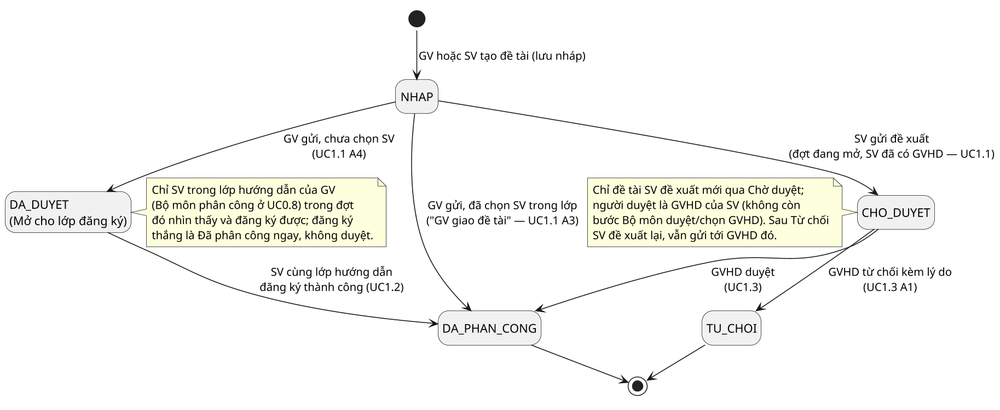
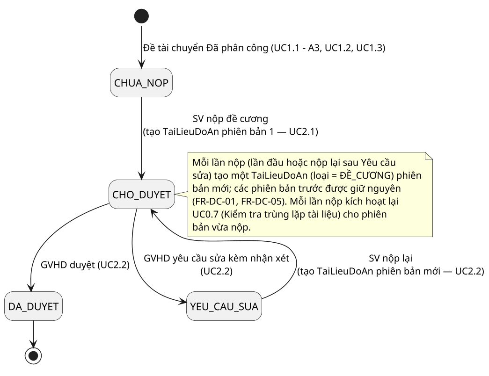
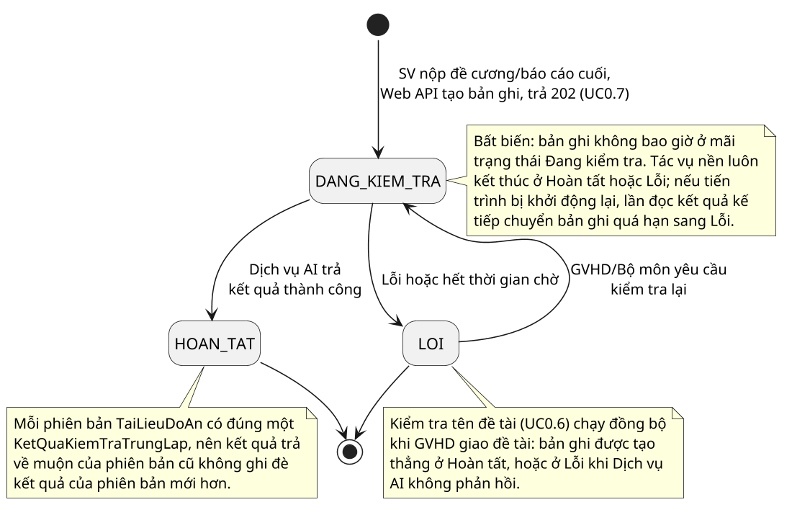

# Chương 3. Thiết kế

## 3.1. Sơ đồ lớp thực thể

> **Mã PI:** 2.1 — **Yêu cầu:** DSGN-01

Sơ đồ lớp thực thể mô hình hóa toàn bộ dữ liệu nghiệp vụ của hệ thống, đủ để phủ mọi yêu cầu chức năng ở §2.3 và mọi trường dữ liệu của các biểu mẫu MAU-01..MAU-07. Kế hoạch 01-02 (tracer) khởi tạo lát cắt UC1.1: `SinhVien`, `GiangVien`, `DotDoAn`, `DeTai`, `KetQuaKiemTraTrungLap`, `ChiTietTrungLap`. Kế hoạch 01-05 bổ sung 13 lớp — tài khoản & phân quyền, đề cương & tài liệu, tiến độ, hội đồng & bảo vệ, kho đồ án, thông báo và cấu hình ngưỡng — cùng ba máy trạng thái (đề tài, đề cương, kết quả kiểm tra trùng lặp). Khi điều chỉnh nghiệp vụ phân công GVHD đầu đợt (UC0.8, Alembic 0015), sơ đồ có thêm lớp thứ 20 `PhanCongHuongDan` và máy trạng thái đề tài được cập nhật theo luồng GVHD duyệt (§3.1.2).

### 3.1.1. Bảng lớp thực thể

| Lớp | Tên tiếng Việt | Mô tả | Yêu cầu liên quan |
|-----|----------------|-------|--------------------|
| TaiKhoan | Tài khoản | Thông tin đăng nhập và phân quyền dùng chung cho cả 3 vai trò; `SinhVien`/`GiangVien` là hồ sơ nghiệp vụ gắn 1-1 với một `TaiKhoan` (tài khoản vai trò Bộ môn không có hồ sơ riêng) | FR-TK-01, FR-TK-03 |
| SinhVien | Sinh viên | Hồ sơ sinh viên: mã số, họ tên, lớp, khoa; có thể đề xuất hoặc đăng ký một đề tài | FR-TK-04, FR-DT-01 |
| GiangVien | Giảng viên | Hồ sơ giảng viên: mã số, họ tên, học vị; có thể đề xuất đề tài, được phân công hướng dẫn, làm thành viên hội đồng | FR-TK-04, FR-DT-01 |
| DotDoAn | Đợt đồ án | Khung thời gian một khóa mở đợt làm đồ án; chứa các đề tài, các mốc tiến độ và bảng phân công GVHD của đợt đó | FR-TK-05 |
| PhanCongHuongDan | Phân công hướng dẫn | Một dòng phân công: trong một đợt đồ án, một Sinh viên được Bộ môn gán cho đúng một Giảng viên hướng dẫn (lớp hướng dẫn của GV), kèm thời điểm gán; là căn cứ để SV gửi đề tài tới GVHD, GV giao/mở đề tài cho lớp và GVHD duyệt đề tài | FR-DT-05, FR-DT-08, FR-DT-09, FR-DT-11 |
| MocTienDo | Mốc tiến độ | Một mốc báo cáo tiến độ cố định áp dụng cho toàn bộ đợt đồ án (mốc 1, mốc 2, mốc cuối...) | FR-TD-01 |
| DeTai | Đề tài | Đề tài đồ án, gắn với một đợt, người đề xuất là GV hoặc SV, trạng thái theo vòng đời Nháp → Chờ duyệt → Mở cho lớp đăng ký/Từ chối → Đã phân công (§3.1.2); `giang_vien_id` là GV đề xuất hoặc GVHD | FR-DT-01, FR-DT-03, FR-DT-04, FR-DT-06, FR-DT-07, FR-DT-10 |
| DeCuong | Đề cương | Hồ sơ đề cương của một đề tài đã phân công; theo dõi trạng thái vòng lặp nộp – duyệt – sửa | FR-DC-01, FR-DC-04 |
| TaiLieuDoAn | Tài liệu đồ án | Một phiên bản file được tải lên (đề cương, báo cáo tiến độ, báo cáo cuối); mỗi lần nộp lại tạo một bản ghi mới, giữ nguyên bản ghi cũ | FR-DC-01, FR-DC-02, FR-BV-01 |
| LuotDuyetDeCuong | Lượt duyệt đề cương | Một quyết định duyệt/yêu cầu sửa của GVHD cho một vòng nộp đề cương, kèm nhận xét | FR-DC-04, FR-DC-05 |
| BaoCaoTienDo | Báo cáo tiến độ | Báo cáo Sinh viên nộp theo từng mốc tiến độ, kèm nhận xét và đánh giá của GVHD | FR-TD-02, FR-TD-03, FR-TD-04 |
| HoiDong | Hội đồng | Một hội đồng bảo vệ: tên, ngày/giờ/phòng bảo vệ | FR-BV-02 |
| ThanhVienHoiDong | Thành viên hội đồng | Một Giảng viên tham gia một hội đồng với một vai trò cụ thể (chủ tịch, thư ký, ủy viên) | FR-BV-02, FR-BV-04 |
| LichBaoVe | Lịch bảo vệ | Vị trí bảo vệ của một Sinh viên (và đề tài của SV đó) trong một hội đồng cụ thể, kèm điểm trung bình và trạng thái đã chốt | FR-BV-03, FR-BV-07 |
| DiemBaoVe | Điểm bảo vệ | Điểm và nhận xét của từng thành viên hội đồng chấm cho một lịch bảo vệ | FR-BV-04, FR-BV-05, FR-BV-06 |
| DoAnKho | Đồ án kho | Bản ghi kho dữ liệu đồ án: khóa, tên đề tài, SV, GVHD, từ khóa, điểm; nguồn Hệ thống (tự động khi chốt bảo vệ) hoặc Import (khóa cũ) | FR-KHO-01, FR-KHO-02, FR-KHO-03, FR-KHO-04 |
| KetQuaKiemTraTrungLap | Kết quả kiểm tra trùng lặp | Bản ghi một lần gọi kiểm tra trùng lặp (tên đề tài hoặc tài liệu), lưu tỷ lệ tổng, ngưỡng áp dụng và đối tượng cụ thể được kiểm tra tại thời điểm đó | FR-DT-02, FR-AI-01, FR-AI-04 |
| ChiTietTrungLap | Chi tiết trùng lặp | Từng dòng chi tiết của một kết quả kiểm tra: đối tượng trùng, tỷ lệ, đoạn nguồn/đoạn trùng, vị trí tương ứng và nguồn trùng (không gian id `KhongGianNguon` + id) | FR-AI-02, FR-AI-03 |
| ThongBao | Thông báo | Thông báo in-app gửi cho một tài khoản khi có sự kiện liên quan (phân công GVHD, đề tài chờ duyệt, duyệt/từ chối, nhận xét mới, phân công hội đồng, lịch bảo vệ...) | FR-TB-01 |
| CauHinhNguong | Cấu hình ngưỡng | Ngưỡng cảnh báo trùng lặp do Bộ môn cấu hình, riêng cho tên đề tài và cho nội dung tài liệu | FR-AI-05 |

Ghi chú đọc bảng: cột "Yêu cầu liên quan" chỉ liệt kê các FR chính gắn trực tiếp với lớp; danh sách đầy đủ FR ↔ lớp ↔ bảng ↔ màn hình nằm ở `docs/truy-vet.md` (hoàn thiện ở kế hoạch 01-07).

### 3.1.2. Biểu đồ trạng thái Đề tài

| Từ | Sự kiện / tác nhân | Đến |
|----|---------------------|-----|
| (khởi tạo) | GV hoặc SV tạo đề tài mới, lưu nháp (UC1.1) | NHAP |
| NHAP | SV gửi đề xuất (đợt đang mở, SV đã có GVHD trong đợt — đề tài gắn ngay GVHD đó, UC1.1) | CHO_DUYET |
| NHAP | GV gửi đề tài đã chọn một SV trong lớp hướng dẫn — "GV giao đề tài" (UC1.1 – A3) | DA_PHAN_CONG |
| NHAP | GV gửi đề tài chưa chọn SV — "Mở cho lớp đăng ký" (UC1.1 – A4) | DA_DUYET |
| CHO_DUYET | GVHD của SV duyệt (UC1.3) | DA_PHAN_CONG |
| CHO_DUYET | GVHD của SV từ chối kèm lý do bắt buộc (UC1.3 – A1) | TU_CHOI |
| DA_DUYET | SV cùng lớp hướng dẫn đăng ký thành công (UC1.2) | DA_PHAN_CONG |

Hệ thống giữ nguyên 5 mã trạng thái; mã `DA_DUYET` nay mang nghĩa "Mở cho lớp đăng ký" (nhãn hiển thị trên giao diện) và `CHO_DUYET` chỉ còn xuất hiện với đề tài do sinh viên đề xuất. Mọi đường tới `DA_PHAN_CONG` đều đi qua GVHD đã được Bộ môn phân công (`PhanCongHuongDan`), không còn bước Bộ môn duyệt/chọn GVHD. `DA_PHAN_CONG` và `TU_CHOI` là hai trạng thái kết thúc vòng đời đăng ký/duyệt đề tài; sau `TU_CHOI` sinh viên tạo đề tài mới (vẫn gửi tới cùng GVHD).

### 3.1.3. Biểu đồ trạng thái Đề cương

| Từ | Sự kiện / tác nhân | Đến |
|----|---------------------|-----|
| (khởi tạo) | Đề tài chuyển Đã phân công (UC1.1 – A3, UC1.2 hoặc UC1.3) | CHUA_NOP |
| CHUA_NOP | SV nộp đề cương — tạo `TaiLieuDoAn` phiên bản 1 (UC2.1) | CHO_DUYET |
| CHO_DUYET | GVHD duyệt (UC2.2) | DA_DUYET |
| CHO_DUYET | GVHD yêu cầu sửa kèm nhận xét (UC2.2) | YEU_CAU_SUA |
| YEU_CAU_SUA | SV nộp lại — tạo `TaiLieuDoAn` phiên bản mới (UC2.2) | CHO_DUYET |

Mỗi lần vào lại `CHO_DUYET` (nộp lần đầu hoặc nộp lại) tạo một `TaiLieuDoAn` (loại `ĐỀ_CƯƠNG`) phiên bản mới và kích hoạt lại UC0.7 cho phiên bản đó; các phiên bản trước được giữ nguyên (FR-DC-01, FR-DC-05).

### 3.1.4. Biểu đồ trạng thái Kết quả kiểm tra trùng lặp

| Từ | Sự kiện / tác nhân | Đến |
|----|---------------------|-----|
| (khởi tạo) | Web API tạo bản ghi kiểm tra, trả 202 (UC0.7 — nộp đề cương/báo cáo) | DANG_KIEM_TRA |
| DANG_KIEM_TRA | Dịch vụ AI trả kết quả thành công | HOAN_TAT |
| DANG_KIEM_TRA | Timeout hoặc lỗi dịch vụ AI (NFR-09) | LOI |
| LOI | GVHD/Bộ môn yêu cầu kiểm tra lại | DANG_KIEM_TRA |

Bất biến bắt buộc: một bản ghi không bao giờ ở mãi trạng thái `DANG_KIEM_TRA` — timeout hoặc lỗi luôn chuyển sang `LOI` (cho phép kiểm tra lại). Mỗi phiên bản `TaiLieuDoAn` có đúng một `KetQuaKiemTraTrungLap` riêng (1-1, xem §3.1.1), nên kết quả của một phiên bản cũ hơn không bao giờ bị kết quả trả về muộn của phiên bản mới hơn ghi đè — đó luôn là hai bản ghi độc lập.
