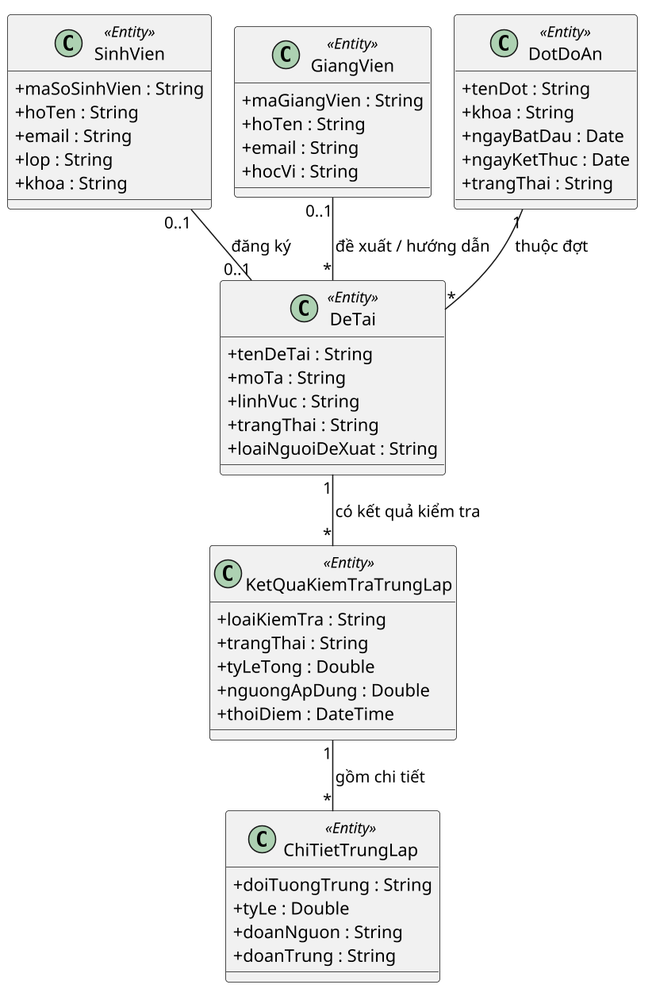

# Chương 3. Thiết kế

## 3.1. Sơ đồ lớp thực thể

> **Mã PI:** 2.1 — **Yêu cầu:** DSGN-01

Sơ đồ lớp thực thể dưới đây được xây dựng dần theo từng UC. Kế hoạch 01-02 (tracer) khởi tạo lát cắt UC1.1: `SinhVien`, `GiangVien`, `DotDoAn`, `DeTai`, `KetQuaKiemTraTrungLap`, `ChiTietTrungLap`. Kế hoạch 01-05 bổ sung các lớp còn lại (Đề cương, Báo cáo tiến độ, Hội đồng, Tài liệu đồ án) và máy trạng thái.

| Lớp | Tên tiếng Việt | Mô tả |
|-----|----------------|-------|
| SinhVien | Sinh viên | Tài khoản sinh viên, có thể đề xuất hoặc đăng ký một đề tài |
| GiangVien | Giảng viên | Tài khoản giảng viên, có thể đề xuất đề tài và được phân công hướng dẫn |
| DotDoAn | Đợt đồ án | Khung thời gian một khóa mở đợt làm đồ án, chứa các đề tài của đợt đó |
| DeTai | Đề tài | Đề tài đồ án, gắn với một đợt, có thể có người đề xuất là GV hoặc SV, trạng thái theo vòng đời Nháp → Chờ duyệt → Đã duyệt/Từ chối → Đã phân công |
| KetQuaKiemTraTrungLap | Kết quả kiểm tra trùng lặp | Bản ghi một lần gọi kiểm tra trùng lặp (tên đề tài hoặc tài liệu) gắn với một đề tài, lưu tỷ lệ tổng và ngưỡng áp dụng tại thời điểm kiểm tra |
| ChiTietTrungLap | Chi tiết trùng lặp | Từng dòng chi tiết của một kết quả kiểm tra: đối tượng trùng, tỷ lệ, đoạn nguồn/đoạn trùng tương ứng |
