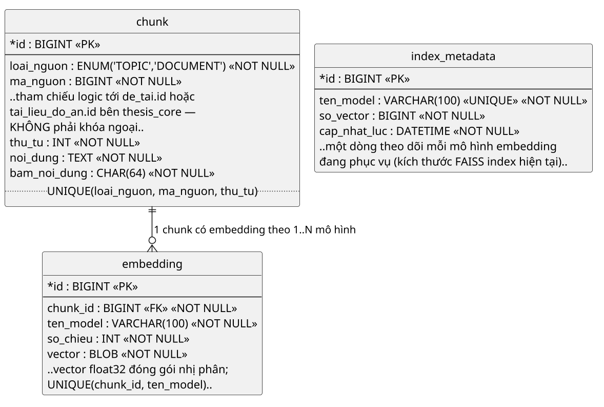

## 3.2. Thiết kế cơ sở dữ liệu

> **Mã PI:** 2.1 — **Yêu cầu:** DSGN-02

### 3.2.1. Nguyên tắc thiết kế

Hệ thống dùng **MySQL 8** với **hai schema trên cùng một server**: `thesis_core` (sở hữu bởi Web API — toàn bộ thực thể nghiệp vụ ở §3.1) và `thesis_ai` (sở hữu bởi Dịch vụ AI — embedding, chunk văn bản, metadata chỉ mục, xem §3.2.6). Đây là ranh giới sở hữu dữ liệu (schema ownership) làm cho kiến trúc SOA ở §3.3 là thật chứ không phải "một CSDL, hai tiến trình giả vờ là hai dịch vụ": **không có khóa ngoại và không có câu truy vấn nào băng qua hai schema** — Web API không bao giờ đọc/ghi trực tiếp vào `thesis_ai`, Dịch vụ AI không bao giờ đọc/ghi trực tiếp vào `thesis_core`. Trao đổi dữ liệu giữa hai schema chỉ qua REST nội bộ (`/ingest`, `/check-title`, `/check-document` — xem §3.3.5).

Các nguyên tắc áp dụng cho toàn bộ `thesis_core`:

- **Bảng mã tiếng Việt:** mọi bảng và cột văn bản dùng `CHARACTER SET utf8mb4 COLLATE utf8mb4_vietnamese_ci` (đặt ở mức database, kế thừa xuống bảng/cột), đảm bảo lưu trữ, so sánh và sắp xếp đúng tiếng Việt có dấu (NFR-13).
- **Chuẩn hóa Unicode NFC:** mọi văn bản (tên đề tài, họ tên, nội dung đề cương/báo cáo, nhận xét...) được chuẩn hóa **NFC** tại **mọi điểm nhập liệu** trước khi ghi vào CSDL — API request của client, văn bản trích xuất từ DOCX/PDF, import CSV hàng loạt (UC5.4) — để việc so sánh chuỗi (kiểm tra trùng mã, tra cứu) và so sánh ngữ nghĩa (Dịch vụ AI) không phụ thuộc vào dạng tổ hợp (NFD) hay dựng sẵn (NFC) của bàn phím/nguồn nhập (NFR-14).
- **Quản lý schema bằng migration:** `thesis_core` và `thesis_ai` mỗi schema có một bộ migration Alembic riêng (DEPL-01, Phase 2); không sửa cấu trúc bảng trực tiếp trên server.
- **Embedding tính sẵn lúc ingest:** `thesis_ai` chỉ lưu vector đã tính sẵn (NFR-11); không có bảng nào trong `thesis_core` lưu vector.


### 3.2.2. Lược đồ thesis_core

Lược đồ `thesis_core` gồm 19 bảng, khớp 1-1 với 19 lớp thực thể ở §3.1 (không có bảng liên kết N-N nào không map tới lớp — `thanh_vien_hoi_dong` và `diem_bao_ve` là các lớp liên kết đã được mô hình hóa tường minh thành lớp ở §3.1, không phải bảng kỹ thuật ẩn). Hình 3.5 ở trên thể hiện đầy đủ khóa chính, khóa ngoại, kiểu dữ liệu MySQL 8 và ràng buộc NOT NULL/UNIQUE của cả 19 bảng.

### 3.2.3. Từ điển dữ liệu

#### `tai_khoan`

| Cột | Kiểu | Null | Khóa | Mô tả |
|---|---|---|---|---|
| id | BIGINT | Không | PK | Định danh tài khoản |
| ma_dang_nhap | VARCHAR(50) | Không | UNIQUE | Mã SV/GV dùng để đăng nhập (FR-TK-01) |
| email | VARCHAR(150) | Không | UNIQUE | Email đăng nhập thay thế |
| mat_khau_bam | VARCHAR(255) | Không | — | Mật khẩu băm bcrypt (NFR-02) |
| vai_tro | ENUM('SINH_VIEN','GIANG_VIEN','BO_MON') | Không | — | Vai trò quyết định quyền truy cập (NFR-04) |
| bi_khoa | BOOLEAN | Không | — | Tài khoản bị Bộ môn khóa (NFR-05) |

#### `sinh_vien`

| Cột | Kiểu | Null | Khóa | Mô tả |
|---|---|---|---|---|
| id | BIGINT | Không | PK | Định danh sinh viên |
| tai_khoan_id | BIGINT | Không | FK, UNIQUE → tai_khoan | Tài khoản đăng nhập tương ứng |
| ma_so_sinh_vien | VARCHAR(20) | Có | UNIQUE | Mã số sinh viên |
| ho_ten | VARCHAR(150) | Có | — | Họ tên |
| email | VARCHAR(150) | Có | — | Email liên hệ |
| lop | VARCHAR(50) | Có | — | Lớp hành chính |
| khoa | VARCHAR(100) | Có | — | Khoa/Viện quản lý sinh viên |

#### `giang_vien`

| Cột | Kiểu | Null | Khóa | Mô tả |
|---|---|---|---|---|
| id | BIGINT | Không | PK | Định danh giảng viên |
| tai_khoan_id | BIGINT | Không | FK, UNIQUE → tai_khoan | Tài khoản đăng nhập tương ứng |
| ma_giang_vien | VARCHAR(20) | Có | UNIQUE | Mã số giảng viên |
| ho_ten | VARCHAR(150) | Có | — | Họ tên |
| email | VARCHAR(150) | Có | — | Email liên hệ |
| hoc_vi | VARCHAR(50) | Có | — | Học vị |

#### `dot_do_an`

| Cột | Kiểu | Null | Khóa | Mô tả |
|---|---|---|---|---|
| id | BIGINT | Không | PK | Định danh đợt đồ án |
| ten_dot | VARCHAR(100) | Không | — | Tên đợt |
| khoa | VARCHAR(20) | Không | — | Khóa sinh viên áp dụng (vd. K18) |
| nam_hoc | VARCHAR(20) | Có | — | Năm học |
| ngay_bat_dau | DATE | Không | — | Ngày mở đợt |
| ngay_ket_thuc | DATE | Có | — | Ngày đóng đợt |
| trang_thai | VARCHAR(20) | Không | — | `DANG_MO` / `DA_DONG` (FR-TK-05) |

#### `moc_tien_do`

| Cột | Kiểu | Null | Khóa | Mô tả |
|---|---|---|---|---|
| id | BIGINT | Không | PK | Định danh mốc tiến độ |
| dot_do_an_id | BIGINT | Không | FK → dot_do_an | Đợt áp dụng mốc này |
| ten_moc | VARCHAR(100) | Không | — | Tên mốc (Mốc 1, Mốc 2, Mốc cuối...) |
| thu_tu | INT | Không | — | Thứ tự hiển thị/hạn nộp |
| han_nop | DATE | Có | — | Hạn nộp báo cáo cho mốc |

#### `de_tai`

| Cột | Kiểu | Null | Khóa | Mô tả |
|---|---|---|---|---|
| id | BIGINT | Không | PK | Định danh đề tài |
| dot_do_an_id | BIGINT | Không | FK → dot_do_an | Đợt đồ án chứa đề tài |
| giang_vien_id | BIGINT | Có | FK → giang_vien | GV đề xuất hoặc GVHD |
| sinh_vien_id | BIGINT | Có | FK → sinh_vien | SV đề xuất hoặc đã đăng ký |
| sinh_vien_id_dang_hoat_dong | BIGINT | Có (derived) | UNIQUE | Cột sinh — xem §3.2.5, cơ chế (a) |
| ten_de_tai | VARCHAR(255) | Không | — | Tên đề tài |
| mo_ta | TEXT | Có | — | Mô tả |
| linh_vuc | VARCHAR(100) | Có | — | Lĩnh vực |
| trang_thai | VARCHAR(20) | Không | — | `NHAP`/`CHO_DUYET`/`DA_DUYET`/`TU_CHOI`/`DA_PHAN_CONG` (§3.1.2) |
| loai_nguoi_de_xuat | VARCHAR(10) | Không | — | `GIANG_VIEN` / `SINH_VIEN` |

#### `de_cuong`

| Cột | Kiểu | Null | Khóa | Mô tả |
|---|---|---|---|---|
| id | BIGINT | Không | PK | Định danh đề cương |
| de_tai_id | BIGINT | Không | FK, UNIQUE → de_tai | Đề tài sở hữu đề cương này |
| trang_thai | VARCHAR(20) | Không | — | `CHUA_NOP`/`CHO_DUYET`/`YEU_CAU_SUA`/`DA_DUYET` (§3.1.3) |
| ngay_nop_dau_tien | DATETIME | Có | — | Thời điểm nộp phiên bản đầu tiên |

#### `tai_lieu_do_an`

| Cột | Kiểu | Null | Khóa | Mô tả |
|---|---|---|---|---|
| id | BIGINT | Không | PK | Định danh phiên bản tài liệu |
| de_tai_id | BIGINT | Không | FK → de_tai | Đề tài sở hữu tài liệu |
| de_cuong_id | BIGINT | Có | FK → de_cuong | Chỉ đặt khi `loai = ĐỀ_CƯƠNG` |
| loai | VARCHAR(20) | Không | — | `DE_CUONG`/`BAO_CAO_TIEN_DO`/`BAO_CAO_CUOI`/`KHO` |
| so_phien_ban | INT | Không | UNIQUE cùng (de_tai_id, loai) | Số phiên bản, tăng dần mỗi lần nộp lại |
| ten_goc | VARCHAR(255) | Không | — | Tên file người dùng gửi lên |
| ten_luu_tru | VARCHAR(255) | Không | UNIQUE | Tên file do server sinh (NFR-06, không dùng tên gốc) |
| kich_thuoc | BIGINT | Không | — | Dung lượng (byte), kiểm tra ≤ 20 MB (NFR-06) |
| dinh_dang | VARCHAR(10) | Không | — | `DOCX` / `PDF`, xác định theo magic bytes |
| thoi_diem_nop | DATETIME | Không | — | Thời điểm nộp |

#### `luot_duyet_de_cuong`

| Cột | Kiểu | Null | Khóa | Mô tả |
|---|---|---|---|---|
| id | BIGINT | Không | PK | Định danh lượt duyệt |
| de_cuong_id | BIGINT | Không | FK → de_cuong | Đề cương được duyệt |
| tai_lieu_do_an_id | BIGINT | Không | FK, UNIQUE → tai_lieu_do_an | Phiên bản cụ thể được duyệt lượt này |
| giang_vien_id | BIGINT | Không | FK → giang_vien | GVHD thực hiện duyệt |
| ket_qua | VARCHAR(20) | Không | — | `DA_DUYET` / `YEU_CAU_SUA` |
| nhan_xet | TEXT | Có | — | Nhận xét của GVHD |
| thoi_diem | DATETIME | Không | — | Thời điểm duyệt |

#### `bao_cao_tien_do`

| Cột | Kiểu | Null | Khóa | Mô tả |
|---|---|---|---|---|
| id | BIGINT | Không | PK | Định danh báo cáo tiến độ |
| de_tai_id | BIGINT | Không | FK, UNIQUE cùng moc_tien_do_id → de_tai | Đề tài nộp báo cáo |
| moc_tien_do_id | BIGINT | Không | FK → moc_tien_do | Mốc áp dụng |
| noi_dung | TEXT | Có | — | Nội dung mô tả tiến độ |
| thoi_diem_nop | DATETIME | Không | — | Thời điểm nộp |
| nhan_xet | TEXT | Có | — | Nhận xét của GVHD |
| danh_gia | VARCHAR(20) | Có | — | Mức đánh giá của GVHD |

#### `hoi_dong`

| Cột | Kiểu | Null | Khóa | Mô tả |
|---|---|---|---|---|
| id | BIGINT | Không | PK | Định danh hội đồng |
| ten_hoi_dong | VARCHAR(150) | Không | — | Tên hội đồng |
| ngay_bao_ve | DATE | Không | — | Ngày bảo vệ |
| gio_bao_ve | TIME | Không | — | Giờ bảo vệ |
| phong | VARCHAR(50) | Không | — | Phòng bảo vệ |

#### `thanh_vien_hoi_dong`

| Cột | Kiểu | Null | Khóa | Mô tả |
|---|---|---|---|---|
| id | BIGINT | Không | PK | Định danh thành viên hội đồng |
| hoi_dong_id | BIGINT | Không | FK, UNIQUE cùng giang_vien_id → hoi_dong | Hội đồng |
| giang_vien_id | BIGINT | Không | FK → giang_vien | Giảng viên là thành viên |
| vai_tro | VARCHAR(20) | Không | — | `CHU_TICH`/`THU_KY`/`UY_VIEN` |

#### `lich_bao_ve`

| Cột | Kiểu | Null | Khóa | Mô tả |
|---|---|---|---|---|
| id | BIGINT | Không | PK | Định danh lịch bảo vệ |
| hoi_dong_id | BIGINT | Không | FK → hoi_dong | Hội đồng xếp lịch |
| de_tai_id | BIGINT | Không | FK → de_tai | Đề tài được bảo vệ |
| sinh_vien_id | BIGINT | Không | FK, UNIQUE → sinh_vien | SV bảo vệ (mỗi SV chỉ có 1 lịch) |
| thu_tu | INT | Có | — | Thứ tự bảo vệ trong buổi |
| diem_trung_binh | DECIMAL(4,2) | Có | — | Trung bình cộng điểm thành viên (FR-BV-05) |
| da_chot | BOOLEAN | Không | — | Đã chốt kết quả (FR-BV-06) |

#### `diem_bao_ve`

| Cột | Kiểu | Null | Khóa | Mô tả |
|---|---|---|---|---|
| id | BIGINT | Không | PK | Định danh điểm |
| lich_bao_ve_id | BIGINT | Không | FK, UNIQUE cùng giang_vien_id → lich_bao_ve | Lịch bảo vệ được chấm |
| giang_vien_id | BIGINT | Không | FK → giang_vien | Thành viên hội đồng chấm điểm |
| diem | DECIMAL(4,2) | Không | — | Điểm thành viên chấm |
| nhan_xet | TEXT | Có | — | Nhận xét |

#### `do_an_kho`

| Cột | Kiểu | Null | Khóa | Mô tả |
|---|---|---|---|---|
| id | BIGINT | Không | PK | Định danh bản ghi kho |
| de_tai_id | BIGINT | Có | FK → de_tai | Null nếu là bản ghi import khóa cũ (FR-KHO-04) |
| sinh_vien_id | BIGINT | Có | FK → sinh_vien | SV thực hiện đồ án |
| giang_vien_id | BIGINT | Có | FK → giang_vien | GVHD |
| khoa | VARCHAR(20) | Có | — | Khóa sinh viên |
| ten_de_tai | VARCHAR(255) | Không | — | Tên đề tài (lưu lại kể cả khi import không map được de_tai_id) |
| tu_khoa | VARCHAR(255) | Có | — | Từ khóa tìm kiếm |
| diem | DECIMAL(4,2) | Có | — | Điểm bảo vệ |
| nguon | VARCHAR(20) | Không | — | `HE_THONG` (tự động khi chốt bảo vệ) / `IMPORT` (khóa cũ) |
| trang_thai_index | VARCHAR(20) | Không | — | Trạng thái đã đẩy sang Dịch vụ AI để index (FR-KHO-05) |

#### `ket_qua_kiem_tra_trung_lap`

| Cột | Kiểu | Null | Khóa | Mô tả |
|---|---|---|---|---|
| id | BIGINT | Không | PK | Định danh kết quả kiểm tra |
| de_tai_id | BIGINT | Có | FK → de_tai | Đặt khi `loai_kiem_tra = TEN_DE_TAI` |
| tai_lieu_do_an_id | BIGINT | Có | FK, UNIQUE → tai_lieu_do_an | Đặt khi `loai_kiem_tra = TAI_LIEU`; UNIQUE đảm bảo mỗi phiên bản tài liệu có đúng 1 kết quả (§3.2.5) |
| loai_kiem_tra | VARCHAR(20) | Không | — | `TEN_DE_TAI` / `TAI_LIEU` |
| trang_thai | VARCHAR(20) | Không | — | `DANG_KIEM_TRA`/`HOAN_TAT`/`LOI` (§3.1.4) |
| ty_le_tong | DECIMAL(5,2) | Có | — | Tỷ lệ tương đồng tổng (%) |
| nguong_ap_dung | DECIMAL(5,2) | Không | — | Ngưỡng cấu hình tại thời điểm kiểm tra (chụp lại từ `cau_hinh_nguong`) |
| doi_tuong_duoc_kiem_tra | VARCHAR(255) | Có | — | Mô tả đối tượng cụ thể được kiểm tra (tên đề tài nhập, hoặc số phiên bản tài liệu) |
| thoi_diem | DATETIME | Không | — | Thời điểm tạo bản ghi |

#### `chi_tiet_trung_lap`

| Cột | Kiểu | Null | Khóa | Mô tả |
|---|---|---|---|---|
| id | BIGINT | Không | PK | Định danh dòng chi tiết |
| ket_qua_id | BIGINT | Không | FK → ket_qua_kiem_tra_trung_lap | Kết quả chứa dòng chi tiết này |
| doi_tuong_trung | VARCHAR(255) | Không | — | Đề tài/đồ án trùng (tên hoặc mã tham chiếu `do_an_kho`) |
| ty_le | DECIMAL(5,2) | Không | — | Tỷ lệ trùng của riêng đoạn này |
| doan_nguon | TEXT | Có | — | Đoạn văn bản của tài liệu đang kiểm tra |
| doan_trung | TEXT | Có | — | Đoạn văn bản trùng trong đồ án/đề tài đối chiếu |
| vi_tri | VARCHAR(50) | Có | — | Vị trí đoạn trong tài liệu (trang/đoạn) |

#### `thong_bao`

| Cột | Kiểu | Null | Khóa | Mô tả |
|---|---|---|---|---|
| id | BIGINT | Không | PK | Định danh thông báo |
| tai_khoan_id | BIGINT | Không | FK → tai_khoan | Người nhận |
| loai | VARCHAR(30) | Không | — | Loại sự kiện (duyệt đề tài, nhận xét mới...) |
| noi_dung | TEXT | Không | — | Nội dung hiển thị |
| lien_ket | VARCHAR(255) | Có | — | Đường dẫn tới màn hình liên quan |
| da_doc | BOOLEAN | Không | — | Đã đọc hay chưa (FR-TB-01) |
| thoi_diem | DATETIME | Không | — | Thời điểm phát sinh |

#### `cau_hinh_nguong`

| Cột | Kiểu | Null | Khóa | Mô tả |
|---|---|---|---|---|
| id | BIGINT | Không | PK | Định danh cấu hình |
| loai | VARCHAR(30) | Không | UNIQUE | `NGUONG_TEN_DE_TAI` / `NGUONG_TAI_LIEU` — mỗi loại đúng 1 dòng hiện hành |
| gia_tri | DECIMAL(5,2) | Không | — | Giá trị ngưỡng % (0–100, FR-AI-05) |
| tai_khoan_id | BIGINT | Có | FK → tai_khoan | Người (Bộ môn) cập nhật lần gần nhất |
| thoi_diem_cap_nhat | DATETIME | Không | — | Thời điểm lưu cấu hình |

### 3.2.4. Ánh xạ lớp thực thể – bảng

| Lớp thực thể | Bảng | Ghi chú |
|---|---|---|
| TaiKhoan | tai_khoan | — |
| SinhVien | sinh_vien | — |
| GiangVien | giang_vien | — |
| DotDoAn | dot_do_an | — |
| MocTienDo | moc_tien_do | — |
| DeTai | de_tai | — |
| DeCuong | de_cuong | — |
| TaiLieuDoAn | tai_lieu_do_an | — |
| LuotDuyetDeCuong | luot_duyet_de_cuong | — |
| BaoCaoTienDo | bao_cao_tien_do | — |
| HoiDong | hoi_dong | — |
| ThanhVienHoiDong | thanh_vien_hoi_dong | — |
| LichBaoVe | lich_bao_ve | — |
| DiemBaoVe | diem_bao_ve | — |
| DoAnKho | do_an_kho | — |
| KetQuaKiemTraTrungLap | ket_qua_kiem_tra_trung_lap | — |
| ChiTietTrungLap | chi_tiet_trung_lap | — |
| ThongBao | thong_bao | — |
| CauHinhNguong | cau_hinh_nguong | — |

### 3.2.5. Ràng buộc toàn vẹn và xử lý đồng thời

**(a) Mỗi Sinh viên chỉ có tối đa một đề tài đang hoạt động.** Cột sinh `de_tai.sinh_vien_id_dang_hoat_dong` được MySQL tự tính:

```sql
sinh_vien_id_dang_hoat_dong BIGINT
  GENERATED ALWAYS AS (
    CASE WHEN trang_thai IN ('CHO_DUYET', 'DA_DUYET', 'DA_PHAN_CONG')
         THEN sinh_vien_id END
  ) STORED,
UNIQUE KEY uk_de_tai_sv_hoat_dong (sinh_vien_id_dang_hoat_dong)
```

Cột chỉ mang giá trị `sinh_vien_id` khi đề tài đang ở một trong ba trạng thái "đang hoạt động"; ở `NHAP` và `TU_CHOI` cột này là `NULL`. MySQL cho phép **nhiều dòng NULL** cùng tồn tại trong một chỉ mục UNIQUE (NULL không được coi là trùng), nên ràng buộc chỉ thực sự chặn khi cùng một `sinh_vien_id` xuất hiện ở hai đề tài đang hoạt động cùng lúc — đúng ngữ nghĩa cần (FR-DT-06).

**(b) Mỗi đề tài chỉ có tối đa một Sinh viên, kể cả khi hai SV đăng ký gần như đồng thời.** Vì `de_tai.sinh_vien_id` là một cột đơn (không phải bảng N-N), rủi ro race condition không nằm ở "một dòng có 2 SV" mà ở "hai request cùng lúc đều tưởng mình đăng ký thành công" cho cùng một dòng. Tầng ứng dụng (Web API) bắt buộc dùng một trong hai cơ chế, không chỉ kiểm tra rồi ghi (check-then-act):

- **UPDATE có điều kiện, kiểm tra số dòng bị ảnh hưởng:** `UPDATE de_tai SET sinh_vien_id = :sv, trang_thai = 'CHO_DUYET' WHERE id = :dt AND sinh_vien_id IS NULL`; nếu số dòng ảnh hưởng trả về là 0, đăng ký bị từ chối ("đề tài vừa được người khác đăng ký" — đúng luồng ngoại lệ E1 của UC1.2). InnoDB khóa dòng cho transaction đang ghi, transaction thứ hai chờ và luôn thấy `sinh_vien_id` đã khác NULL.
- **Tương đương:** `SELECT ... FOR UPDATE` trên dòng `de_tai` trước khi kiểm tra và ghi trong cùng transaction.

**(c) Các ràng buộc UNIQUE khác đã thể hiện trực tiếp trên lược đồ (Hình 3.5):**

| Ràng buộc | Bảng | Mục đích |
|---|---|---|
| UNIQUE(de_tai_id, loai, so_phien_ban) | tai_lieu_do_an | Số phiên bản duy nhất trong cùng một loại tài liệu của một đề tài |
| UNIQUE(tai_lieu_do_an_id) trên luot_duyet_de_cuong | luot_duyet_de_cuong | Mỗi phiên bản đề cương chỉ có một lượt duyệt kết luận |
| UNIQUE(de_tai_id, moc_tien_do_id) | bao_cao_tien_do | Một báo cáo cho mỗi (đề tài, mốc) |
| UNIQUE(hoi_dong_id, giang_vien_id) | thanh_vien_hoi_dong | Một GV không lặp lại vai trò trong cùng một hội đồng |
| UNIQUE(sinh_vien_id) trên lich_bao_ve | lich_bao_ve | Mỗi SV chỉ được xếp một lịch bảo vệ |
| UNIQUE(lich_bao_ve_id, giang_vien_id) | diem_bao_ve | Đúng một điểm cho mỗi cặp (lịch bảo vệ, giảng viên) — không thành viên nào chấm hai lần |
| UNIQUE(tai_lieu_do_an_id) trên ket_qua_kiem_tra_trung_lap | ket_qua_kiem_tra_trung_lap | Mỗi phiên bản tài liệu có đúng một kết quả kiểm tra trùng lặp — nên kết quả trả về muộn của một phiên bản **không thể** ghi đè kết quả của phiên bản khác: chúng luôn là hai bản ghi (hai `id`) khác nhau, gắn với hai `tai_lieu_do_an_id` khác nhau |

**(d) Điểm bảo vệ chỉ chốt khi đủ điều kiện (FR-BV-06):** thao tác chốt (`lich_bao_ve.da_chot = TRUE`, `diem_trung_binh = AVG(diem_bao_ve.diem)`) được Web API kiểm tra ở tầng ứng dụng: số dòng `diem_bao_ve` của `lich_bao_ve_id` đó phải bằng số dòng `thanh_vien_hoi_dong` của `hoi_dong_id` tương ứng trước khi cho phép `UPDATE`; sau khi `da_chot = TRUE`, Web API từ chối mọi ghi/sửa `diem_bao_ve` cho `lich_bao_ve_id` đó (ràng buộc nghiệp vụ, không có cách biểu diễn thuần CSDL gọn hơn transaction kiểm tra trước khi ghi).

### 3.2.6. Lược đồ thesis_ai

Schema `thesis_ai` thuộc sở hữu riêng của Dịch vụ AI, tách biệt hoàn toàn khỏi `thesis_core` (§3.2.1) — không có khóa ngoại nào nối hai schema.



| Bảng | Cột chính | Mô tả |
|---|---|---|
| chunk | id, loai_nguon, ma_nguon, thu_tu, noi_dung, bam_noi_dung | Một đoạn văn bản đã tách (tiêu đề = 1 chunk loại `TOPIC`; tài liệu = nhiều chunk loại `DOCUMENT` theo đoạn văn). `ma_nguon` là số tham chiếu logic tới `de_tai.id` hoặc `tai_lieu_do_an.id` bên `thesis_core`, gửi kèm trong payload `/ingest` — **không phải khóa ngoại thật**, giữ đúng ranh giới schema |
| embedding | id, chunk_id (FK → chunk), ten_model, so_chieu, vector | Vector embedding của một chunk theo một mô hình cụ thể; `vector` là mảng `float32` đóng gói nhị phân trong `BLOB`; UNIQUE(chunk_id, ten_model) để tránh tính trùng embedding cho cùng một chunk + mô hình |
| index_metadata | id, ten_model, so_vector, cap_nhat_luc | Một dòng theo dõi mỗi mô hình embedding đang phục vụ: tổng số vector hiện có trong chỉ mục FAISS trong bộ nhớ và thời điểm cập nhật gần nhất — dùng để phát hiện lệch giữa CSDL và chỉ mục trong bộ nhớ sau khi khởi động lại dịch vụ |

Chi tiết luồng `/ingest` (push-on-write) và cách chỉ mục FAISS được xây lại từ `thesis_ai` khi Dịch vụ AI khởi động nằm ở §3.3.5/§3.3.8.
