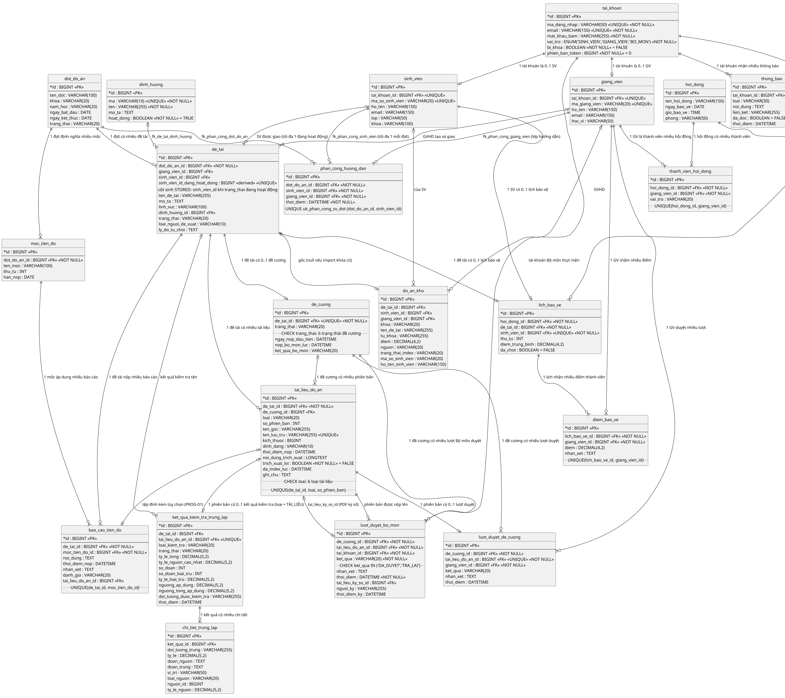

## 3.2. Thiết kế cơ sở dữ liệu

> **Mã PI:** 2.1 — **Yêu cầu:** DSGN-02

### 3.2.1. Nguyên tắc thiết kế

Hệ thống dùng **MySQL 8** với **hai schema trên cùng một server**: `thesis_core` (sở hữu bởi Web API — toàn bộ thực thể nghiệp vụ ở §3.1) và `thesis_ai` (sở hữu bởi Dịch vụ AI — embedding, chunk văn bản, metadata chỉ mục, xem §3.2.6). Đây là ranh giới sở hữu dữ liệu (schema ownership) làm cho kiến trúc SOA ở §3.3 là thật chứ không phải "một CSDL, hai tiến trình giả vờ là hai dịch vụ": **không có khóa ngoại và không có câu truy vấn nào băng qua hai schema** — Web API không bao giờ đọc/ghi trực tiếp vào `thesis_ai`, Dịch vụ AI không bao giờ đọc/ghi trực tiếp vào `thesis_core`. Trao đổi dữ liệu giữa hai schema chỉ qua REST nội bộ (`/ingest`, `/check-title`, `/check-document` — xem §3.3.5).

Các nguyên tắc áp dụng cho toàn bộ `thesis_core`:

- **Bảng mã tiếng Việt:** mọi bảng và cột văn bản dùng `CHARACTER SET utf8mb4 COLLATE utf8mb4_vietnamese_ci` (đặt ở mức database, kế thừa xuống bảng/cột), đảm bảo lưu trữ, so sánh và sắp xếp đúng tiếng Việt có dấu (NFR-13).
- **Chuẩn hóa Unicode NFC:** mọi văn bản (tên đề tài, họ tên, nội dung đề cương/báo cáo, nhận xét...) được chuẩn hóa **NFC** tại **mọi điểm nhập liệu** trước khi ghi vào CSDL — API request của client, văn bản trích xuất từ DOCX/PDF, import CSV hàng loạt (UC5.4) — để việc so sánh chuỗi (kiểm tra trùng mã, tra cứu) và so sánh ngữ nghĩa (Dịch vụ AI) không phụ thuộc vào dạng tổ hợp (NFD) hay dựng sẵn (NFC) của bàn phím/nguồn nhập (NFR-14).
- **Quản lý schema bằng migration:** `thesis_core` và `thesis_ai` mỗi schema có một bộ migration Alembic riêng (DEPL-01, Phase 2); không sửa cấu trúc bảng trực tiếp trên server.
- **Embedding tính sẵn lúc ingest:** `thesis_ai` chỉ lưu vector đã tính sẵn (NFR-11); không có bảng nào trong `thesis_core` lưu vector.



### 3.2.2. Lược đồ thesis_core

Lược đồ `thesis_core` gồm 22 bảng, khớp 1-1 với 22 lớp thực thể ở §3.1 (không có bảng liên kết N-N nào không map tới lớp — `thanh_vien_hoi_dong` và `diem_bao_ve` là các lớp liên kết đã được mô hình hóa tường minh thành lớp ở §3.1, không phải bảng kỹ thuật ẩn). Hình 3.5 ở trên thể hiện đầy đủ khóa chính, khóa ngoại, kiểu dữ liệu MySQL 8 và ràng buộc NOT NULL/UNIQUE của cả 22 bảng. Bảng `phan_cong_huong_dan` được bổ sung ở Alembic 0015 khi điều chỉnh nghiệp vụ phân công GVHD đầu đợt (UC0.8); hai bảng `dinh_huong` và `luot_duyet_bo_mon` được bổ sung ở Alembic 0016 cho danh mục định hướng (UC0.9) và luồng duyệt đề cương hai cấp (UC2.3, UC2.4).

### 3.2.3. Từ điển dữ liệu

#### `tai_khoan`

| Cột | Kiểu | Null | Khóa | Mô tả |
|---|---|---|---|---|
| id | BIGINT | Không | PK | Định danh tài khoản |
| ma_dang_nhap | VARCHAR(50) | Không | UNIQUE | Mã SV/GV dùng để đăng nhập (FR-TK-01) |
| email | VARCHAR(150) | Không | UNIQUE | Email đăng nhập thay thế |
| mat_khau_bam | VARCHAR(255) | Không | — | Mật khẩu băm bcrypt (NFR-02) |
| vai_tro | ENUM('SINH_VIEN','GIANG_VIEN','BO_MON') | Không | — | Vai trò quyết định quyền truy cập (NFR-04) |
| bi_khoa | BOOLEAN | Không | — | Tài khoản bị Bộ môn khóa (NFR-05) |
| phien_ban_token | BIGINT | Không | — | Phiên bản token (mặc định 0), tăng khi đăng xuất để thu hồi mọi JWT cũ (NFR bảo mật phiên) |

#### `sinh_vien`

| Cột | Kiểu | Null | Khóa | Mô tả |
|---|---|---|---|---|
| id | BIGINT | Không | PK | Định danh sinh viên |
| tai_khoan_id | BIGINT | Không | FK, UNIQUE → tai_khoan | Tài khoản đăng nhập tương ứng |
| ma_so_sinh_vien | VARCHAR(20) | Có | UNIQUE | Mã số sinh viên |
| ho_ten | VARCHAR(150) | Có | — | Họ tên |
| email | VARCHAR(150) | Có | — | Email liên hệ |
| lop | VARCHAR(50) | Có | — | Lớp hành chính |
| khoa | VARCHAR(100) | Có | — | Khoa/Viện quản lý sinh viên |

#### `giang_vien`

| Cột | Kiểu | Null | Khóa | Mô tả |
|---|---|---|---|---|
| id | BIGINT | Không | PK | Định danh giảng viên |
| tai_khoan_id | BIGINT | Không | FK, UNIQUE → tai_khoan | Tài khoản đăng nhập tương ứng |
| ma_giang_vien | VARCHAR(20) | Có | UNIQUE | Mã số giảng viên |
| ho_ten | VARCHAR(150) | Có | — | Họ tên |
| email | VARCHAR(150) | Có | — | Email liên hệ |
| hoc_vi | VARCHAR(50) | Có | — | Học vị |

#### `dot_do_an`

| Cột | Kiểu | Null | Khóa | Mô tả |
|---|---|---|---|---|
| id | BIGINT | Không | PK | Định danh đợt đồ án |
| ten_dot | VARCHAR(100) | Không | — | Tên đợt |
| khoa | VARCHAR(20) | Không | — | Khóa sinh viên áp dụng (vd. K18) |
| nam_hoc | VARCHAR(20) | Có | — | Năm học |
| ngay_bat_dau | DATE | Không | — | Ngày mở đợt |
| ngay_ket_thuc | DATE | Có | — | Ngày đóng đợt |
| trang_thai | VARCHAR(20) | Không | — | `DANG_MO` / `DA_DONG` (FR-TK-05) |

#### `moc_tien_do`

| Cột | Kiểu | Null | Khóa | Mô tả |
|---|---|---|---|---|
| id | BIGINT | Không | PK | Định danh mốc tiến độ |
| dot_do_an_id | BIGINT | Không | FK → dot_do_an | Đợt áp dụng mốc này |
| ten_moc | VARCHAR(100) | Không | — | Tên mốc (Mốc 1, Mốc 2, Mốc cuối...) |
| thu_tu | INT | Không | — | Thứ tự hiển thị/hạn nộp |
| han_nop | DATE | Có | — | Hạn nộp báo cáo cho mốc |

#### `phan_cong_huong_dan`

| Cột | Kiểu | Null | Khóa | Mô tả |
|---|---|---|---|---|
| id | BIGINT | Không | PK | Định danh dòng phân công |
| dot_do_an_id | BIGINT | Không | FK → dot_do_an (`fk_phan_cong_dot_do_an`), UNIQUE cùng sinh_vien_id | Đợt đồ án áp dụng phân công |
| sinh_vien_id | BIGINT | Không | FK → sinh_vien (`fk_phan_cong_sinh_vien`) | Sinh viên được phân công; `uk_phan_cong_sv_dot (dot_do_an_id, sinh_vien_id)` bảo đảm mỗi SV tối đa một GVHD mỗi đợt (FR-DT-05) |
| giang_vien_id | BIGINT | Không | FK → giang_vien (`fk_phan_cong_giang_vien`) | GVHD — tập SV của một GV trong đợt là "lớp hướng dẫn" của GV đó |
| thoi_diem | DATETIME | Không | — | Thời điểm gán/đổi GVHD gần nhất |

Khi chuyển dữ liệu (Alembic 0015), mọi đề tài đang hoạt động đã có cả SV và GV sinh ra một dòng phân công tương ứng, và đề tài GV đề xuất mà SV đã đăng ký còn ở `CHO_DUYET` (bước Bộ môn xác nhận của luồng cũ) được chuyển thẳng sang `DA_PHAN_CONG`. Góp ý GVHD mục 1 (quick 261014-u0j) không thêm migration: lược đồ giữ nguyên, chỉ thay đổi hành vi ứng dụng.

#### `de_tai`

| Cột | Kiểu | Null | Khóa | Mô tả |
|---|---|---|---|---|
| id | BIGINT | Không | PK | Định danh đề tài |
| dot_do_an_id | BIGINT | Không | FK → dot_do_an | Đợt đồ án chứa đề tài |
| giang_vien_id | BIGINT | Có | FK → giang_vien | GVHD tạo và giao đề tài (chỉ GVHD được Bộ môn phân công cho SV trong đợt, `phan_cong_huong_dan`) |
| sinh_vien_id | BIGINT | Có | FK → sinh_vien | SV được GVHD giao đề tài (bắt buộc khi tạo; NULL chỉ với bản nháp mất SV do đổi GVHD hoặc dữ liệu cũ) |
| sinh_vien_id_dang_hoat_dong | BIGINT | Có (derived) | UNIQUE | Cột sinh — xem §3.2.5, cơ chế (a) |
| ten_de_tai | VARCHAR(255) | Không | — | Tên đề tài |
| mo_ta | TEXT | Có | — | Mô tả |
| linh_vuc | VARCHAR(100) | Có | — | Lĩnh vực |
| trang_thai | VARCHAR(20) | Không | — | `NHAP`/`CHO_DUYET`/`DA_DUYET`/`TU_CHOI`/`DA_PHAN_CONG` (§3.1.2); hệ thống chỉ còn tạo `NHAP` và `DA_PHAN_CONG`, ba giá trị còn lại là giá trị cũ của phiên bản trước, giữ để tương thích dữ liệu, không còn phát sinh |
| loai_nguoi_de_xuat | VARCHAR(10) | Không | — | `GIANG_VIEN` / `SINH_VIEN`; hệ thống luôn ghi `GIANG_VIEN` (giá trị `SINH_VIEN` là của phiên bản trước, giữ để tương thích dữ liệu) |
| ly_do_tu_choi | TEXT | Có | — | Cột cũ của phiên bản trước (lý do GVHD từ chối đề tài), giữ để tương thích dữ liệu, không còn phát sinh |

#### `de_cuong`

| Cột | Kiểu | Null | Khóa | Mô tả |
|---|---|---|---|---|
| id | BIGINT | Không | PK | Định danh đề cương |
| de_tai_id | BIGINT | Không | FK, UNIQUE → de_tai | Đề tài sở hữu đề cương này |
| trang_thai | VARCHAR(20) | Không | — | `CHUA_NOP`/`CHO_DUYET`/`YEU_CAU_SUA`/`DA_DUYET` (§3.1.3) |
| ngay_nop_dau_tien | DATETIME | Có | — | Thời điểm nộp phiên bản đầu tiên |

#### `tai_lieu_do_an`

| Cột | Kiểu | Null | Khóa | Mô tả |
|---|---|---|---|---|
| id | BIGINT | Không | PK | Định danh phiên bản tài liệu |
| de_tai_id | BIGINT | Không | FK → de_tai | Đề tài sở hữu tài liệu |
| de_cuong_id | BIGINT | Có | FK → de_cuong | Chỉ đặt khi `loai = ĐỀ_CƯƠNG` |
| loai | VARCHAR(20) | Không | — | `DE_CUONG`/`BAO_CAO_TIEN_DO`/`BAO_CAO_CUOI`/`KHO` |
| so_phien_ban | INT | Không | UNIQUE cùng (de_tai_id, loai) | Số phiên bản, tăng dần mỗi lần nộp lại |
| ten_goc | VARCHAR(255) | Không | — | Tên file người dùng gửi lên |
| ten_luu_tru | VARCHAR(255) | Không | UNIQUE | Tên file do server sinh (NFR-06, không dùng tên gốc) |
| kich_thuoc | BIGINT | Không | — | Dung lượng (byte), kiểm tra ≤ 20 MB (NFR-06) |
| dinh_dang | VARCHAR(10) | Không | — | `DOCX` / `PDF`, xác định theo magic bytes |
| thoi_diem_nop | DATETIME | Không | — | Thời điểm nộp |
| noi_dung_trich_xuat | LONGTEXT | Có | — | Văn bản trích xuất lúc nộp (NFC) để gửi Dịch vụ AI — cột bổ sung khi thi công Phase 3 (D-03) |
| trich_xuat_loi | BOOLEAN | Không | — | TRUE khi không trích xuất được văn bản; không chặn việc nộp (D-03) |
| da_index_luc | DATETIME | Có | — | Lần đưa đề cương/báo cáo cuối vào chỉ mục Dịch vụ AI (DOCUMENT) thành công gần nhất; NULL = chưa vào chỉ mục — Web API tự thử lại sau lần ingest thành công kế tiếp, `ai_index backfill --loai DOCUMENT --chua-index`, dashboard Bộ môn đếm số tài liệu còn thiếu (sửa lỗi review WR-06, Alembic 0014) |

#### `luot_duyet_de_cuong`

| Cột | Kiểu | Null | Khóa | Mô tả |
|---|---|---|---|---|
| id | BIGINT | Không | PK | Định danh lượt duyệt |
| de_cuong_id | BIGINT | Không | FK → de_cuong | Đề cương được duyệt |
| tai_lieu_do_an_id | BIGINT | Không | FK, UNIQUE → tai_lieu_do_an | Phiên bản cụ thể được duyệt lượt này |
| giang_vien_id | BIGINT | Không | FK → giang_vien | GVHD thực hiện duyệt |
| ket_qua | VARCHAR(20) | Không | — | `DA_DUYET` / `YEU_CAU_SUA` |
| nhan_xet | TEXT | Có | — | Nhận xét của GVHD |
| thoi_diem | DATETIME | Không | — | Thời điểm duyệt |

#### `bao_cao_tien_do`

| Cột | Kiểu | Null | Khóa | Mô tả |
|---|---|---|---|---|
| id | BIGINT | Không | PK | Định danh báo cáo tiến độ |
| de_tai_id | BIGINT | Không | FK, UNIQUE cùng moc_tien_do_id → de_tai | Đề tài nộp báo cáo |
| moc_tien_do_id | BIGINT | Không | FK → moc_tien_do | Mốc áp dụng |
| noi_dung | TEXT | Có | — | Nội dung mô tả tiến độ |
| thoi_diem_nop | DATETIME | Không | — | Thời điểm nộp |
| nhan_xet | TEXT | Có | — | Nhận xét của GVHD |
| danh_gia | VARCHAR(20) | Có | — | Mức đánh giá của GVHD: `DAT` (Đạt) / `CAN_CAI_THIEN` (Cần cải thiện) / `CHUA_DAT` (Chưa đạt) |
| tai_lieu_do_an_id | BIGINT | Có | FK → tai_lieu_do_an | Tệp đính kèm tùy chọn (phiên bản loại BAO_CAO_TIEN_DO); cột bổ sung khi thi công Phase 3 (PROG-01) |

#### `hoi_dong`

| Cột | Kiểu | Null | Khóa | Mô tả |
|---|---|---|---|---|
| id | BIGINT | Không | PK | Định danh hội đồng |
| ten_hoi_dong | VARCHAR(150) | Không | — | Tên hội đồng |
| ngay_bao_ve | DATE | Không | — | Ngày bảo vệ |
| gio_bao_ve | TIME | Không | — | Giờ bảo vệ |
| phong | VARCHAR(50) | Không | — | Phòng bảo vệ |

#### `thanh_vien_hoi_dong`

| Cột | Kiểu | Null | Khóa | Mô tả |
|---|---|---|---|---|
| id | BIGINT | Không | PK | Định danh thành viên hội đồng |
| hoi_dong_id | BIGINT | Không | FK, UNIQUE cùng giang_vien_id → hoi_dong | Hội đồng |
| giang_vien_id | BIGINT | Không | FK → giang_vien | Giảng viên là thành viên |
| vai_tro | VARCHAR(20) | Không | — | `CHU_TICH`/`THU_KY`/`UY_VIEN` |

#### `lich_bao_ve`

| Cột | Kiểu | Null | Khóa | Mô tả |
|---|---|---|---|---|
| id | BIGINT | Không | PK | Định danh lịch bảo vệ |
| hoi_dong_id | BIGINT | Không | FK → hoi_dong | Hội đồng xếp lịch |
| de_tai_id | BIGINT | Không | FK → de_tai | Đề tài được bảo vệ |
| sinh_vien_id | BIGINT | Không | FK, UNIQUE → sinh_vien | SV bảo vệ (mỗi SV chỉ có 1 lịch) |
| thu_tu | INT | Có | — | Thứ tự bảo vệ trong buổi |
| diem_trung_binh | DECIMAL(4,2) | Có | — | Trung bình cộng điểm thành viên (FR-BV-05) |
| da_chot | BOOLEAN | Không | — | Đã chốt kết quả (FR-BV-06) |

#### `diem_bao_ve`

| Cột | Kiểu | Null | Khóa | Mô tả |
|---|---|---|---|---|
| id | BIGINT | Không | PK | Định danh điểm |
| lich_bao_ve_id | BIGINT | Không | FK, UNIQUE cùng giang_vien_id → lich_bao_ve | Lịch bảo vệ được chấm |
| giang_vien_id | BIGINT | Không | FK → giang_vien | Thành viên hội đồng chấm điểm |
| diem | DECIMAL(4,2) | Không | — | Điểm thành viên chấm |
| nhan_xet | TEXT | Có | — | Nhận xét |

#### `do_an_kho`

| Cột | Kiểu | Null | Khóa | Mô tả |
|---|---|---|---|---|
| id | BIGINT | Không | PK | Định danh bản ghi kho |
| de_tai_id | BIGINT | Có | FK → de_tai | Null nếu là bản ghi import khóa cũ (FR-KHO-04) |
| sinh_vien_id | BIGINT | Có | FK → sinh_vien | SV thực hiện đồ án |
| giang_vien_id | BIGINT | Có | FK → giang_vien | GVHD |
| khoa | VARCHAR(20) | Có | — | Khóa sinh viên |
| ten_de_tai | VARCHAR(255) | Không | — | Tên đề tài (lưu lại kể cả khi import không map được de_tai_id) |
| tu_khoa | VARCHAR(255) | Có | — | Từ khóa tìm kiếm |
| diem | DECIMAL(4,2) | Có | — | Điểm bảo vệ |
| nguon | VARCHAR(20) | Không | — | `HE_THONG` (tự động khi chốt bảo vệ) / `IMPORT` (khóa cũ) |
| trang_thai_index | VARCHAR(20) | Không | — | Trạng thái đã đẩy sang Dịch vụ AI để index (FR-KHO-05): `CHUA_INDEX` (chưa index / lỗi AI, Bộ môn index lại sau — UC5.2 E1) / `DA_INDEX` |
| ma_so_sinh_vien | VARCHAR(20) | Có | — | Ảnh chụp mã SV tại thời điểm lưu kho — bản ghi import khóa cũ không có tài khoản SV; cột bổ sung khi thi công Phase 3 |
| ho_ten_sinh_vien | VARCHAR(150) | Có | — | Ảnh chụp họ tên SV tại thời điểm lưu kho — bản ghi import khóa cũ không có tài khoản SV; cột bổ sung khi thi công Phase 3 |

#### `ket_qua_kiem_tra_trung_lap`

| Cột | Kiểu | Null | Khóa | Mô tả |
|---|---|---|---|---|
| id | BIGINT | Không | PK | Định danh kết quả kiểm tra |
| de_tai_id | BIGINT | Có | FK → de_tai | Đặt khi `loai_kiem_tra = TEN_DE_TAI` |
| tai_lieu_do_an_id | BIGINT | Có | FK, UNIQUE → tai_lieu_do_an | Đặt khi `loai_kiem_tra = TAI_LIEU`; UNIQUE đảm bảo mỗi phiên bản tài liệu có đúng 1 kết quả (§3.2.5) |
| loai_kiem_tra | VARCHAR(20) | Không | — | `TEN_DE_TAI` / `TAI_LIEU` |
| trang_thai | VARCHAR(20) | Không | — | `DANG_KIEM_TRA`/`HOAN_TAT`/`LOI` (§3.1.4) |
| ty_le_tong | DECIMAL(5,2) | Có | — | Tỷ lệ tương đồng tổng (%) — với kiểm tra tài liệu: phần ký tự của mọi câu bị gắn cờ (cộng mọi nguồn), so với `nguong_tong_ap_dung` để bắt bài ghép từ nhiều đồ án (Alembic 0017) |
| ty_le_nguon_cao_nhat | DECIMAL(5,2) | Có | — | Kiểm tra tài liệu: tỷ lệ trùng với **một** đồ án nguồn cao nhất (`do_an_trung` của Dịch vụ AI). Đây là thống kê triển khai của `NGUONG_TAI_LIEU` (ngưỡng khớp trên tỷ lệ tới đồ án nguồn của cặp có chủ đích, mục 4.x.3): "Vượt ngưỡng cảnh báo" khi `ty_le_nguon_cao_nhat >= nguong_ap_dung` (lý do `MOT_NGUON`) **hoặc** `ty_le_tong >= nguong_tong_ap_dung` (lý do `TONG_NGUON`) — Web API tính, trả `vuot_nguong` và `ly_do_vuot_nguong`. Bổ sung khi sửa lỗi review Phase 4 (CR-01, Alembic 0012); dòng cũ được điền bằng phần ký tự đoạn của nguồn lớn nhất × tỷ lệ tổng |
| so_doan | INT | Có | — | Kiểm tra tài liệu: số câu nội dung thực sự được so sánh (Dịch vụ AI trả; CR-04, Alembic 0013) |
| so_doan_loai_tru | INT | Có | — | Kiểm tra tài liệu: số dòng bị lọc như phần mẫu chung (bìa, mục lục, tài liệu tham khảo, phụ lục…) |
| ty_le_loai_tru | DECIMAL(5,2) | Có | — | Kiểm tra tài liệu: % ký tự bị lọc — phần **không** được kiểm tra; MH-09/MH-14 hiển thị và cảnh báo GVHD khi > 50 % |
| nguong_ap_dung | DECIMAL(5,2) | Không | — | Ngưỡng cấu hình tại thời điểm kiểm tra (chụp lại từ `cau_hinh_nguong`) |
| nguong_tong_ap_dung | DECIMAL(5,2) | Có | — | Kiểm tra tài liệu: `NGUONG_TONG_TAI_LIEU` tại thời điểm kiểm tra (chụp lại như `nguong_ap_dung`), so với `ty_le_tong`. NULL ở kết quả có trước Alembic 0017 → chỉ xét ngưỡng theo một đồ án (không hồi tố) |
| doi_tuong_duoc_kiem_tra | VARCHAR(255) | Có | — | Mô tả đối tượng cụ thể được kiểm tra (tên đề tài nhập, hoặc số phiên bản tài liệu) |
| thoi_diem | DATETIME | Không | — | Thời điểm tạo bản ghi |

#### `chi_tiet_trung_lap`

| Cột | Kiểu | Null | Khóa | Mô tả |
|---|---|---|---|---|
| id | BIGINT | Không | PK | Định danh dòng chi tiết |
| ket_qua_id | BIGINT | Không | FK → ket_qua_kiem_tra_trung_lap | Kết quả chứa dòng chi tiết này |
| doi_tuong_trung | VARCHAR(255) | Không | — | Đề tài/đồ án trùng (tên hoặc mã tham chiếu `do_an_kho`) |
| ty_le | DECIMAL(5,2) | Không | — | Tỷ lệ trùng của riêng đoạn này |
| doan_nguon | TEXT | Có | — | Đoạn văn bản của tài liệu đang kiểm tra |
| doan_trung | TEXT | Có | — | Đoạn văn bản trùng trong đồ án/đề tài đối chiếu |
| vi_tri | VARCHAR(50) | Có | — | Vị trí đoạn trong tài liệu (trang/đoạn) |
| loai_nguon | VARCHAR(20) | Có | CHECK | Không gian id của nguồn trùng theo Dịch vụ AI: `TOPIC` (de_tai), `ARCHIVE` (do_an_kho), `DOCUMENT` (tai_lieu_do_an); NULL với dòng cũ |
| nguon_id | BIGINT | Có | — | Id của nguồn trong không gian `loai_nguon` (tham chiếu đa hình, không FK). Dùng để tra nhãn đúng bảng và để quyết định SV có được xem `doan_trung` hay không (chỉ khi nguồn là đồ án đã vào kho) |
| ty_le_nguon | DECIMAL(5,2) | Có | — | Tỷ lệ trùng với riêng nguồn của đoạn này (`do_an_trung` của Dịch vụ AI, không gian `DOCUMENT`) — cột "Tỷ lệ" của "Đồ án trùng" trên MH-09/MH-14 đọc thẳng giá trị này (CR-01, Alembic 0012); NULL với dòng cũ |

#### `thong_bao`

| Cột | Kiểu | Null | Khóa | Mô tả |
|---|---|---|---|---|
| id | BIGINT | Không | PK | Định danh thông báo |
| tai_khoan_id | BIGINT | Không | FK → tai_khoan | Người nhận |
| loai | VARCHAR(30) | Không | — | Loại sự kiện (phân công GVHD `PHAN_CONG_GVHD`, GVHD giao đề tài `DE_TAI_PHAN_CONG`, nhận xét mới...; các loại cũ `DE_TAI_CHO_DUYET`, `DE_TAI_TU_CHOI` không còn phát sinh) |
| noi_dung | TEXT | Không | — | Nội dung hiển thị |
| lien_ket | VARCHAR(255) | Có | — | Đường dẫn tới màn hình liên quan |
| da_doc | BOOLEAN | Không | — | Đã đọc hay chưa (FR-TB-01) |
| thoi_diem | DATETIME | Không | — | Thời điểm phát sinh |

#### `cau_hinh_nguong`

| Cột | Kiểu | Null | Khóa | Mô tả |
|---|---|---|---|---|
| id | BIGINT | Không | PK | Định danh cấu hình |
| loai | VARCHAR(30) | Không | UNIQUE | Mỗi loại đúng 1 dòng hiện hành: `NGUONG_TEN_DE_TAI` — tên đề tài có độ tương đồng ngữ nghĩa từ giá trị này trở lên được cảnh báo khi GVHD tạo/giao đề tài (UC0.6); `NGUONG_TAI_LIEU` — đề cương/báo cáo có tỷ lệ trùng với **một** đồ án nguồn (`ty_le_nguon_cao_nhat`) từ giá trị này trở lên là "Vượt ngưỡng cảnh báo" (UC0.7, chụp vào `nguong_ap_dung`); `NGUONG_TONG_TAI_LIEU` — đề cương/báo cáo có tỷ lệ tổng mọi nguồn (`ty_le_tong`) từ giá trị này trở lên cũng là "Vượt ngưỡng cảnh báo", kể cả khi không đồ án nào vượt `NGUONG_TAI_LIEU` (bài ghép từ nhiều đồ án; UC0.7, chụp vào `nguong_tong_ap_dung`; bổ sung ở Alembic 0017); `NGUONG_DOAN_TRUNG` — một câu có độ tương đồng ngữ nghĩa với đồ án đã lưu từ giá trị này trở lên được tính là đoạn trùng (gửi sang Dịch vụ AI dưới tên `nguong_doan`; bổ sung khi thi công Phase 4, D-04). Giá trị mặc định lấy từ hiệu chỉnh (Alembic 0010: 67,8 / 10,4 / 67,7; Alembic 0017: 14,8); Bộ môn sửa cả bốn trên màn hình UC0.4 (`GET/PUT /api/thresholds`), Web API đọc lại theo từng request nên lần kiểm tra kế tiếp dùng giá trị mới |
| gia_tri | DECIMAL(5,2) | Không | — | Giá trị ngưỡng % (0–100, FR-AI-05) |
| tai_khoan_id | BIGINT | Có | FK → tai_khoan | Người (Bộ môn) cập nhật lần gần nhất |
| thoi_diem_cap_nhat | DATETIME | Không | — | Thời điểm lưu cấu hình |

### 3.2.4. Ánh xạ lớp thực thể – bảng

| Lớp thực thể | Bảng | Ghi chú |
|---|---|---|
| TaiKhoan | tai_khoan | — |
| SinhVien | sinh_vien | — |
| GiangVien | giang_vien | — |
| DotDoAn | dot_do_an | — |
| PhanCongHuongDan | phan_cong_huong_dan | Bổ sung ở Alembic 0015 (UC0.8) |
| DinhHuong | dinh_huong | Bổ sung ở Alembic 0016 (UC0.9) |
| MocTienDo | moc_tien_do | — |
| DeTai | de_tai | — |
| DeCuong | de_cuong | — |
| TaiLieuDoAn | tai_lieu_do_an | — |
| LuotDuyetDeCuong | luot_duyet_de_cuong | — |
| LuotDuyetBoMon | luot_duyet_bo_mon | Bổ sung ở Alembic 0016 (UC2.4) |
| BaoCaoTienDo | bao_cao_tien_do | — |
| HoiDong | hoi_dong | — |
| ThanhVienHoiDong | thanh_vien_hoi_dong | — |
| LichBaoVe | lich_bao_ve | — |
| DiemBaoVe | diem_bao_ve | — |
| DoAnKho | do_an_kho | — |
| KetQuaKiemTraTrungLap | ket_qua_kiem_tra_trung_lap | — |
| ChiTietTrungLap | chi_tiet_trung_lap | — |
| ThongBao | thong_bao | — |
| CauHinhNguong | cau_hinh_nguong | — |

### 3.2.5. Ràng buộc toàn vẹn và xử lý đồng thời

**(a) Mỗi Sinh viên chỉ có tối đa một đề tài đang hoạt động.** Cột sinh `de_tai.sinh_vien_id_dang_hoat_dong` được MySQL tự tính:

```sql
sinh_vien_id_dang_hoat_dong BIGINT
  GENERATED ALWAYS AS (
    CASE WHEN trang_thai IN ('CHO_DUYET', 'DA_DUYET', 'DA_PHAN_CONG')
         THEN sinh_vien_id END
  ) STORED,
UNIQUE KEY uk_de_tai_sv_hoat_dong (sinh_vien_id_dang_hoat_dong)
```

Cột chỉ mang giá trị `sinh_vien_id` khi đề tài đang ở một trong ba trạng thái "đang hoạt động"; ở `NHAP` và `TU_CHOI` (giá trị cũ) cột này là `NULL`. MySQL cho phép **nhiều dòng NULL** cùng tồn tại trong một chỉ mục UNIQUE (NULL không được coi là trùng), nên ràng buộc chỉ thực sự chặn khi cùng một `sinh_vien_id` xuất hiện ở hai đề tài đang hoạt động cùng lúc — đúng ngữ nghĩa cần (FR-DT-06).

**(b) Mỗi đề tài chỉ có tối đa một Sinh viên, kể cả khi hai yêu cầu giao đề tài đến gần như đồng thời.** Vì `de_tai.sinh_vien_id` là một cột đơn (không phải bảng N-N), rủi ro race condition nằm ở "hai request cùng lúc đều tưởng mình giao thành công" cho cùng một sinh viên. Tầng ứng dụng (Web API) không chỉ kiểm tra rồi ghi (check-then-act) mà dựa vào chỉ mục UNIQUE ở (a): INSERT/UPDATE thứ hai vi phạm `uk_de_tai_sv_hoat_dong` và được trả về 409 "Sinh viên này đã có một đề tài đang hoạt động" (đúng luồng ngoại lệ E4 của UC1.1). Gửi bản nháp dùng thêm cơ chế sau:

- **UPDATE có điều kiện, kiểm tra số dòng bị ảnh hưởng:** `UPDATE de_tai SET trang_thai = 'DA_PHAN_CONG' WHERE id = :dt AND trang_thai = 'NHAP' AND sinh_vien_id = :sv AND dot_do_an_id IN (đợt đang mở)` (GVHD đã được kiểm tra thuộc `phan_cong_huong_dan` của đợt trước đó); nếu số dòng ảnh hưởng trả về là 0, việc gửi bị từ chối (bản nháp không còn ở `NHAP` hoặc đợt đã đóng). InnoDB khóa dòng cho transaction đang ghi, transaction thứ hai chờ và thấy trạng thái đã đổi.
- **Tương đương:** `SELECT ... FOR UPDATE` trên dòng `de_tai` trước khi kiểm tra và ghi trong cùng transaction.

**(c) Các ràng buộc UNIQUE khác đã thể hiện trực tiếp trên lược đồ (Hình 3.5):**

| Ràng buộc | Bảng | Mục đích |
|---|---|---|
| UNIQUE(dot_do_an_id, sinh_vien_id) — `uk_phan_cong_sv_dot` | phan_cong_huong_dan | Mỗi SV có tối đa một GVHD trong một đợt (BR-PC-01); khi Bộ môn lưu phân công, Web API khóa (`SELECT ... FOR UPDATE`) các dòng phân công và đề tài đang hoạt động của các SV liên quan để không đua với GVHD đang giao đề tài cùng lúc |
| UNIQUE(de_tai_id, loai, so_phien_ban) | tai_lieu_do_an | Số phiên bản duy nhất trong cùng một loại tài liệu của một đề tài |
| UNIQUE(tai_lieu_do_an_id) trên luot_duyet_de_cuong | luot_duyet_de_cuong | Mỗi phiên bản đề cương chỉ có một lượt duyệt kết luận |
| UNIQUE(de_tai_id, moc_tien_do_id) | bao_cao_tien_do | Một báo cáo cho mỗi (đề tài, mốc) |
| UNIQUE(hoi_dong_id, giang_vien_id) | thanh_vien_hoi_dong | Một GV không lặp lại vai trò trong cùng một hội đồng |
| UNIQUE(sinh_vien_id) trên lich_bao_ve | lich_bao_ve | Mỗi SV chỉ được xếp một lịch bảo vệ |
| UNIQUE(lich_bao_ve_id, giang_vien_id) | diem_bao_ve | Đúng một điểm cho mỗi cặp (lịch bảo vệ, giảng viên) — không thành viên nào chấm hai lần |
| UNIQUE(tai_lieu_do_an_id) trên ket_qua_kiem_tra_trung_lap | ket_qua_kiem_tra_trung_lap | Mỗi phiên bản tài liệu có đúng một kết quả kiểm tra trùng lặp — nên kết quả trả về muộn của một phiên bản **không thể** ghi đè kết quả của phiên bản khác: chúng luôn là hai bản ghi (hai `id`) khác nhau, gắn với hai `tai_lieu_do_an_id` khác nhau |

**(d) Điểm bảo vệ chỉ chốt khi đủ điều kiện (FR-BV-06):** thao tác chốt (`lich_bao_ve.da_chot = TRUE`, `diem_trung_binh = AVG(diem_bao_ve.diem)`) được Web API kiểm tra ở tầng ứng dụng: số dòng `diem_bao_ve` của `lich_bao_ve_id` đó phải bằng số dòng `thanh_vien_hoi_dong` của `hoi_dong_id` tương ứng trước khi cho phép `UPDATE`; sau khi `da_chot = TRUE`, Web API từ chối mọi ghi/sửa `diem_bao_ve` cho `lich_bao_ve_id` đó (ràng buộc nghiệp vụ, không có cách biểu diễn thuần CSDL gọn hơn transaction kiểm tra trước khi ghi).

### 3.2.6. Lược đồ thesis_ai

Schema `thesis_ai` thuộc sở hữu riêng của Dịch vụ AI, tách biệt hoàn toàn khỏi `thesis_core` (§3.2.1) — không có khóa ngoại nào nối hai schema.


| Bảng | Cột chính | Mô tả |
|---|---|---|
| chunk | id, loai_nguon, ma_nguon, thu_tu, noi_dung, bam_noi_dung, nhom | Một đơn vị văn bản đã tách. `loai_nguon` là `VARCHAR(20)` + CHECK `TOPIC` / `ARCHIVE` / `DOCUMENT` (quy ước VARCHAR + CHECK của dự án thay cho ENUM). Tên đề tài hiện hành (`TOPIC`) và tên đồ án trong kho (`ARCHIVE`) là 1 chunk; đề cương/báo cáo (`DOCUMENT`) là nhiều chunk **mức câu** sau khi lọc phần mẫu chung. `ma_nguon` là số tham chiếu logic theo `loai_nguon` — `de_tai.id`, `do_an_kho.id` hoặc `tai_lieu_do_an.id` bên `thesis_core` (ba không gian id riêng), gửi kèm trong payload `/ingest` — **không phải khóa ngoại thật**, giữ đúng ranh giới schema. `bam_noi_dung` (SHA-256) để ingest lại nội dung không đổi thì không encode lại. `nhom` (BIGINT, NULL được; Alembic 0003 của Dịch vụ AI) là nhóm của nguồn `DOCUMENT` — Web API gửi `de_tai_id` qua `/ingest`, mọi phiên bản đề cương/báo cáo của một đề tài là một nhóm khi đếm cụm phổ biến của tín hiệu nguyên văn; nội dung không đổi mà chỉ đổi `nhom` thì chỉ cập nhật nhóm, không encode lại |
| embedding | id, chunk_id (FK → chunk), ten_model, so_chieu, vector | Vector embedding của một chunk theo một mô hình **và commit trọng số** cụ thể (`ten_model` = repo@12 ký tự đầu của commit Hugging Face đã chốt, vd. `bkai-foundation-models/vietnamese-bi-encoder@84f9d9ada0d1` — dịch vụ nạp mô hình theo đúng commit này, không theo nhánh `main`; sửa lỗi review WR-01); `vector` là mảng `float32` đóng gói nhị phân trong `BLOB`; UNIQUE(chunk_id, ten_model) để tránh tính trùng embedding cho cùng một chunk + mô hình; đổi mô hình thì `/reindex` encode bổ sung các chunk còn thiếu vector của mô hình mới |
| index_metadata | id, ten_model, so_vector, cap_nhat_luc | Một dòng theo dõi mỗi mô hình embedding đang phục vụ: tổng số vector hiện có trong chỉ mục FAISS trong bộ nhớ và thời điểm cập nhật gần nhất — dùng để phát hiện lệch giữa CSDL và chỉ mục trong bộ nhớ sau khi khởi động lại dịch vụ |

Điều chỉnh khi thi công Phase 4 (bổ sung, không đổi ranh giới schema):

- **Ba không gian id.** Cặp (`loai_nguon`, `ma_nguon`) mới xác định một nguồn; cùng số `12` có thể là đề tài 12, bản ghi kho 12 và tài liệu 12 — Web API luôn ánh xạ ngược theo `loai` trả về (WR-06).
- **Ngữ nghĩa thay thế của `/ingest`.** Ingest lại (`loai_nguon`, `ma_nguon`) xóa toàn bộ chunk cũ của nguồn đó rồi ghi chunk mới trong một transaction; văn bản rỗng để lại nguồn không còn chunk (cách Web API gỡ vector khi dọn dữ liệu kiểm thử). Mỗi lần ingest có thay đổi gọi mô hình đúng một lần (NFR-11).
- **Dựng lại từ CSDL lúc khởi động.** Chỉ mục FAISS (`IndexFlatIP`) và chỉ mục vân tay (winnowing, chỉ mục ngược vân tay → câu) nằm trong bộ nhớ, được dựng lại từ `chunk` + `embedding` của mô hình hiện hành khi Dịch vụ AI khởi động — không encode lại; mã băm k-gram không được lưu mà tính lại từ `noi_dung` (và `nhom`).

Chi tiết luồng `/ingest` (push-on-write) và hợp đồng API nằm ở §3.3.5/§3.3.8.
