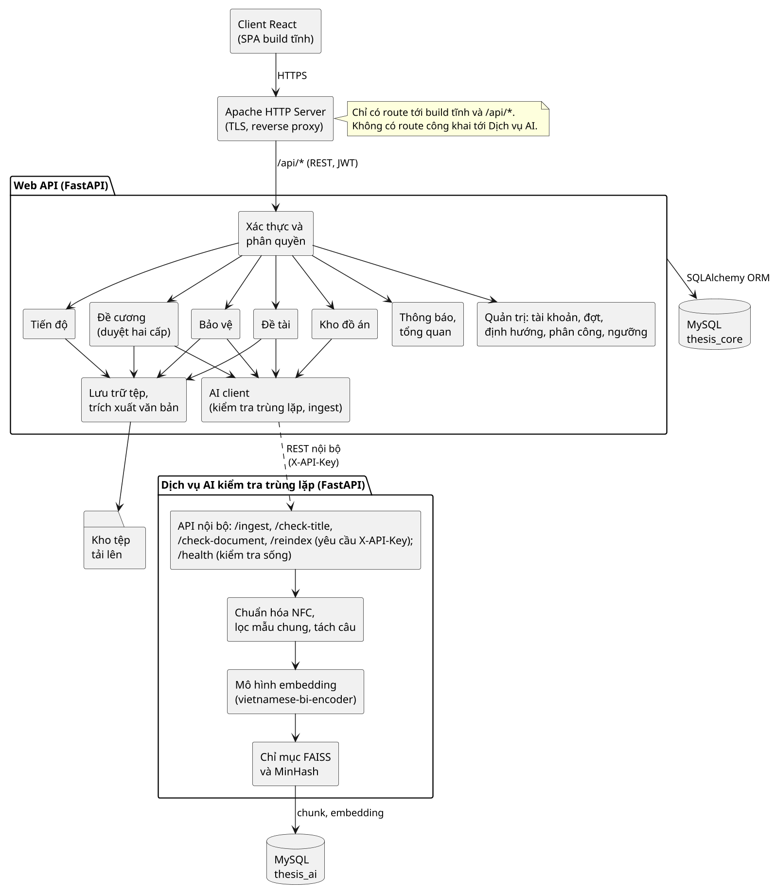
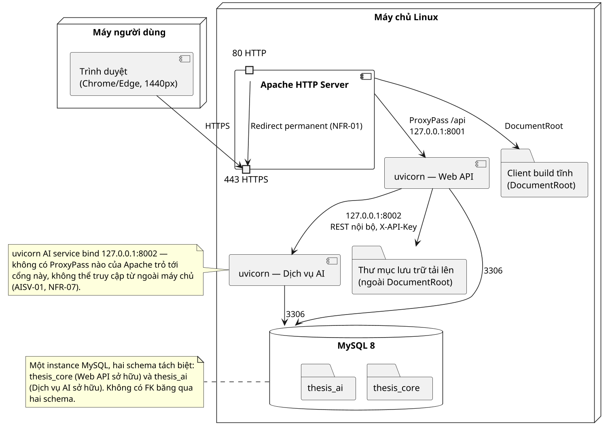
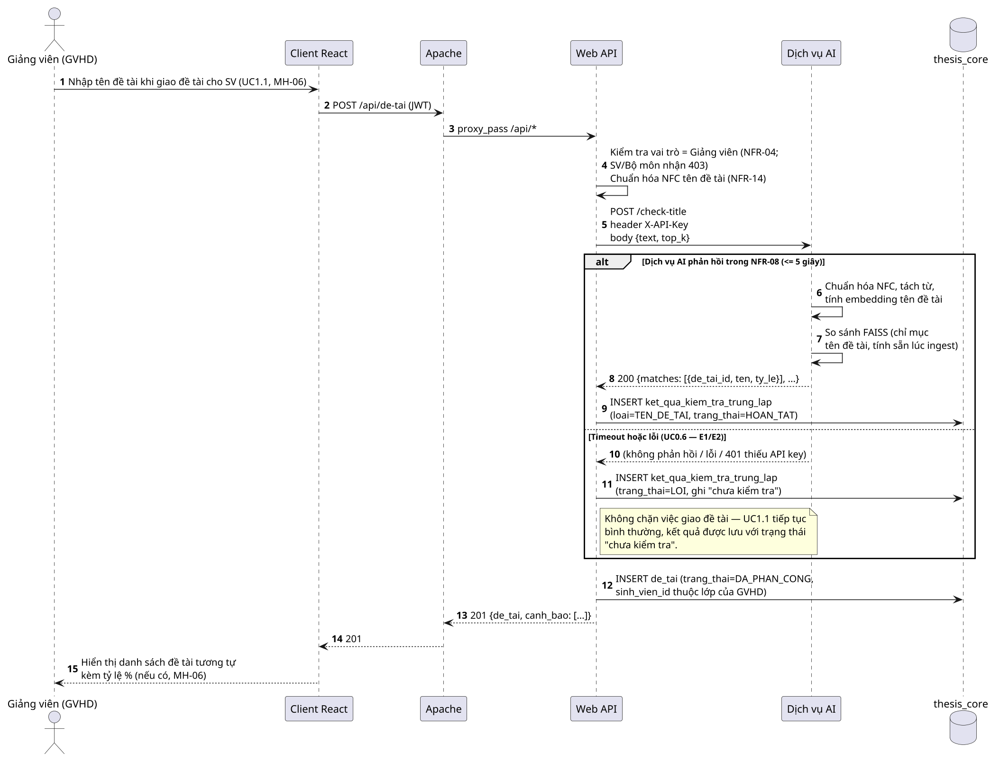
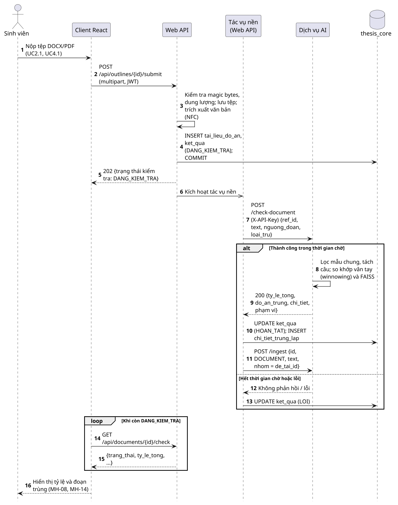

## 3.3. Thiết kế kiến trúc hệ thống

> **Mã PI:** 2.2 — **Yêu cầu:** DSGN-03

### 3.3.1. Mô hình SOA tổng quan

Hệ thống gồm **ba thành phần triển khai độc lập** (three separately deployable components), đúng nghĩa kiến trúc hướng dịch vụ (SOA) chứ không phải một khối đơn (monolith) chia thư mục:

1. **Client React** — SPA build tĩnh, chỉ gọi Web API, không bao giờ biết địa chỉ hay khóa của Dịch vụ AI.
2. **Web API (FastAPI)** — sở hữu toàn bộ 5 UC nghiệp vụ chính, sở hữu schema `thesis_core`, sở hữu lưu trữ tệp, và là **client REST duy nhất** của Dịch vụ AI.
3. **Dịch vụ AI kiểm tra trùng lặp (FastAPI)** — sở hữu schema `thesis_ai` riêng, chỉ nói REST, không có route công khai qua Apache.

Cả ba đứng sau **Apache**, nhưng Apache chỉ có route tới build tĩnh của Client và tới `/api/*` (Web API). **Dịch vụ AI hoàn toàn nội bộ**: không có `ProxyPass` nào của Apache trỏ tới cổng của nó, và uvicorn của nó chỉ bind vào `127.0.0.1` — đây là lý do kiến trúc thỏa AISV-01/NFR-07 mà không cần thêm tường lửa: đơn giản là không có đường vào từ ngoài máy chủ. Việc tách dịch vụ AI khỏi Web API (thay vì gọi hàm nội bộ trong cùng tiến trình) phục vụ đúng yêu cầu chấm điểm PI 2.2 — chứng minh khả năng thiết kế hệ thống nhiều dịch vụ với ranh giới sở hữu dữ liệu rõ ràng (schema ownership, §3.2.1) — và tách rời được vòng đời phát triển: nghiệp vụ CRUD (Web API) và mô hình embedding/chỉ mục (Dịch vụ AI) có thể xây dựng, kiểm thử và triển khai độc lập nhau (Phase 2–4).

### 3.3.2. Sơ đồ thành phần

Web API được chia thành các thành phần con theo module nghiệp vụ (Xác thực & phân quyền, Đề tài, Đề cương, Tiến độ, Bảo vệ, Kho, Thông báo, Lưu trữ tệp & trích xuất văn bản) cộng một thành phần **AI client** tập trung mọi lệnh gọi ra Dịch vụ AI — mọi router nghiệp vụ cần kiểm tra trùng lặp đều đi qua thành phần này, không tự mở kết nối HTTP riêng. Dịch vụ AI được chia thành 4 thành phần con (Chuẩn hóa NFC & tách từ, Lọc phần mẫu chung & chia đoạn, Mô hình embedding, Chỉ mục vector FAISS) sau 5 giao diện cung cấp `/ingest`, `/check-title`, `/check-document`, `/reindex`, `/health`.

### 3.3.3. Sơ đồ triển khai

Một máy chủ Linux chạy cả ba tiến trình: Apache (443/80), uvicorn Web API (127.0.0.1:8001), uvicorn Dịch vụ AI (127.0.0.1:8002), và MySQL 8 (3306) với hai schema `thesis_core`/`thesis_ai`. Thư mục lưu trữ tệp tải lên nằm **ngoài** `DocumentRoot` của Apache (không thể tải trực tiếp qua URL tĩnh — chỉ Web API đọc/ghi). Client build tĩnh phục vụ trực tiếp từ `DocumentRoot`.

### 3.3.4. Giao tiếp giữa các thành phần

| Kênh | Giao thức | Xác thực | Dữ liệu trao đổi |
|---|---|---|---|
| Trình duyệt ↔ Apache | HTTPS (443), HTTP (80) chỉ để redirect | — (TLS) | HTML/JS/CSS tĩnh, JSON qua `/api/*` |
| Apache ↔ Web API | HTTP nội bộ (proxy_pass tới 127.0.0.1:8001) | JWT người dùng (Bearer, trong Authorization header, xác thực ở Web API) | REST JSON, multipart (upload file) |
| Web API ↔ Dịch vụ AI | HTTP nội bộ (httpx tới 127.0.0.1:8002) | API key nội bộ tĩnh (header `X-API-Key`) — **JWT người dùng dừng lại ở Web API, không bao giờ được chuyển tiếp** | REST JSON, chỉ văn bản (text đã trích xuất) — không bao giờ gửi file |
| Web API ↔ `thesis_core` | SQLAlchemy ORM qua driver MySQL (127.0.0.1:3306) | Tài khoản DB riêng của Web API | SQL |
| Dịch vụ AI ↔ `thesis_ai` | SQLAlchemy ORM qua driver MySQL (127.0.0.1:3306) | Tài khoản DB riêng của Dịch vụ AI, đặc quyền tối thiểu: `thesis_ai` chỉ SELECT/INSERT/UPDATE/DELETE khi phục vụ; migration chạy riêng bằng `thesis_ai_migrate` (DDL) trước khi dịch vụ khởi động | SQL |
| Web API ↔ lưu trữ tệp | Ghi/đọc file hệ thống (local disk) | Quyền hệ điều hành của tiến trình Web API | Byte nhị phân DOCX/PDF |

### 3.3.5. Hợp đồng API dịch vụ AI

Toàn bộ payload chỉ chứa văn bản đã trích xuất — Dịch vụ AI không bao giờ nhận hay trả về file nhị phân (Anti-Pattern 2, `research/ARCHITECTURE.md`).

| Endpoint | Phương thức | Mục đích | Đầu vào | Đầu ra |
|---|---|---|---|---|
| `/ingest` | POST | Đẩy một đề tài, bản ghi kho hoặc tài liệu mới vào corpus (push-on-write); ngữ nghĩa **thay thế** theo (`type`, `id`) — ingest lại thay toàn bộ chunk cũ, văn bản rỗng gỡ nguồn khỏi chỉ mục | `{id, type: TOPIC\|ARCHIVE\|DOCUMENT, text}` | `{chunk_count, indexed: true}` |
| `/check-title` | POST | So sánh ngữ nghĩa tên đề tài với đề tài hiện hành (TOPIC) và kho (ARCHIVE) (đồng bộ, UC0.6) | `{text, top_k, nguong?}` — `nguong` = NGUONG_TEN_DE_TAI hiện hành | `{matches: [{ref_id, loai: TOPIC\|ARCHIVE, ty_le}]}` |
| `/check-document` | POST | So sánh nội dung tài liệu, phát hiện đoạn trùng (bất đồng bộ về phía Web API, UC0.7) | `{ref_id, text, top_k, nguong_doan?, nguong_nguyen_van?, loai_tru?: [id]}` — `nguong_doan` = NGUONG_DOAN_TRUNG hiện hành, `loai_tru` = các phiên bản của cùng đề tài | `{ty_le_tong, do_an_trung: [{ref_id, ty_le}], chi_tiet: [{ref_id, doan_nguon, doan_trung, vi_tri, ty_le, tin_hieu: NGUYEN_VAN\|NGU_NGHIA, diem_ngu_nghia, diem_nguyen_van}], so_doan, so_doan_loai_tru, ty_le_loai_tru}` |
| `/reindex` | POST | Nạp lại/xây lại chỉ mục hàng loạt (seed ban đầu hoặc đổi mô hình embedding) | `{items: [{id, type, text}, ...]}` hoặc rỗng (encode chunk còn thiếu vector của mô hình hiện hành rồi xây lại từ `thesis_ai`) | `{indexed_count}` |
| `/health` | GET | Kiểm tra tình trạng dịch vụ (readiness của mô hình + chỉ mục) | — | `{status, model_loaded, index_size, index_size_tieu_de, index_size_tai_lieu, ten_model, encode_calls, thieu_embedding}` |

Hợp đồng được **điều chỉnh khi thi công Phase 4 (bổ sung, không phá hợp đồng)**: thêm loại nguồn `ARCHIVE` và ngữ nghĩa thay thế của `/ingest`; tham số tùy chọn `nguong` (`/check-title`) và `nguong_doan`, `nguong_nguyen_van`, `loai_tru` (`/check-document`) — thiếu thì dịch vụ dùng giá trị mặc định đã hiệu chỉnh, ngoài 0–100 trả `422`; trường trả về `loai` (kết quả tên), `tin_hieu`, `diem_ngu_nghia`, `diem_nguyen_van`, `so_doan`, `so_doan_loai_tru`, `ty_le_loai_tru` (kết quả tài liệu — dùng để giải thích vì sao một đoạn bị đánh dấu trên MH-14; ba trường phạm vi được Web API lưu và hiển thị để GVHD biết bao nhiêu nội dung không được kiểm tra — sửa lỗi review CR-04) và các chỉ số theo dõi của `/health`. `ty_le_tong` = tỷ lệ ký tự của các câu bị gắn cờ trên tổng ký tự câu nội dung (sau khi lọc phần mẫu chung); `vi_tri` = số thứ tự câu (`Câu a–b`). Client cũ bỏ qua các trường mới vẫn đúng.

Mọi endpoint (trừ `/health`) yêu cầu header `X-API-Key` hợp lệ; thiếu hoặc sai trả về `401` (NFR-07).

### 3.3.6. Nhóm API của Web API

Bảng dưới liệt kê hình dạng ở mức nhóm route theo từng UC — đường dẫn chính xác là quyết định của Phase 2 khi hiện thực FastAPI router:

| Nhóm | UC | Mô tả |
|---|---|---|
| auth | UC0.1 | Đăng nhập, làm mới phiên, đăng xuất |
| accounts | UC0.2 | Bộ môn quản lý tài khoản SV/GV |
| cohorts (đợt đồ án) | UC0.3 | Bộ môn mở/đóng đợt |
| thresholds (ngưỡng) | UC0.4 | Bộ môn cấu hình ngưỡng cảnh báo |
| notifications | UC0.5 | Danh sách thông báo, đánh dấu đã đọc |
| assignments (phân công GVHD) | UC0.8 | Bộ môn phân công/import phân công GVHD theo đợt; GV xem lớp hướng dẫn, SV xem GVHD của mình |
| topics (đề tài) | UC1.1–UC1.2 | Tạo/sửa/gửi đề tài và kiểm tra trùng tên (`POST/PUT /api/topics`, `submit`, `check-title` — chỉ GVHD; SV và Bộ môn nhận 403); xem danh sách, chi tiết đề tài theo phạm vi vai trò. Không còn endpoint đăng ký đề tài và duyệt đề tài (đã gỡ, trả 404) |
| outlines (đề cương) | UC2.1–UC2.3 | Nộp, duyệt/yêu cầu sửa, lịch sử phiên bản |
| progress (tiến độ) | UC3.1–UC3.4 | Mốc tiến độ, nộp báo cáo, nhận xét, dashboard |
| defense (bảo vệ) | UC4.1–UC4.5 | Nộp báo cáo cuối, hội đồng, lịch, chấm điểm, chốt kết quả |
| archive (kho) | UC5.1–UC5.4 | Tìm kiếm, quản lý bản ghi, import |

### 3.3.7. Luồng kiểm tra trùng lặp (D-07)

Hai luồng AI có đặc tính hiệu năng khác nhau nên dùng hai mẫu tương tác khác nhau (Pattern 1, `research/ARCHITECTURE.md`):

**Kiểm tra tên đề tài — đồng bộ** (`/check-title`, chỉ so sánh một chuỗi ngắn với chỉ mục trong bộ nhớ, ≤ 5 giây theo NFR-08 nên chờ đồng bộ không ảnh hưởng trải nghiệm):

**Kiểm tra tài liệu — bất đồng bộ** (`/check-document`, phải trích xuất + chia đoạn + embedding nhiều đoạn của một file, có thể tới 30 giây theo NFR-09 — nếu chờ đồng bộ sẽ chặn request nộp bài, vi phạm NFR-10):

Cả hai sơ đồ đều thể hiện: header `X-API-Key` trên mọi lệnh gọi Web API → Dịch vụ AI (JWT người dùng dừng ở Web API); nhánh `alt` xử lý khi Dịch vụ AI không phản hồi hoặc lỗi (không chặn nghiệp vụ chính); và với luồng bất đồng bộ — trạng thái `202 Accepted` trả về ngay, client polling trạng thái, và bất biến phiên bản (mỗi `tai_lieu_do_an` có đúng một `ket_qua_kiem_tra_trung_lap`, §3.2.5) đảm bảo kết quả trả về muộn của một phiên bản cũ không bao giờ ghi đè kết quả của phiên bản mới hơn.

### 3.3.8. Quyết định kiến trúc

| Quyết định | Lý do |
|---|---|
| **Schema ownership** — `thesis_core` (Web API) và `thesis_ai` (Dịch vụ AI) là hai schema tách biệt, không FK băng qua | Giữ ranh giới dịch vụ là thật; đổi schema một bên không âm thầm phá vỡ bên kia (Anti-Pattern 1, `research/ARCHITECTURE.md`) |
| **Push-on-write qua `/ingest`**, không để Dịch vụ AI tự đọc `thesis_core` | Dịch vụ AI không cần biết schema hay có quyền truy cập CSDL của Web API (Pattern 2) |
| **JWT dừng ở Web API**, Web API ↔ Dịch vụ AI dùng API key nội bộ riêng | Dịch vụ AI không có khái niệm người dùng/vai trò; giảm bán kính ảnh hưởng nếu API key nội bộ rò rỉ so với JWT người dùng (Anti-Pattern 3) |
| **Embedding tính sẵn lúc `/ingest`**, không tính lại khi có bản ghi mới | NFR-11 — thêm 1 bản ghi không kéo theo tính lại N bản ghi cũ (Pattern 3) |
| **NFC ở mọi điểm nhập liệu** (form, văn bản trích xuất DOCX/PDF, import CSV, cả hai phía Web API và Dịch vụ AI) | So sánh chuỗi và so sánh ngữ nghĩa cho cùng kết quả bất kể dạng Unicode nguồn (NFR-14) |
| **`BackgroundTasks` trong tiến trình** cho luồng bất đồng bộ, chưa dùng hàng đợi ngoài (Celery/Redis) | Đủ ở quy mô đồ án (300 đề tài, 50 tài liệu, một server); sơ đồ tuần tự vẫn thể hiện đúng lời gọi dịch vụ bất đồng bộ — hàng đợi ngoài là điểm mở rộng khi lên production thật, không đổi hợp đồng API |
| **Ngưỡng gửi theo từng request** (D-04) — `cau_hinh_nguong` ở Web API là nguồn chính; Web API đọc lại khi mỗi lần kiểm tra và gửi `nguong` / `nguong_doan` sang Dịch vụ AI | Dịch vụ AI không giữ trạng thái chính sách; Bộ môn đổi ngưỡng trên UC0.4 thì lần kiểm tra kế tiếp áp dụng ngay, còn kết quả đã ghi giữ snapshot `nguong_ap_dung` (không hồi tố) |
| **Một worker uvicorn, chỉ mục trong bộ nhớ** cho Dịch vụ AI (FAISS `IndexFlatIP` chính xác + ma trận MinHash, dựng lại từ `thesis_ai` lúc khởi động) | `/ingest` sửa chỉ mục tại chỗ trong tiến trình — worker thứ hai sẽ phục vụ chỉ mục cũ; ở quy mô vài nghìn câu, tìm kiếm chính xác dưới 0,1 s nên không cần chỉ mục xấp xỉ hay dịch vụ vector riêng |

**Đường mở rộng khi lên quy mô thật** (ngoài phạm vi đồ án): thay `BackgroundTasks` bằng Celery/RQ + Redis để việc kiểm tra sống sót qua việc khởi động lại tiến trình và chạy trên worker riêng; lưu chỉ mục FAISS xuống đĩa hoặc chuyển sang một CSDL vector chuyên dụng nếu số lượng vector vượt quá vài trăm nghìn.
