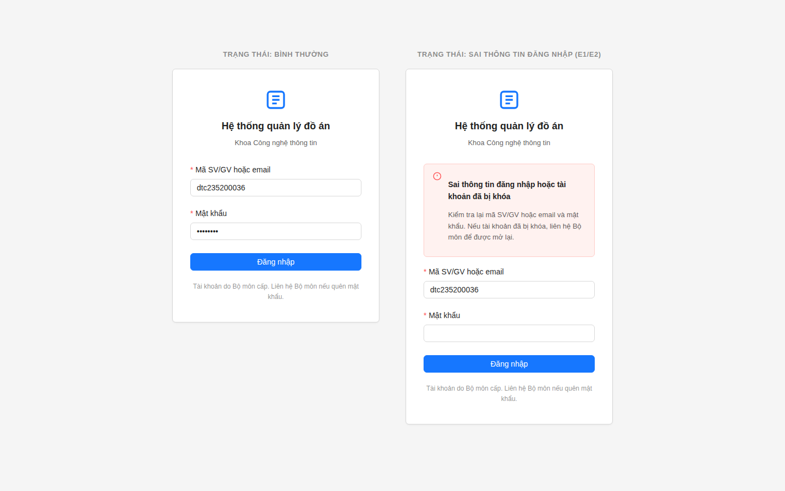
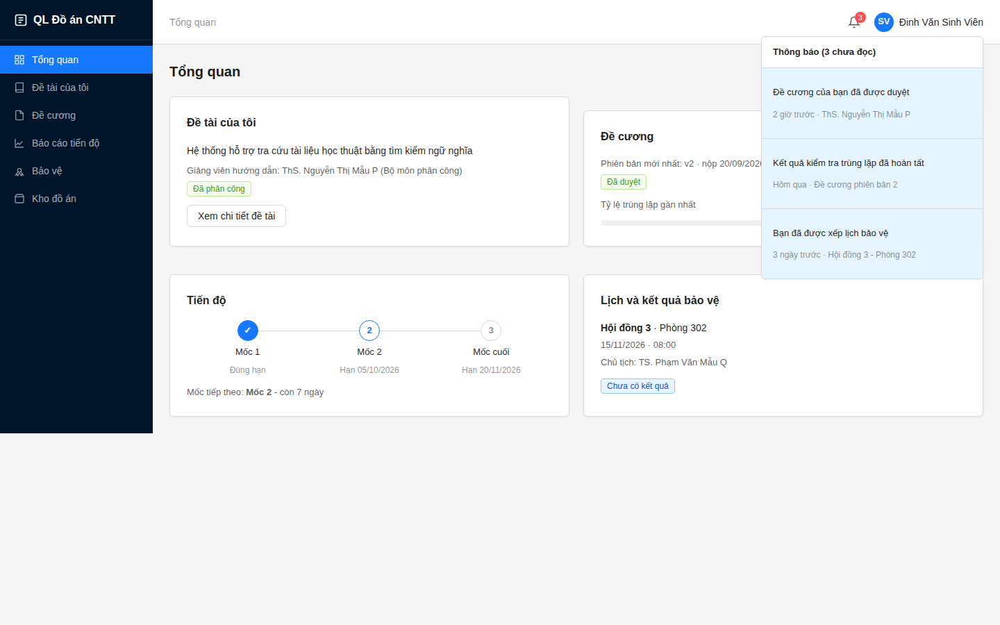
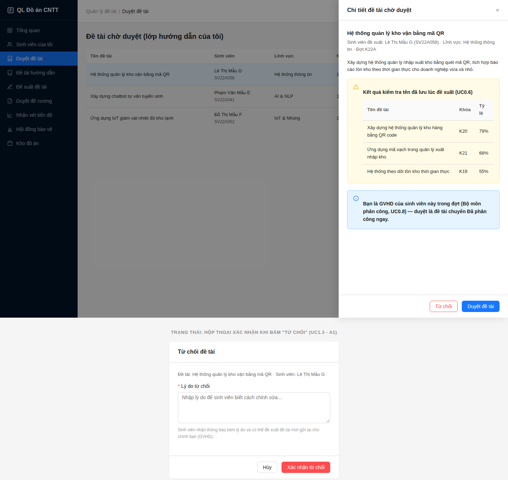
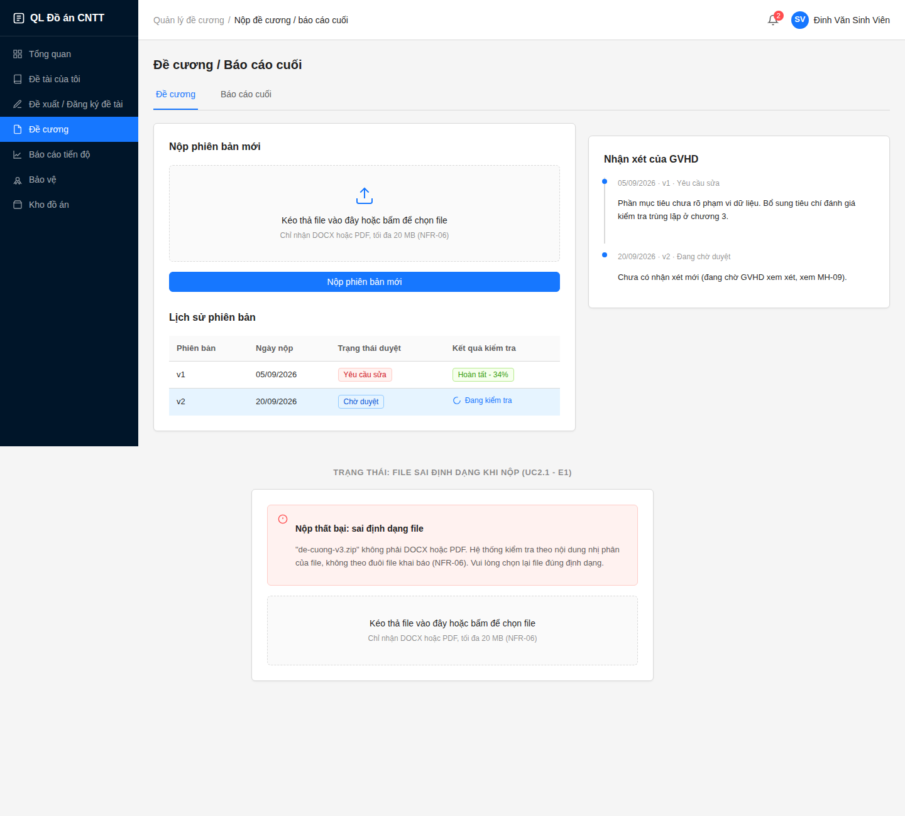
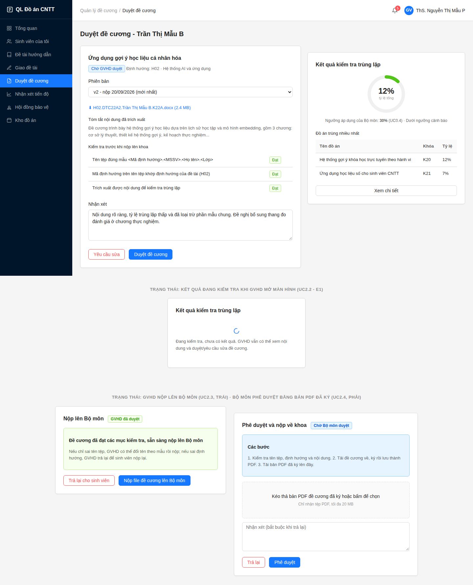
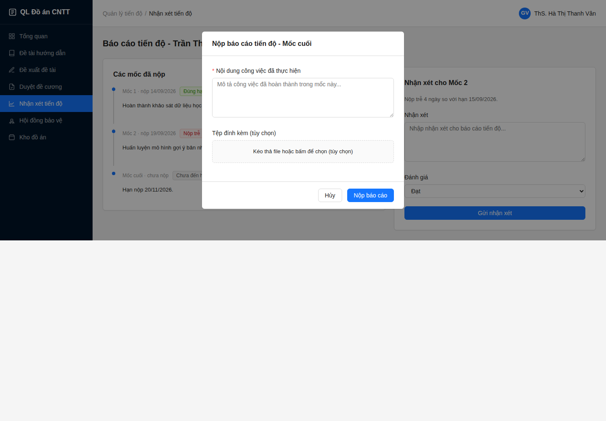
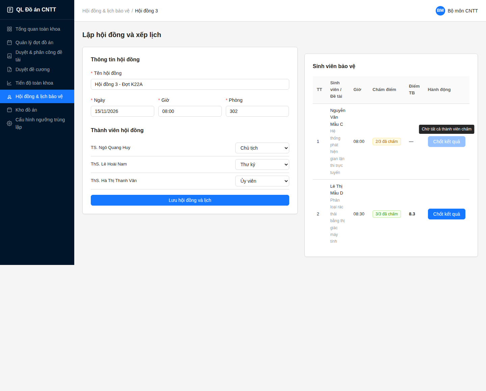
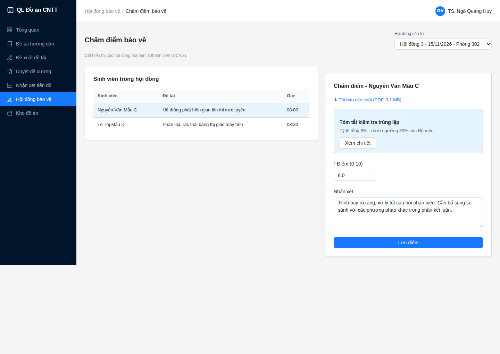
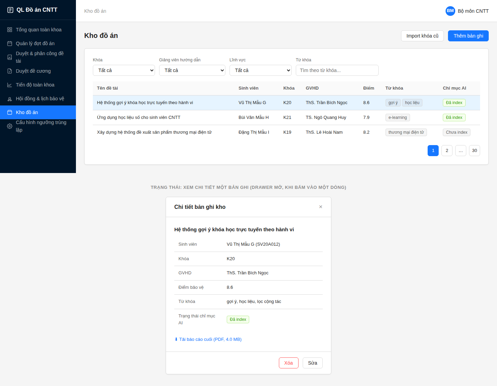
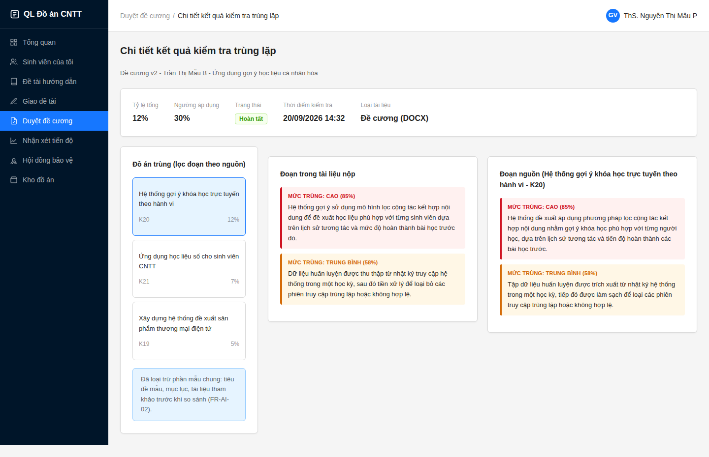

## 3.4. Thiết kế giao diện

> **Mã PI:** 2.3 — **Yêu cầu:** DSGN-04

Các mockup của đồ án là **prototype HTML/CSS tĩnh**, lưu trong `mockup/` (mở trực tiếp `mockup/mh-NN.html` bằng bất kỳ trình duyệt nào); mỗi ảnh PNG đi kèm được chụp ở độ rộng 1440px bằng headless Chrome (`tools/render-diagrams.sh`). Đây là phần thay thế Figma theo quyết định D-11 (sửa 28/09/2026), và là "phần mềm thiết kế tương đương" của tiêu chí PI 2.3. Toàn bộ màn hình được thiết kế sau khi nạp hai skill UI/UX đã cài trong môi trường làm việc: `ui-ux-pro-max` và `design-taste-frontend` (xem ghi chú áp dụng/loại trừ bên dưới).

### 3.4.1. Quy ước giao diện và thành phần

Phong cách chốt theo D-12: **Ant Design admin** — sider tối bên trái, header có breadcrumb, bảng (table) và biểu mẫu (form) là hai loại nội dung chính. Theo D-13, thiết kế **chỉ cho desktop, khung cố định 1440px**; không có phiên bản responsive/mobile.

**Ghi chú áp dụng skill:** `ui-ux-pro-max` cung cấp hướng dẫn chung cho dashboard/form/table (nhãn gắn với input, phản hồi trạng thái submit, xử lý bảng dài) — được áp dụng trực tiếp. `design-taste-frontend` tự khai là **không dành cho dashboard/admin panel** (mục "Out of Scope" của skill khuyến nghị dùng Fluent/Carbon/Atlassian/Polaris cho các giao diện dạng này); vì D-12 đã chốt cứng Ant Design cho toàn bộ Phase 2–4, hướng dẫn về hệ thống thiết kế của skill này bị **override theo D-12** — chỉ áp dụng các nguyên tắc anti-slop trung lập của nó (không icon vẽ tay tùy tiện, không dữ liệu giả kiểu "Jane Doe", nhất quán một họ font/một palette).

| Lớp CSS | Thành phần Ant Design | Dùng ở màn hình |
|---|---|---|
| `ant-layout`, `ant-layout-sider`, `ant-layout-main` | Layout, Sider | Tất cả |
| `ant-layout-header`, `ant-breadcrumb`, `ant-badge`, `ant-header-user` | Layout.Header, Breadcrumb, Badge, Avatar | Tất cả |
| `ant-menu`, `ant-menu-item`, `ant-menu-item-selected` | Menu | Tất cả |
| `ant-card`, `ant-card-title` | Card | Tất cả |
| `ant-form-item`, `ant-input`, `ant-select-selector`, `ant-input-textarea` | Form, Input, Select, Input.TextArea | MH-06, MH-08, MH-09... |
| `ant-btn`, `ant-btn-primary`, `ant-btn-default`, `ant-btn-danger` | Button | Tất cả |
| `ant-tag`, `ant-tag-processing`, `ant-tag-warning`, `ant-tag-success`, `ant-tag-error` | Tag | MH-05, MH-06, MH-07... |
| `ant-alert`, `ant-alert-warning`, `ant-alert-error`, `ant-alert-info` | Alert | MH-06, MH-09, MH-14 |
| `ant-table` | Table | MH-05, MH-06, MH-09, MH-13... |
| `ant-progress` | Progress | MH-06, MH-09, MH-14 |
| `ant-statistic`, `ant-statistic-value`, `ant-statistic-title` | Statistic | MH-03, MH-04 |
| `ant-steps`, `ant-steps-item`, `ant-steps-item-finish`, `ant-steps-item-process` | Steps | MH-02, MH-10 |
| `ant-dropdown`, `ant-dropdown-header`, `ant-dropdown-item` | Dropdown (chuông thông báo mở sẵn) | MH-02, MH-03, MH-04 |
| `ant-pagination`, `ant-pagination-item` | Pagination | MH-04, MH-05, MH-13 |
| `ant-filter-bar`, `ant-filter-item` | Form (thanh lọc trên Table) | MH-05, MH-13 |
| `login-layout`, `login-card` (`login-card` kế thừa `ant-card`) | Layout riêng cho màn đăng nhập (không có Sider/Header) | MH-01 |
| `ant-drawer-mask`, `ant-drawer`, `ant-drawer-header`, `ant-drawer-body`, `ant-drawer-footer` | Drawer | MH-07 |
| `ant-modal-mask`, `ant-modal`, `ant-modal-header`, `ant-modal-body`, `ant-modal-footer` | Modal | MH-07 |
| `ant-tabs-nav`, `ant-tabs-tab`, `ant-tabs-tab-active` | Tabs | MH-08 |
| `ant-upload-dragger`, `ant-upload-text`, `ant-upload-hint` | Upload.Dragger | MH-08 |
| `ant-spin` | Spin | MH-08, MH-09 |
| `ant-timeline`, `ant-timeline-item` | Timeline | MH-08 |
| `ant-progress-circle-wrap`, `ant-progress-circle-value` | Progress (dạng vòng tròn) | MH-09 |
| `dup-passage`, `dup-passage-high/medium/low`, `dup-passage-label`, `dup-thesis-list`, `dup-thesis-item` | Khối highlight đoạn trùng và danh sách đồ án trùng (không phải component AntD, quy ước riêng nêu ở §3.4.16) | MH-09, MH-14 |
| `mockup-state-panel` | Khối minh họa trạng thái thay thế đặt sau `ant-layout` đóng, tránh chồng 2 lớp overlay (không phải component AntD) | MH-07, MH-08, MH-09, MH-13 |
| `ant-tooltip-wrap`, `ant-tooltip` | Tooltip (hiển thị thường trực vì ảnh tĩnh không có hover) | MH-11 |
| `member-picker-row`, `member-picker-name` | Danh sách chọn thành viên kèm Select vai trò (không phải component AntD đơn lẻ) | MH-11 |
| `ant-input-number` | InputNumber | MH-12 |

**Sider menu theo vai trò** (chốt tại đây, kế hoạch 01-06 sao chép nguyên văn):

- **Sinh viên:** Tổng quan · Đề tài của tôi · Đề xuất / Đăng ký đề tài · Đề cương · Báo cáo tiến độ · Bảo vệ · Kho đồ án
- **Giảng viên:** Tổng quan · Đề tài hướng dẫn · Đề xuất đề tài · Duyệt đề cương · Nhận xét tiến độ · Hội đồng bảo vệ · Kho đồ án
- **Bộ môn:** Tổng quan toàn khoa · Quản lý đợt đồ án · Duyệt & phân công đề tài · Duyệt đề cương · Tiến độ toàn khoa · Hội đồng & lịch bảo vệ · Kho đồ án · Cấu hình ngưỡng trùng lặp

### 3.4.2. Danh mục màn hình

| Mã MH | Tên màn hình | Vai trò | UC | Tệp nguồn | Ảnh | Trạng thái |
|---|---|---|---|---|---|---|
| MH-01 | Đăng nhập | Cả 3 vai trò | UC0.1 | [mh-01.html](mockup/mh-01.html) | [mh-01.png](mockup/mh-01.png) | Đã dựng |
| MH-02 | Dashboard Sinh viên | Sinh viên | UC0.5, UC4.5 | [mh-02.html](mockup/mh-02.html) | [mh-02.png](mockup/mh-02.png) | Đã dựng |
| MH-03 | Dashboard Giảng viên | Giảng viên | — | [mh-03.html](mockup/mh-03.html) | [mh-03.png](mockup/mh-03.png) | Đã dựng |
| MH-04 | Dashboard Bộ môn (kèm tiến độ toàn khoa) | Bộ môn | UC3.1, UC3.4 | [mh-04.html](mockup/mh-04.html) | [mh-04.png](mockup/mh-04.png) | Đã dựng |
| MH-05 | Danh sách đề tài (lọc trạng thái/đợt/GV) | Cả 3 vai trò | UC1.4, UC1.2 | [mh-05.html](mockup/mh-05.html) | [mh-05.png](mockup/mh-05.png) | Đã dựng |
| MH-06 | Đề xuất / đăng ký đề tài có cảnh báo trùng tên | Giảng viên, Sinh viên | UC1.1, UC0.6 | [mh-06.html](mockup/mh-06.html) | [mh-06.png](mockup/mh-06.png) | Đã dựng |
| MH-07 | Duyệt đề tài và phân công GVHD | Bộ môn | UC1.3 | [mh-07.html](mockup/mh-07.html) | [mh-07.png](mockup/mh-07.png) | Đã dựng |
| MH-08 | Nộp đề cương / báo cáo cuối (phiên bản, trạng thái kiểm tra) | Sinh viên | UC2.1, UC2.3, UC4.1 | [mh-08.html](mockup/mh-08.html) | [mh-08.png](mockup/mh-08.png) | Đã dựng |
| MH-09 | Duyệt đề cương có panel kết quả trùng lặp | Giảng viên | UC2.2 | [mh-09.html](mockup/mh-09.html) | [mh-09.png](mockup/mh-09.png) | Đã dựng |
| MH-10 | Báo cáo tiến độ và nhận xét | Sinh viên, Giảng viên | UC3.2, UC3.3 | [mh-10.html](mockup/mh-10.html) | [mh-10.png](mockup/mh-10.png) | Đã dựng |
| MH-11 | Lập hội đồng và xếp lịch | Bộ môn | UC4.2, UC4.4 | [mh-11.html](mockup/mh-11.html) | [mh-11.png](mockup/mh-11.png) | Đã dựng |
| MH-12 | Chấm điểm bảo vệ | Giảng viên | UC4.3 | [mh-12.html](mockup/mh-12.html) | [mh-12.png](mockup/mh-12.png) | Đã dựng |
| MH-13 | Kho đồ án (tìm kiếm, lọc) | Cả 3 vai trò | UC5.1, UC5.3, UC5.4 | [mh-13.html](mockup/mh-13.html) | [mh-13.png](mockup/mh-13.png) | Đã dựng |
| MH-14 | Chi tiết kết quả kiểm tra trùng lặp | Giảng viên, Bộ môn | UC0.7 | [mh-14.html](mockup/mh-14.html) | [mh-14.png](mockup/mh-14.png) | Đã dựng |

### 3.4.3. MH-01 – Đăng nhập

**Vai trò:** Sinh viên, Giảng viên, Bộ môn · **UC:** UC0.1 · **FR:** FR-TK-01, FR-TK-02, FR-TK-03

**Mục đích:** Cho người dùng đăng nhập bằng mã SV/GV hoặc email và mật khẩu; hệ thống phát hành JWT giữ vai trò cho toàn bộ phiên làm việc.

**Vùng (regions):** Không có Sider/Header (trước khi đăng nhập). Nền xám (`--ant-color-bg-layout`), thẻ `ant-card` căn giữa gồm logo + tên hệ thống, hai trường Mã SV/GV hoặc email và Mật khẩu, nút chính "Đăng nhập".

**Trạng thái (states):**
- Bình thường: hai trường trống hoặc đã điền, chưa submit.
- Sai thông tin đăng nhập hoặc tài khoản bị khóa (E1/E2, minh họa cạnh trạng thái bình thường trong ảnh): `ant-alert-error` phía trên form với thông báo chung, không tiết lộ trường nào sai (đúng UC0.1 – E1).

**Tương tác (interactions):**
- "Đăng nhập" xác thực mật khẩu (bcrypt), phát hành JWT; sai thông tin hoặc tài khoản khóa hiển thị lại form kèm `ant-alert-error`.

### 3.4.4. MH-02 – Dashboard Sinh viên

**Vai trò:** Sinh viên · **UC:** UC0.5, UC4.5 (tổng hợp UC1–UC3) · **FR:** FR-TB-01, FR-BV-07

**Mục đích:** Cho Sinh viên thấy nhanh trạng thái đề tài, đề cương, tiến độ và lịch/kết quả bảo vệ của chính mình ngay khi đăng nhập.

**Vùng (regions):** Sider Sinh viên (mục "Tổng quan" đang chọn); Header có chuông thông báo (badge số chưa đọc) và tên người dùng; nội dung chính chia lưới 2 cột 4 thẻ: Đề tài của tôi (Tag trạng thái, GVHD), Đề cương (phiên bản, trạng thái duyệt, tỷ lệ trùng lặp gần nhất bằng `ant-progress`), Tiến độ (`ant-steps` các mốc kèm mốc tiếp theo), Lịch và kết quả bảo vệ.

**Trạng thái (states):**
- Chuông thông báo mở sẵn (minh họa trong ảnh, NOTF-01): panel `ant-dropdown` liệt kê 3 thông báo chưa đọc, mỗi dòng có tiêu đề và thời gian.
- Thẻ Lịch và kết quả bảo vệ: trước khi Bộ môn chốt kết quả hiển thị Tag "Chưa có kết quả" (DEFN-04); sau khi chốt sẽ hiển thị điểm bảo vệ trên cùng vị trí (UC4.5).

**Tương tác (interactions):**
- "Xem chi tiết đề tài" mở MH-05 (xem chi tiết đề tài của mình).
- Bấm vào một thông báo trong panel đánh dấu thông báo đó đã đọc (UC0.5).

### 3.4.5. MH-03 – Dashboard Giảng viên

**Vai trò:** Giảng viên · **UC:** tổng hợp UC1.3, UC2.2, UC3.3, UC4.3 · **FR:** FR-DC-03, FR-TD-03, FR-BV-04

**Mục đích:** Cho Giảng viên hướng dẫn thấy khối lượng công việc đang chờ (đề cương chờ duyệt, báo cáo tiến độ chờ nhận xét, hội đồng tham gia) và đi thẳng tới màn xử lý tương ứng.

**Vùng (regions):** Sider Giảng viên (mục "Tổng quan" đang chọn); Header không mở panel thông báo ở màn này; 4 thẻ `ant-statistic` (SV hướng dẫn, đề cương chờ duyệt, báo cáo tiến độ chờ nhận xét, hội đồng tham gia); bảng "Việc cần xử lý" với cột Loại việc (Tag), Sinh viên/Đề tài, Hạn/Ghi chú, Hành động.

**Trạng thái (states):**
- Số liệu Statistic phản ánh trực tiếp số dòng cần xử lý; "Đề cương chờ duyệt" tô màu đỏ (`ant-statistic-value-danger`) khi có việc tồn đọng.

**Tương tác (interactions):**
- Nút "Duyệt" ở dòng đề cương mở MH-09 (Duyệt đề cương).
- Nút "Xem" ở dòng báo cáo tiến độ mở MH-10 (Báo cáo tiến độ và nhận xét).
- Nút "Chấm điểm" ở dòng hội đồng mở MH-12 (Chấm điểm bảo vệ).

### 3.4.6. MH-04 – Dashboard Bộ môn (kèm tiến độ toàn khoa)

**Vai trò:** Bộ môn · **UC:** UC3.1, UC3.4 · **FR:** FR-TD-01, FR-TD-04

**Mục đích:** Cho Bộ môn một màn tổng quan toàn khoa: số đề tài chờ duyệt, SV chưa có đề tài, SV trễ mốc, hội đồng sắp tới, cùng bảng tiến độ chi tiết từng SV và mốc của đợt đang chọn.

**Vùng (regions):** Sider Bộ môn (mục "Tổng quan toàn khoa" đang chọn); Select chọn đợt đồ án ở góc phải tiêu đề; 4 thẻ `ant-statistic`; bảng "Tiến độ Sinh viên" một cột cho mỗi mốc (Mốc 1, Mốc 2, Mốc cuối), mỗi ô là Tag trạng thái; thẻ "Mốc tiến độ của đợt" liệt kê tên mốc + hạn nộp và nút "Thiết lập mốc".

**Trạng thái (states):**
- Cột mốc dùng 4 Tag: `ant-tag-success` "Đúng hạn", `ant-tag-error` "Trễ mốc" (đỏ, đánh dấu tự động theo PROG-03 khi qua hạn mà SV chưa nộp), `ant-tag-processing` "Chưa đến hạn" (mốc hiện tại của SV chưa qua hạn) và `ant-tag-default` "Chưa đến hạn" (mốc tương lai, phân biệt bằng thứ tự cột).
- Bảng có phân trang (`ant-pagination`) vì hiển thị tối đa một trang trong 100 SV.

**Tương tác (interactions):**
- "Thiết lập mốc" mở form thêm/sửa mốc tiến độ (UC3.1, màn CRUD phụ ngoài bộ mockup chính theo D-14).
- Đổi Select đợt đồ án tải lại toàn bộ số liệu và bảng theo đợt mới.

### 3.4.7. MH-05 – Danh sách đề tài

**Vai trò:** Sinh viên, Giảng viên, Bộ môn · **UC:** UC1.4, UC1.2 · **FR:** FR-DT-07, FR-DT-03

**Mục đích:** Cho cả 3 vai trò xem và lọc danh sách đề tài theo đợt, trạng thái, GVHD và lĩnh vực; là điểm vào để Sinh viên đăng ký một đề tài do GV đề xuất còn trống (UC1.2).

**Vùng (regions):** Sider theo vai trò đang đăng nhập (ảnh minh họa dùng Sider Sinh viên, mục "Đề xuất / Đăng ký đề tài"); `ant-filter-bar` gồm 5 bộ lọc (Đợt đồ án, Trạng thái, Giảng viên hướng dẫn, Lĩnh vực, ô tìm kiếm tự do); bảng liệt kê Tên đề tài, Lĩnh vực, Người đề xuất, GVHD, Sinh viên, Trạng thái (Tag), Hành động; `ant-pagination`; nút chính "Đề xuất đề tài" ở góc phải tiêu đề.

**Trạng thái (states):**
- 5 trạng thái đề tài theo FR-DT-07: `ant-tag-default` Nháp, `ant-tag-processing` Chờ duyệt, `ant-tag-warning` Đã duyệt (còn trống, mở đăng ký), `ant-tag-error` Từ chối, `ant-tag-success` Đã phân công.
- Cột Hành động đổi theo trạng thái và vai trò xem: SV thấy nút chính "Đăng ký" trên đề tài "Đã duyệt" còn trống, các trạng thái khác chỉ có "Xem" (A1, UC1.4).

**Tương tác (interactions):**
- "Đề xuất đề tài" mở MH-06.
- "Đăng ký" trên một đề tài "Đã duyệt" còn trống thực hiện UC1.2 (đăng ký đề tài có sẵn).
- "Xem" mở chi tiết đề tài (không có mockup riêng, dùng lại bố cục MH-06 ở chế độ chỉ đọc).

### 3.4.8. MH-06 – Đề xuất đề tài

**Vai trò:** Giảng viên, Sinh viên · **UC:** UC1.1, UC0.6 · **FR:** FR-DT-01, FR-DT-02

**Mục đích:** Cho phép người dùng nhập một đề xuất đề tài mới và thấy ngay cảnh báo nếu có đề tài tương tự trong kho, trước khi quyết định sửa tên hay vẫn gửi.

**Vùng (regions):**
- Sider trái: menu điều hướng theo vai trò (mục "Đề xuất / Đăng ký đề tài" đang chọn)
- Header: breadcrumb "Quản lý đề tài / Đề xuất đề tài", chuông thông báo có badge số chưa đọc, tên người dùng
- Nội dung chính: form một cột trong `ant-card` gồm Đợt đồ án, Tên đề tài, cảnh báo trùng lặp (nếu có), Lĩnh vực, Mô tả, và hai nút hành động cuối form

**Trạng thái (states):**
- Chưa nhập đủ trường bắt buộc: nút "Gửi đề xuất" vẫn hiển thị nhưng submit sẽ báo lỗi validate tại từng trường (không hiển thị ở bản tĩnh này)
- Không phát hiện trùng lặp: khối `ant-alert-warning` không xuất hiện, form chỉ còn 4 trường
- Phát hiện trùng lặp (trạng thái được minh họa trong ảnh dưới): hiển thị `ant-alert-warning` với bảng tối đa N đề tài tương tự kèm `ant-progress` tỷ lệ %, và hai nút "Sửa tên đề tài" / "Vẫn gửi đề xuất"

**Tương tác (interactions):**
- "Sửa tên đề tài" đưa focus lại về ô Tên đề tài để người dùng chỉnh sửa (luồng thay thế A1, UC1.1)
- "Vẫn gửi đề xuất" đóng cảnh báo và tiếp tục điền các trường còn lại (luồng thay thế A2, UC1.1)
- "Gửi đề xuất" tạo đề tài trạng thái "Chờ duyệt" (bước TB-DT-06)

### 3.4.9. MH-07 – Duyệt đề tài và phân công GVHD

**Vai trò:** Bộ môn · **UC:** UC1.3 · **FR:** FR-DT-04, FR-DT-05

**Mục đích:** Cho Bộ môn xem chi tiết một đề tài đang "Chờ duyệt" kèm kết quả kiểm tra tên đã lưu từ lúc đề xuất, rồi quyết định duyệt kèm phân công GVHD hoặc từ chối kèm lý do.

**Vùng (regions):** Sider Bộ môn (mục "Duyệt & phân công đề tài" đang chọn); bảng "Đề tài chờ duyệt" (Tên đề tài, Người đề xuất, Lĩnh vực, Ngày đề xuất, Kiểm tra tên, Hành động); Drawer phải mở sẵn cho dòng đang xem, gồm thông tin đề tài, `ant-alert-warning` chứa bảng kết quả kiểm tra tên đã lưu ở UC1.1 (top 3 đề tài tương tự kèm %), Select "Giảng viên hướng dẫn", footer Drawer có "Từ chối" / "Duyệt và phân công".

**Trạng thái (states):**
- Kiểm tra tên: `ant-tag-success` "Không trùng", `ant-tag-warning` "N đề tài tương tự", `ant-tag-default` "Chưa kiểm tra" (UC1.1 - E1, dịch vụ AI không phản hồi lúc đề xuất).
- Hộp thoại xác nhận từ chối (minh họa bên dưới ảnh chính, UC1.3 - A1): `ant-modal` với TextArea "Lý do từ chối" bắt buộc và nút "Xác nhận từ chối".

**Tương tác (interactions):**
- "Duyệt và phân công" chuyển đề tài sang "Đã phân công", gửi thông báo in-app cho SV và GV được phân công.
- "Từ chối" mở Modal yêu cầu nhập lý do bắt buộc; "Xác nhận từ chối" chuyển đề tài sang "Từ chối" kèm lý do.
- Select "Giảng viên hướng dẫn" vẫn yêu cầu Bộ môn xác nhận thủ công kể cả khi GV đề xuất là người phù hợp duy nhất (UC1.3 - E1).

### 3.4.10. MH-08 – Nộp đề cương / báo cáo cuối

**Vai trò:** Sinh viên · **UC:** UC2.1, UC2.3, UC4.1 · **FR:** FR-DC-01, FR-DC-02, FR-DC-05, FR-BV-01

**Mục đích:** Cho Sinh viên nộp phiên bản đề cương hoặc báo cáo cuối mới, xem lịch sử phiên bản kèm trạng thái kiểm tra trùng lặp, và xem lại nhận xét của GVHD qua các lần duyệt.

**Vùng (regions):** Sider Sinh viên (mục "Đề cương" đang chọn); Tabs "Đề cương" / "Báo cáo cuối" (tab Đề cương đang chọn); `ant-upload-dragger` với luật "Chỉ nhận DOCX hoặc PDF, tối đa 20 MB" (NFR-06, §2.4); bảng "Lịch sử phiên bản" (Phiên bản, Ngày nộp, Trạng thái duyệt, Kết quả kiểm tra); `ant-timeline` "Nhận xét của GVHD".

**Trạng thái (states):**
- Cột Kết quả kiểm tra: `ant-spin` "Đang kiểm tra" (phiên bản vừa nộp, UC0.7 chưa hoàn tất) hoặc Tag "Hoàn tất - N%" liên kết sang MH-14.
- Trạng thái duyệt: `ant-tag-error` "Yêu cầu sửa" (UC2.2 - A1, quay lại nộp), `ant-tag-processing` "Chờ duyệt".
- File sai định dạng khi nộp (minh họa bên dưới ảnh chính, UC2.1 - E1): `ant-alert-error` giải thích hệ thống kiểm tra theo nội dung nhị phân chứ không theo đuôi file (NFR-06).

**Tương tác (interactions):**
- "Nộp phiên bản mới" tạo một phiên bản đề cương/báo cáo mới (không ghi đè), kích hoạt UC0.7 chạy bất đồng bộ.
- Tag "Hoàn tất - N%" ở cột Kết quả kiểm tra mở MH-14 (chi tiết kết quả).
- Tab "Báo cáo cuối" dùng lại đúng bố cục Upload + lịch sử phiên bản cho UC4.1 (báo cáo cuối chỉ nộp một lần, không có vòng lặp sửa-duyệt).

### 3.4.11. MH-09 – Duyệt đề cương

**Vai trò:** Giảng viên · **UC:** UC2.2 · **FR:** FR-DC-03, FR-DC-04

**Mục đích:** Cho GVHD xem nội dung đề cương mới nhất cùng kết quả kiểm tra trùng lặp ngay trên cùng màn hình, rồi quyết định duyệt hoặc yêu cầu sửa kèm nhận xét.

**Vùng (regions):** Sider Giảng viên (mục "Duyệt đề cương" đang chọn); trái: tên đề tài, Select phiên bản, link tải file, tóm tắt nội dung trích xuất, TextArea "Nhận xét", nút "Yêu cầu sửa" / "Duyệt đề cương"; phải: panel "Kết quả kiểm tra trùng lặp" với `ant-progress-circle` (tỷ lệ tổng), ngưỡng áp dụng của Bộ môn (UC0.4), bảng đồ án trùng nhiều nhất, nút "Xem chi tiết" mở MH-14.

**Trạng thái (states):**
- Vòng tròn Progress đổi màu theo mức so với ngưỡng Bộ môn cấu hình (xanh khi dưới ngưỡng cảnh báo).
- Kết quả đang kiểm tra khi GVHD mở màn hình (minh họa bên dưới ảnh chính, UC2.2 - E1): panel chỉ hiển thị `ant-spin` và ghi chú "Đang kiểm tra, chưa có kết quả"; GVHD vẫn xem được nội dung và duyệt/yêu cầu sửa bình thường.

**Tương tác (interactions):**
- "Duyệt đề cương" chuyển đề cương sang "Đã duyệt", gửi thông báo in-app cho SV.
- "Yêu cầu sửa" chuyển sang "Yêu cầu sửa" kèm nội dung TextArea "Nhận xét", SV quay lại UC2.1 để nộp phiên bản mới.
- "Xem chi tiết" mở MH-14 (chi tiết kết quả kiểm tra trùng lặp, AISV-05/AISV-06).

### 3.4.12. MH-10 – Báo cáo tiến độ và nhận xét

**Vai trò:** Sinh viên, Giảng viên · **UC:** UC3.2, UC3.3 · **FR:** FR-TD-02, FR-TD-03

**Mục đích:** Cho GVHD xem báo cáo tiến độ của SV mình hướng dẫn theo từng mốc và ghi nhận xét/đánh giá; cho SV nộp báo cáo của mốc đang mở.

**Vùng (regions):** Sider Giảng viên (mục "Nhận xét tiến độ" đang chọn); trái: `ant-timeline` các mốc đã nộp (tóm tắt nội dung, tệp đính kèm, ngày nộp, Tag Đúng hạn/Nộp trễ/Chưa đến hạn); phải: form nhận xét cho mốc đang chọn (TextArea "Nhận xét", Select "Đánh giá", nút "Gửi nhận xét").

**Trạng thái (states):**
- Modal "Nộp báo cáo tiến độ" (minh họa mở sẵn trong ảnh, phía Sinh viên, UC3.2): TextArea nội dung bắt buộc, Upload tệp đính kèm tùy chọn, nút "Nộp báo cáo".
- Tag mốc: `ant-tag-success` Đúng hạn, `ant-tag-error` Nộp trễ (UC3.2 - E1, vẫn được nhận nhưng đánh dấu trễ để UC3.4 tính), `ant-tag-default` Chưa đến hạn.

**Tương tác (interactions):**
- "Gửi nhận xét" lưu nhận xét + đánh giá, gửi thông báo in-app cho SV.
- "Nộp báo cáo" (trong Modal) ghi nhận báo cáo tiến độ của SV cho mốc đang mở; nộp lại trước khi có nhận xét sẽ ghi đè nội dung (UC3.2 - A1, không giữ lịch sử như đề cương).

### 3.4.13. MH-11 – Lập hội đồng và xếp lịch

**Vai trò:** Bộ môn · **UC:** UC4.2, UC4.4 · **FR:** FR-BV-02, FR-BV-03, FR-BV-05, FR-BV-06

**Mục đích:** Cho Bộ môn tạo hội đồng (thành viên, ngày/giờ/phòng), xếp SV bảo vệ theo hội đồng, theo dõi trạng thái chấm điểm từng SV và chốt kết quả khi đủ điều kiện.

**Vùng (regions):** Sider Bộ môn (mục "Hội đồng & lịch bảo vệ" đang chọn); trái: form Tên hội đồng/Ngày/Giờ/Phòng và danh sách thành viên (`member-picker-row`) mỗi người kèm Select vai trò (Chủ tịch/Thư ký/Ủy viên); phải: bảng SV bảo vệ (TT, Sinh viên/Đề tài, Giờ, Chấm điểm, Điểm TB, Hành động).

**Trạng thái (states):**
- Cột Chấm điểm hiển thị Tag "N/3 đã chấm"; khi chưa đủ, nút "Chốt kết quả" bị vô hiệu hóa (`disabled`) kèm `ant-tooltip` cố định "Chờ tất cả thành viên chấm" (UC4.4 - E1); khi đủ, nút bật màu xanh và Điểm TB hiển thị số đã tính (trung bình cộng, FR-BV-05).

**Tương tác (interactions):**
- "Lưu hội đồng và lịch" tạo/cập nhật hội đồng, gửi thông báo in-app cho SV và GV liên quan (UC4.2).
- "Chốt kết quả" (chỉ bấm được khi đủ điểm) tính điểm trung bình cộng, khóa không cho sửa điểm thành viên, và tự động kích hoạt UC5.2 (lưu vào kho).

### 3.4.14. MH-12 – Chấm điểm bảo vệ

**Vai trò:** Giảng viên (thành viên hội đồng) · **UC:** UC4.3 · **FR:** FR-BV-04

**Mục đích:** Cho một thành viên hội đồng chấm điểm và nhận xét cho từng SV thuộc đúng hội đồng mà GV đó tham gia, không thấy được SV của hội đồng khác.

**Vùng (regions):** Sider Giảng viên (mục "Hội đồng bảo vệ" đang chọn); Select "Hội đồng của tôi" ở góc phải tiêu đề kèm ghi chú "Chỉ hiển thị các hội đồng mà bạn là thành viên"; trái: bảng SV trong hội đồng đang chọn; phải: khu chấm điểm cho SV đang chọn - link tải báo cáo cuối, tóm tắt kiểm tra trùng lặp kèm nút "Xem chi tiết" (→ MH-14), `ant-input-number` "Điểm (0-10)", TextArea "Nhận xét", nút "Lưu điểm".

**Trạng thái (states):**
- Select "Hội đồng của tôi" chỉ liệt kê hội đồng GV này là thành viên (UC4.3, ràng buộc phía server theo NFR-04 - cố truy cập hội đồng khác qua URL trực tiếp bị từ chối 403, UC4.3 - E1).

**Tương tác (interactions):**
- Chọn một SV trong bảng trái cập nhật khu chấm điểm bên phải.
- "Lưu điểm" ghi nhận điểm và nhận xét của riêng thành viên này; điểm trung bình cộng chỉ được Bộ môn tính và chốt ở MH-11 sau khi đủ mọi thành viên (UC4.4).

### 3.4.15. MH-13 – Kho đồ án

**Vai trò:** Sinh viên, Giảng viên, Bộ môn · **UC:** UC5.1, UC5.3, UC5.4 · **FR:** FR-KHO-02, FR-KHO-03, FR-KHO-04

**Mục đích:** Cho mọi vai trò tra cứu/lọc đồ án trong kho theo khóa, từ khóa, GVHD và lĩnh vực, xem chi tiết một bản ghi; cho Bộ môn thêm/sửa/xóa bản ghi và import hàng loạt đồ án khóa cũ.

**Vùng (regions):** Sider Bộ môn (mục "Kho đồ án" đang chọn, ảnh minh họa dùng vai trò Bộ môn để thấy đủ 2 nút quản trị); `ant-filter-bar` (Khóa, Giảng viên hướng dẫn, Lĩnh vực, Từ khóa); bảng kết quả (Tên đề tài, Sinh viên, Khóa, GVHD, Điểm, Từ khóa dạng Tag, Chỉ mục AI); `ant-pagination`; hai nút Bộ môn "Import khóa cũ" / "Thêm bản ghi" ở góc phải tiêu đề.

**Trạng thái (states):**
- Cột Chỉ mục AI: `ant-tag-success` "Đã index" hoặc `ant-tag-default` "Chưa index" (UC5.2 - E1, dịch vụ AI không phản hồi lúc ingest tự động; Bộ môn có thể yêu cầu index lại qua UC5.3).
- Xem chi tiết một bản ghi (minh họa bên dưới ảnh chính): Drawer với đầy đủ metadata (Sinh viên, Khóa, GVHD, Điểm bảo vệ, Từ khóa, Trạng thái chỉ mục AI), link tải báo cáo cuối, và nút "Xóa" / "Sửa" (UC5.3).

**Tương tác (interactions):**
- Click một dòng mở Drawer chi tiết bản ghi.
- "Thêm bản ghi" mở form thêm bản ghi kho thủ công (UC5.3 - A1, dữ liệu lịch sử thiếu, vẫn đẩy sang dịch vụ AI để index như UC5.2).
- "Import khóa cũ" mở luồng import hàng loạt theo mẫu quy định (UC5.4), báo cáo số bản ghi thành công/lỗi sau khi chạy.

### 3.4.16. MH-14 – Chi tiết kết quả kiểm tra trùng lặp

**Vai trò:** Giảng viên, Bộ môn · **UC:** UC0.7 (`<<include>>` từ UC2.2, UC4.1) · **FR:** FR-AI-02, FR-AI-03

**Mục đích:** Trình bày đầy đủ kết quả kiểm tra trùng lặp tài liệu theo kiểu báo cáo Turnitin/Coopy: tỷ lệ tổng, danh sách đồ án trùng, và từng đoạn trùng highlight cạnh đoạn nguồn, để GVHD/Bộ môn đối chiếu trước khi duyệt hoặc chấm điểm.

**Vùng (regions):** Thanh tóm tắt (`mockup-summary-bar`): tỷ lệ tổng, ngưỡng áp dụng, trạng thái, thời điểm kiểm tra, loại tài liệu; cột trái "Đồ án trùng" (`dup-thesis-list`, đóng vai trò bộ lọc, dòng đang chọn tô nền xanh nhạt) kèm ghi chú "Đã loại trừ phần mẫu chung: tiêu đề mẫu, mục lục, tài liệu tham khảo" (FR-AI-02); hai cột so sánh cạnh nhau "Đoạn trong tài liệu nộp" và "Đoạn nguồn" của đồ án đang chọn.

**Trạng thái (states):**
- Mỗi đoạn trùng dùng khối `dup-passage` với 3 mức: Cao (viền đỏ), Trung bình (viền cam), Thấp (viền xanh lá) - mỗi khối luôn có nhãn chữ ghi rõ mức và tỷ lệ % (không chỉ dựa vào màu) để đọc được cả khi in trắng đen hoặc với người khiếm thị màu.
- Chọn một đồ án khác trong cột trái đổi nội dung cột "Đoạn nguồn" và các đoạn highlight tương ứng.

**Tương tác (interactions):**
- Click một dòng trong "Đồ án trùng" lọc lại cặp đoạn trùng hiển thị ở hai cột so sánh theo đúng nguồn đó.
- Màn được mở từ link "Xem chi tiết" ở MH-09 và từ Tag "Hoàn tất - N%" ở MH-08/lịch sử phiên bản.

