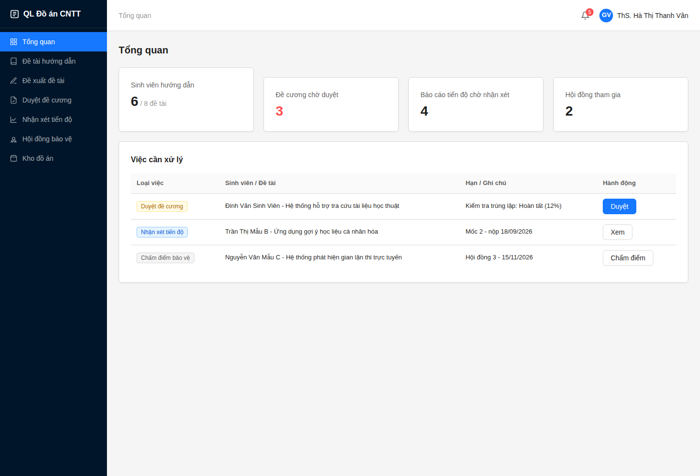
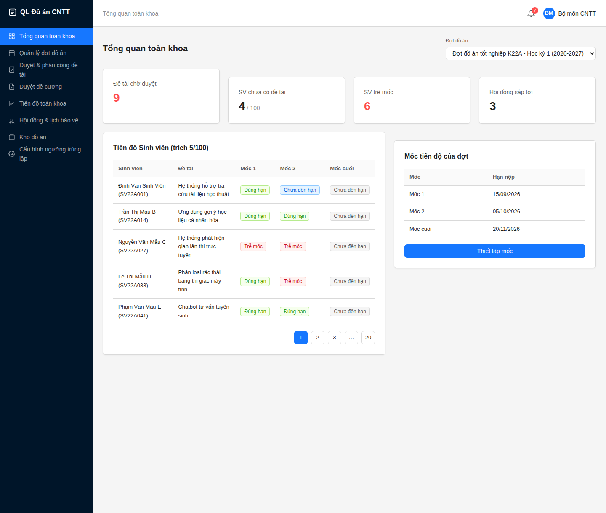
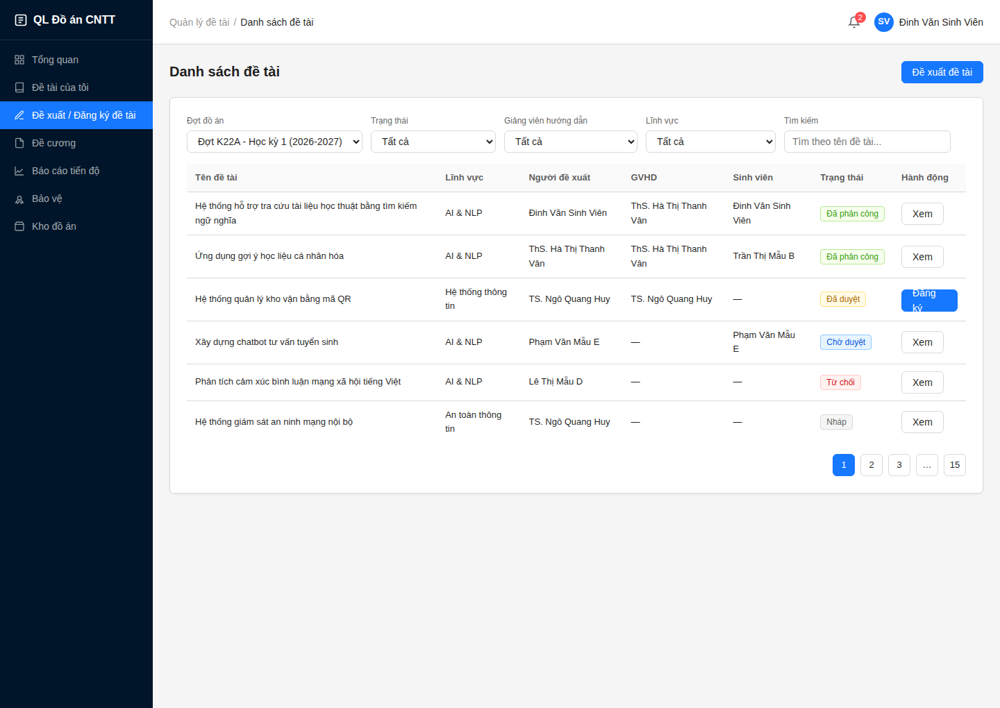
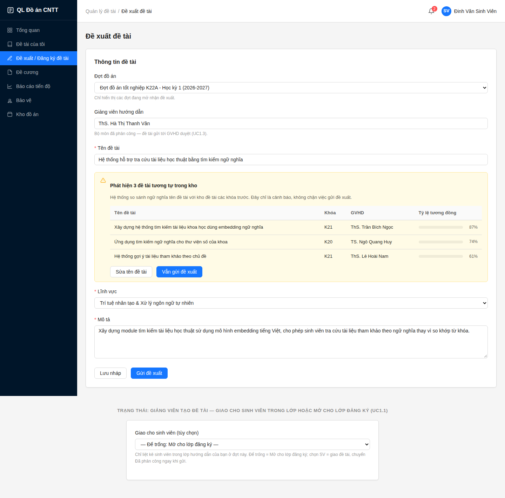

## 3.4. Thiết kế giao diện

> **Mã PI:** 2.3 — **Yêu cầu:** DSGN-04

Các mockup của đồ án là **prototype HTML/CSS tĩnh**, lưu trong `mockup/` (mở trực tiếp `mockup/mh-NN.html` bằng bất kỳ trình duyệt nào); mỗi ảnh PNG đi kèm được chụp ở độ rộng 1440px bằng headless Chrome (`tools/render-diagrams.sh`). Đây là phần thay thế Figma theo quyết định D-11 (sửa 28/09/2026), và là "phần mềm thiết kế tương đương" của tiêu chí PI 2.3. Toàn bộ màn hình được thiết kế sau khi nạp hai skill UI/UX đã cài trong môi trường làm việc: `ui-ux-pro-max` và `design-taste-frontend` (xem ghi chú áp dụng/loại trừ bên dưới).

### 3.4.1. Quy ước giao diện và thành phần

Phong cách chốt theo D-12: **Ant Design admin** — sider tối bên trái, header có breadcrumb, bảng (table) và biểu mẫu (form) là hai loại nội dung chính. Theo D-13, thiết kế **chỉ cho desktop, khung cố định 1440px**; không có phiên bản responsive/mobile.

**Ghi chú áp dụng skill:** `ui-ux-pro-max` cung cấp hướng dẫn chung cho dashboard/form/table (nhãn gắn với input, phản hồi trạng thái submit, xử lý bảng dài) — được áp dụng trực tiếp. `design-taste-frontend` tự khai là **không dành cho dashboard/admin panel** (mục "Out of Scope" của skill khuyến nghị dùng Fluent/Carbon/Atlassian/Polaris cho các giao diện dạng này); vì D-12 đã chốt cứng Ant Design cho toàn bộ Phase 2–4, hướng dẫn về hệ thống thiết kế của skill này bị **override theo D-12** — chỉ áp dụng các nguyên tắc anti-slop trung lập của nó (không icon vẽ tay tùy tiện, không dữ liệu giả kiểu "Jane Doe", nhất quán một họ font/một palette).

| Lớp CSS | Thành phần Ant Design | Dùng ở màn hình |
|---|---|---|
| `ant-layout`, `ant-layout-sider`, `ant-layout-main` | Layout, Sider | Tất cả |
| `ant-layout-header`, `ant-breadcrumb`, `ant-badge`, `ant-header-user` | Layout.Header, Breadcrumb, Badge, Avatar | Tất cả |
| `ant-menu`, `ant-menu-item`, `ant-menu-item-selected` | Menu | Tất cả |
| `ant-card`, `ant-card-title` | Card | Tất cả |
| `ant-form-item`, `ant-input`, `ant-select-selector`, `ant-input-textarea` | Form, Input, Select, Input.TextArea | MH-06, MH-08, MH-09... |
| `ant-btn`, `ant-btn-primary`, `ant-btn-default`, `ant-btn-danger` | Button | Tất cả |
| `ant-tag`, `ant-tag-processing`, `ant-tag-warning`, `ant-tag-success`, `ant-tag-error` | Tag | MH-05, MH-06, MH-07... |
| `ant-alert`, `ant-alert-warning`, `ant-alert-error`, `ant-alert-info` | Alert | MH-06, MH-09, MH-14 |
| `ant-table` | Table | MH-05, MH-06, MH-09, MH-13... |
| `ant-progress` | Progress | MH-06, MH-09, MH-14 |
| `ant-statistic`, `ant-statistic-value`, `ant-statistic-title` | Statistic | MH-03, MH-04 |
| `ant-steps`, `ant-steps-item`, `ant-steps-item-finish`, `ant-steps-item-process` | Steps | MH-02, MH-10 |
| `ant-dropdown`, `ant-dropdown-header`, `ant-dropdown-item` | Dropdown (chuông thông báo mở sẵn) | MH-02, MH-03, MH-04 |
| `ant-pagination`, `ant-pagination-item` | Pagination | MH-04, MH-05, MH-13 |
| `ant-filter-bar`, `ant-filter-item` | Form (thanh lọc trên Table) | MH-05, MH-13 |
| `login-layout`, `login-card` (`login-card` kế thừa `ant-card`) | Layout riêng cho màn đăng nhập (không có Sider/Header) | MH-01 |

**Sider menu theo vai trò** (chốt tại đây, kế hoạch 01-06 sao chép nguyên văn):

- **Sinh viên:** Tổng quan · Đề tài của tôi · Đề xuất / Đăng ký đề tài · Đề cương · Báo cáo tiến độ · Bảo vệ · Kho đồ án
- **Giảng viên:** Tổng quan · Đề tài hướng dẫn · Đề xuất đề tài · Duyệt đề cương · Nhận xét tiến độ · Hội đồng bảo vệ · Kho đồ án
- **Bộ môn:** Tổng quan toàn khoa · Quản lý đợt đồ án · Duyệt & phân công đề tài · Duyệt đề cương · Tiến độ toàn khoa · Hội đồng & lịch bảo vệ · Kho đồ án · Cấu hình ngưỡng trùng lặp

### 3.4.2. Danh mục màn hình

| Mã MH | Tên màn hình | Vai trò | UC | Tệp nguồn | Ảnh | Trạng thái |
|---|---|---|---|---|---|---|
| MH-01 | Đăng nhập | Cả 3 vai trò | UC0.1 | [mh-01.html](mockup/mh-01.html) | [mh-01.png](mockup/mh-01.png) | Đã dựng |
| MH-02 | Dashboard Sinh viên | Sinh viên | UC0.5, UC4.5 | [mh-02.html](mockup/mh-02.html) | [mh-02.png](mockup/mh-02.png) | Đã dựng |
| MH-03 | Dashboard Giảng viên | Giảng viên | — | [mh-03.html](mockup/mh-03.html) | [mh-03.png](mockup/mh-03.png) | Đã dựng |
| MH-04 | Dashboard Bộ môn (kèm tiến độ toàn khoa) | Bộ môn | UC3.1, UC3.4 | [mh-04.html](mockup/mh-04.html) | [mh-04.png](mockup/mh-04.png) | Đã dựng |
| MH-05 | Danh sách đề tài (lọc trạng thái/đợt/GV) | Cả 3 vai trò | UC1.4, UC1.2 | [mh-05.html](mockup/mh-05.html) | [mh-05.png](mockup/mh-05.png) | Đã dựng |
| MH-06 | Đề xuất / đăng ký đề tài có cảnh báo trùng tên | Giảng viên, Sinh viên | UC1.1, UC0.6 | [mh-06.html](mockup/mh-06.html) | [mh-06.png](mockup/mh-06.png) | Đã dựng |
| MH-07 | Duyệt đề tài và phân công GVHD | Bộ môn | UC1.3 | — | — | Chưa dựng |
| MH-08 | Nộp đề cương (phiên bản, trạng thái kiểm tra) | Sinh viên | UC2 | — | — | Chưa dựng |
| MH-09 | Duyệt đề cương có panel kết quả trùng lặp | Giảng viên | UC2 | — | — | Chưa dựng |
| MH-10 | Báo cáo tiến độ và nhận xét | Sinh viên, Giảng viên | UC3 | — | — | Chưa dựng |
| MH-11 | Lập hội đồng và xếp lịch | Bộ môn | UC4 | — | — | Chưa dựng |
| MH-12 | Chấm điểm bảo vệ | Giảng viên | UC4 | — | — | Chưa dựng |
| MH-13 | Kho đồ án (tìm kiếm, lọc) | Cả 3 vai trò | UC5 | — | — | Chưa dựng |
| MH-14 | Chi tiết kết quả kiểm tra trùng lặp | Giảng viên, Bộ môn | UC0.6 | — | — | Chưa dựng |

### 3.4.3. MH-01 – Đăng nhập

**Vai trò:** Sinh viên, Giảng viên, Bộ môn · **UC:** UC0.1 · **FR:** FR-TK-01, FR-TK-02, FR-TK-03

**Mục đích:** Cho người dùng đăng nhập bằng mã SV/GV hoặc email và mật khẩu; hệ thống phát hành JWT giữ vai trò cho toàn bộ phiên làm việc.

**Vùng (regions):** Không có Sider/Header (trước khi đăng nhập). Nền xám (`--ant-color-bg-layout`), thẻ `ant-card` căn giữa gồm logo + tên hệ thống, hai trường Mã SV/GV hoặc email và Mật khẩu, nút chính "Đăng nhập".

**Trạng thái (states):**
- Bình thường: hai trường trống hoặc đã điền, chưa submit.
- Sai thông tin đăng nhập hoặc tài khoản bị khóa (E1/E2, minh họa cạnh trạng thái bình thường trong ảnh): `ant-alert-error` phía trên form với thông báo chung, không tiết lộ trường nào sai (đúng UC0.1 – E1).

**Tương tác (interactions):**
- "Đăng nhập" xác thực mật khẩu (bcrypt), phát hành JWT; sai thông tin hoặc tài khoản khóa hiển thị lại form kèm `ant-alert-error`.

### 3.4.4. MH-02 – Dashboard Sinh viên

**Vai trò:** Sinh viên · **UC:** UC0.5, UC4.5 (tổng hợp UC1–UC3) · **FR:** FR-TB-01, FR-BV-07

**Mục đích:** Cho Sinh viên thấy nhanh trạng thái đề tài, đề cương, tiến độ và lịch/kết quả bảo vệ của chính mình ngay khi đăng nhập.

**Vùng (regions):** Sider Sinh viên (mục "Tổng quan" đang chọn); Header có chuông thông báo (badge số chưa đọc) và tên người dùng; nội dung chính chia lưới 2 cột 4 thẻ: Đề tài của tôi (Tag trạng thái, GVHD), Đề cương (phiên bản, trạng thái duyệt, tỷ lệ trùng lặp gần nhất bằng `ant-progress`), Tiến độ (`ant-steps` các mốc kèm mốc tiếp theo), Lịch và kết quả bảo vệ.

**Trạng thái (states):**
- Chuông thông báo mở sẵn (minh họa trong ảnh, NOTF-01): panel `ant-dropdown` liệt kê 3 thông báo chưa đọc, mỗi dòng có tiêu đề và thời gian.
- Thẻ Lịch và kết quả bảo vệ: trước khi Bộ môn chốt kết quả hiển thị Tag "Chưa có kết quả" (DEFN-04); sau khi chốt sẽ hiển thị điểm bảo vệ trên cùng vị trí (UC4.5).

**Tương tác (interactions):**
- "Xem chi tiết đề tài" mở MH-05 (xem chi tiết đề tài của mình).
- Bấm vào một thông báo trong panel đánh dấu thông báo đó đã đọc (UC0.5).

### 3.4.5. MH-03 – Dashboard Giảng viên

**Vai trò:** Giảng viên · **UC:** tổng hợp UC1.3, UC2.2, UC3.3, UC4.3 · **FR:** FR-DC-03, FR-TD-03, FR-BV-04

**Mục đích:** Cho Giảng viên hướng dẫn thấy khối lượng công việc đang chờ (đề cương chờ duyệt, báo cáo tiến độ chờ nhận xét, hội đồng tham gia) và đi thẳng tới màn xử lý tương ứng.

**Vùng (regions):** Sider Giảng viên (mục "Tổng quan" đang chọn); Header không mở panel thông báo ở màn này; 4 thẻ `ant-statistic` (SV hướng dẫn, đề cương chờ duyệt, báo cáo tiến độ chờ nhận xét, hội đồng tham gia); bảng "Việc cần xử lý" với cột Loại việc (Tag), Sinh viên/Đề tài, Hạn/Ghi chú, Hành động.

**Trạng thái (states):**
- Số liệu Statistic phản ánh trực tiếp số dòng cần xử lý; "Đề cương chờ duyệt" tô màu đỏ (`ant-statistic-value-danger`) khi có việc tồn đọng.

**Tương tác (interactions):**
- Nút "Duyệt" ở dòng đề cương mở MH-09 (Duyệt đề cương).
- Nút "Xem" ở dòng báo cáo tiến độ mở MH-10 (Báo cáo tiến độ và nhận xét).
- Nút "Chấm điểm" ở dòng hội đồng mở MH-12 (Chấm điểm bảo vệ).

### 3.4.6. MH-04 – Dashboard Bộ môn (kèm tiến độ toàn khoa)

**Vai trò:** Bộ môn · **UC:** UC3.1, UC3.4 · **FR:** FR-TD-01, FR-TD-04

**Mục đích:** Cho Bộ môn một màn tổng quan toàn khoa: số đề tài chờ duyệt, SV chưa có đề tài, SV trễ mốc, hội đồng sắp tới, cùng bảng tiến độ chi tiết từng SV và mốc của đợt đang chọn.

**Vùng (regions):** Sider Bộ môn (mục "Tổng quan toàn khoa" đang chọn); Select chọn đợt đồ án ở góc phải tiêu đề; 4 thẻ `ant-statistic`; bảng "Tiến độ Sinh viên" một cột cho mỗi mốc (Mốc 1, Mốc 2, Mốc cuối), mỗi ô là Tag trạng thái; thẻ "Mốc tiến độ của đợt" liệt kê tên mốc + hạn nộp và nút "Thiết lập mốc".

**Trạng thái (states):**
- Cột mốc dùng 4 Tag: `ant-tag-success` "Đúng hạn", `ant-tag-error` "Trễ mốc" (đỏ, đánh dấu tự động theo PROG-03 khi qua hạn mà SV chưa nộp), `ant-tag-processing` "Chưa đến hạn" (mốc hiện tại của SV chưa qua hạn) và `ant-tag-default` "Chưa đến hạn" (mốc tương lai, phân biệt bằng thứ tự cột).
- Bảng có phân trang (`ant-pagination`) vì hiển thị tối đa một trang trong 100 SV.

**Tương tác (interactions):**
- "Thiết lập mốc" mở form thêm/sửa mốc tiến độ (UC3.1, màn CRUD phụ ngoài bộ mockup chính theo D-14).
- Đổi Select đợt đồ án tải lại toàn bộ số liệu và bảng theo đợt mới.

### 3.4.7. MH-05 – Danh sách đề tài

**Vai trò:** Sinh viên, Giảng viên, Bộ môn · **UC:** UC1.4, UC1.2 · **FR:** FR-DT-07, FR-DT-03

**Mục đích:** Cho cả 3 vai trò xem và lọc danh sách đề tài theo đợt, trạng thái, GVHD và lĩnh vực; là điểm vào để Sinh viên đăng ký một đề tài do GV đề xuất còn trống (UC1.2).

**Vùng (regions):** Sider theo vai trò đang đăng nhập (ảnh minh họa dùng Sider Sinh viên, mục "Đề xuất / Đăng ký đề tài"); `ant-filter-bar` gồm 5 bộ lọc (Đợt đồ án, Trạng thái, Giảng viên hướng dẫn, Lĩnh vực, ô tìm kiếm tự do); bảng liệt kê Tên đề tài, Lĩnh vực, Người đề xuất, GVHD, Sinh viên, Trạng thái (Tag), Hành động; `ant-pagination`; nút chính "Đề xuất đề tài" ở góc phải tiêu đề.

**Trạng thái (states):**
- 5 trạng thái đề tài theo FR-DT-07: `ant-tag-default` Nháp, `ant-tag-processing` Chờ duyệt, `ant-tag-warning` Đã duyệt (còn trống, mở đăng ký), `ant-tag-error` Từ chối, `ant-tag-success` Đã phân công.
- Cột Hành động đổi theo trạng thái và vai trò xem: SV thấy nút chính "Đăng ký" trên đề tài "Đã duyệt" còn trống, các trạng thái khác chỉ có "Xem" (A1, UC1.4).

**Tương tác (interactions):**
- "Đề xuất đề tài" mở MH-06.
- "Đăng ký" trên một đề tài "Đã duyệt" còn trống thực hiện UC1.2 (đăng ký đề tài có sẵn).
- "Xem" mở chi tiết đề tài (không có mockup riêng, dùng lại bố cục MH-06 ở chế độ chỉ đọc).

### 3.4.8. MH-06 – Đề xuất đề tài

**Vai trò:** Giảng viên, Sinh viên · **UC:** UC1.1, UC0.6 · **FR:** FR-DT-01, FR-DT-02

**Mục đích:** Cho phép người dùng nhập một đề xuất đề tài mới và thấy ngay cảnh báo nếu có đề tài tương tự trong kho, trước khi quyết định sửa tên hay vẫn gửi.

**Vùng (regions):**
- Sider trái: menu điều hướng theo vai trò (mục "Đề xuất / Đăng ký đề tài" đang chọn)
- Header: breadcrumb "Quản lý đề tài / Đề xuất đề tài", chuông thông báo có badge số chưa đọc, tên người dùng
- Nội dung chính: form một cột trong `ant-card` gồm Đợt đồ án, Tên đề tài, cảnh báo trùng lặp (nếu có), Lĩnh vực, Mô tả, và hai nút hành động cuối form

**Trạng thái (states):**
- Chưa nhập đủ trường bắt buộc: nút "Gửi đề xuất" vẫn hiển thị nhưng submit sẽ báo lỗi validate tại từng trường (không hiển thị ở bản tĩnh này)
- Không phát hiện trùng lặp: khối `ant-alert-warning` không xuất hiện, form chỉ còn 4 trường
- Phát hiện trùng lặp (trạng thái được minh họa trong ảnh dưới): hiển thị `ant-alert-warning` với bảng tối đa N đề tài tương tự kèm `ant-progress` tỷ lệ %, và hai nút "Sửa tên đề tài" / "Vẫn gửi đề xuất"

**Tương tác (interactions):**
- "Sửa tên đề tài" đưa focus lại về ô Tên đề tài để người dùng chỉnh sửa (luồng thay thế A1, UC1.1)
- "Vẫn gửi đề xuất" đóng cảnh báo và tiếp tục điền các trường còn lại (luồng thay thế A2, UC1.1)
- "Gửi đề xuất" tạo đề tài trạng thái "Chờ duyệt" (bước TB-DT-06)

